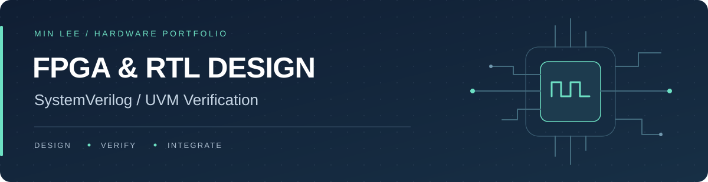
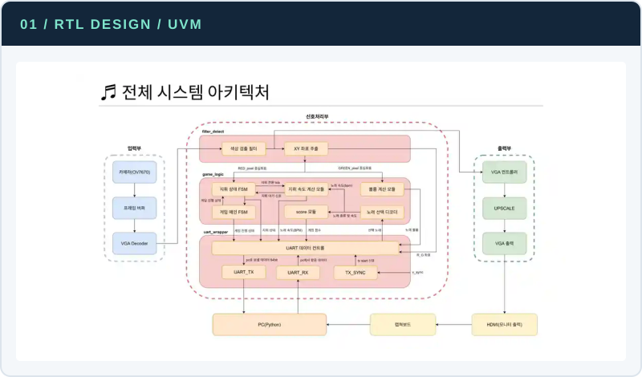
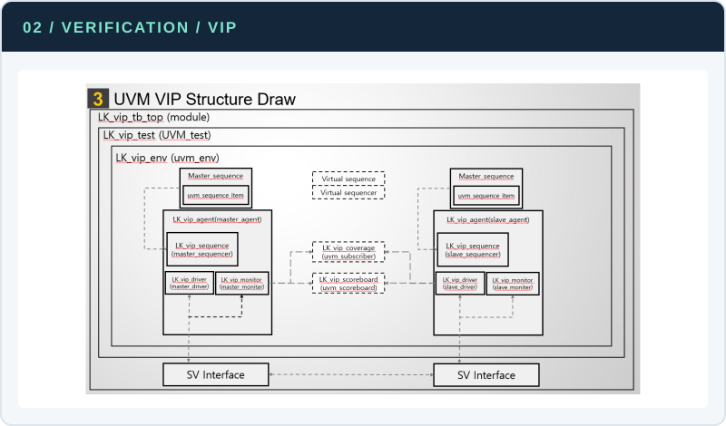
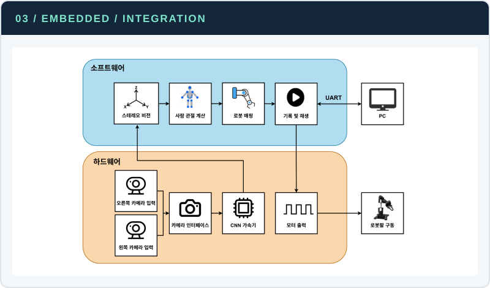

  

<h2 align="center">이민 · Min Lee</h2>

디지털 회로를 설계하고, 시뮬레이션과 실제 보드에서 동작을 확인해 왔습니다. 
RTL·UVM, AXI 주변장치, 임베디드 제어와 영상 입력의 시스템 연동을 경험했습니다.

<a href="https://app.notion.com/p/09623ec941b782e6a750819f197c7713"><b>Notion 포트폴리오 ↗</b></a>
&nbsp; · &nbsp; <a href="SOURCE_CODE.md">소스 코드 안내</a>
&nbsp; · &nbsp; <a href="mailto:h456456@naver.com">이메일</a>

<a href="#대표-프로젝트">대표 프로젝트</a> &nbsp; / &nbsp;
<a href="#전체-프로젝트">전체 프로젝트</a> &nbsp; / &nbsp;
<a href="#기술-스택">기술 스택</a> &nbsp; / &nbsp;
<a href="#교육경험">교육·경험</a> &nbsp; / &nbsp;
<a href="#수상">수상</a>

 

## 대표 프로젝트

RTL 설계, 검증 환경 구축, 시스템 통합을 각각 보여주는 프로젝트입니다.

<table>
<tr>
<td width="33%" valign="top">

<h3><a href="projects/vga-conductor.md">FPGA 지휘 동작 인식 게임</a></h3>

패턴 FSM · Tick/Valid · 점수 RTL

<b>FC 98.96% · 657,780건 PASS</b>

<a href="projects/vga-conductor.md">설계·검증 과정 보기 →</a>

</td>
<td width="33%" valign="top">

<h3><a href="projects/ubus-uvm.md">UBUS Master–Slave UVM VIP</a></h3>

Master Agent · Sequence · Slave 연동

<b>3개 Functional Covergroup 각 100%</b>

<a href="projects/ubus-uvm.md">설계·검증 과정 보기 →</a>

</td>
<td width="33%" valign="top">

<h3><a href="projects/stereo-robot-arm.md">스테레오 비전 동작 추종 로봇팔</a></h3>

스테레오 3D · 사람 각도 · UART · 통합

<b>실물 추종 · 동작 녹화·재생 시연</b>

<a href="projects/stereo-robot-arm.md">설계·검증 과정 보기 →</a>

</td>
</tr>
</table>

 

## 전체 프로젝트

**14개 프로젝트 · 6개 기술 분야** &nbsp; | &nbsp; [교육·기관별 보기](projects/README.md)

| 분야 | 프로젝트 | 주요 내용 |
| :--- | :--- | :--- |
| **RTL·FPGA** | [FPGA 지휘 동작 인식 게임](projects/vga-conductor.md) | 패턴 FSM · 점수 RTL · 제어부 UVM |
| | [AXI4-Lite 주변장치·MicroBlaze](projects/axi-microblaze.md) | GPIO · Timer · UART · I2C Master · AXI 연동 |
| | [RV32I Single-Cycle CPU](projects/rv32i-cpu.md) | CPU RTL · 37개 명령어 · Bubble Sort 실행 검증 |
| | [UART 시계·센서 통합 시스템](projects/uart-sensor.md) | SR04 Datapath·CU·Testbench · Top 통합 |
| | [FPGA Stopwatch·Watch 통합 시간 시스템](projects/stopwatch-watch.md) | Watch FSM·Datapath · 시간 조정 · Testbench |
| | [FPGA VGA 두더지 게임](projects/vga-mole.md) | 화면 생성 · RGB 합성 · DE2 보드 동작 |
| **SV·UVM 검증** | [UBUS Master–Slave UVM VIP](projects/ubus-uvm.md) | Master Agent·Sequence · Slave 연동 |
| | [SPI·I2C 통신 IP UVM 검증](projects/spi-i2c-uvm.md) | Master–Slave 자동 비교 · Coverage |
| | [UART·FIFO·ASCII Decoder 검증](projects/uart-fifo-sv.md) | Class 기반 모듈·통합 경로 자동 비교 |
| **임베디드 제어** | [스테레오 비전 3D 동작 추종 로봇팔](projects/stereo-robot-arm.md) | 스테레오 3D · 사람 각도 · UART · 통합 |
| | [STM32 스마트 주차장 차단기](projects/stm32-parking.md) | 센서 · 상태 제어 · 타이머 인터럽트 · 모터 |
| **회로 설계** | [DDI 구성 블록 회로 설계](projects/ddi-circuit.md) | Schematic · Sizing · DC/TRAN 분석 |
| **소자 평가** | [산화물 TFT 특성·신뢰성 평가](projects/adrc-tft.md) | Transfer·Output · PBS/NBS · 온도·주사 시간 비교 |
| **On-Device AI** | [Jetson 보드게임 인식·분석](projects/jetson-board-game.md) | 장기·바둑 인식 · 국면 안정화 · 엔진·GUI |

프로젝트별 개요·담당 역할·대표 결과와 주제별 상세 자료.

 

## 기술 스택

<table>
<tr>
<td width="50%" valign="top">
<b>01 &nbsp; RTL &amp; FPGA</b>  
Verilog · SystemVerilog · Vivado 
Basys 3 · Zybo Z7-20 
CPU · 통신 IP · AXI 주변장치 · VGA 시스템
</td>
<td width="50%" valign="top">
<b>02 &nbsp; Design Verification</b>  
UVM · VCS · Verdi 
Agent · Sequence · Scoreboard 
Random/Directed Test · Functional Coverage
</td>
</tr>
<tr>
<td valign="top">
<b>03 &nbsp; SoC &amp; Embedded</b>  
C · MicroBlaze · ARM Cortex-A9 · STM32 
UART · I2C · SPI · 레지스터·인터럽트 
모터·센서 연동 · 실물 시스템 제어
</td>
<td valign="top">
<b>04 &nbsp; Synthesis &amp; Timing</b>  
Design Compiler · PrimeTime 
RTL 합성 · 제약 조건 · 타이밍 리포트 
합성·타이밍 분석 실습
</td>
</tr>
<tr>
<td valign="top">
<b>05 &nbsp; Circuit Design</b>  
Virtuoso · Spectre · MATLAB · Tcl 
Schematic · Sizing · DC/TRAN 분석 
트랜지스터 수준 회로 설계·분석
</td>
<td valign="top">
<b>06 &nbsp; On-Device AI &amp; Vision</b>  
Python · OpenCV · Jetson Orin Nano 
좌표·국면 인식 · 후처리 
ONNX/TensorRT 배포
</td>
</tr>
</table>

 

## 교육·경험

**경희대학교 정보디스플레이학과 학사**

<b>교육·실무 경험 8개 과정 보기</b>

| 과정·활동 | 주요 내용 |
| :--- | :--- |
| 대한상공회의소 온디바이스AI 시스템반도체 설계교육 | RTL·UVM, AXI·MicroBlaze, STM32, Jetson, Zybo 로봇팔 |
| 팹리스 실무형 일경험 프로그램 2기 | 차량용 AI SoC, CAN·센서 연동, YOLO 기반 NPU 후처리 |
| 서강대 글로벌반도체설계 전문가과정 | SystemVerilog·UVM, UBUS VIP, 합성·STA·DFT |
| 윈스펙 반도체실무 온라인 실습과정 | 반도체 실무 온라인 실습 |
| 성남시·가천대학교 팹리스 아카데미 | RTL·FPGA 및 트랜지스터 수준 회로 설계 |
| ADRC 연구실 인턴 | 디스플레이 소자의 전기적 특성·신뢰성 측정·평가 |
| KIDS Display School 구동 및 회로 | 디스플레이 Backplane·구동회로, 두 과목 교육성적 A |
| IDEC 온라인교육 | 3개 과정, 총 7일 교육 |

[학력·교육·경험·자격 상세 →](BACKGROUND.md)

## 수상

| 시기 | 수상 |
| :--- | :--- |
| 2026.10 | **최우수상** · 온디바이스 AI 시스템반도체 설계 최종프로젝트 경진대회 |
| 2026.01 | **우수상** · 팹리스 실무형 일경험 프로그램 |
| 2024.07 | **최우수상 · 성남시장 표창** · 성남시 반도체 팹리스 아카데미 |

 

---

<a href="SOURCE_CODE.md">소스 코드 안내</a> &nbsp; · &nbsp;
<a href="projects/README.md">교육·기관별 프로젝트</a> &nbsp; · &nbsp;
<a href="https://app.notion.com/p/09623ec941b782e6a750819f197c7713">Notion 포트폴리오 ↗</a>

