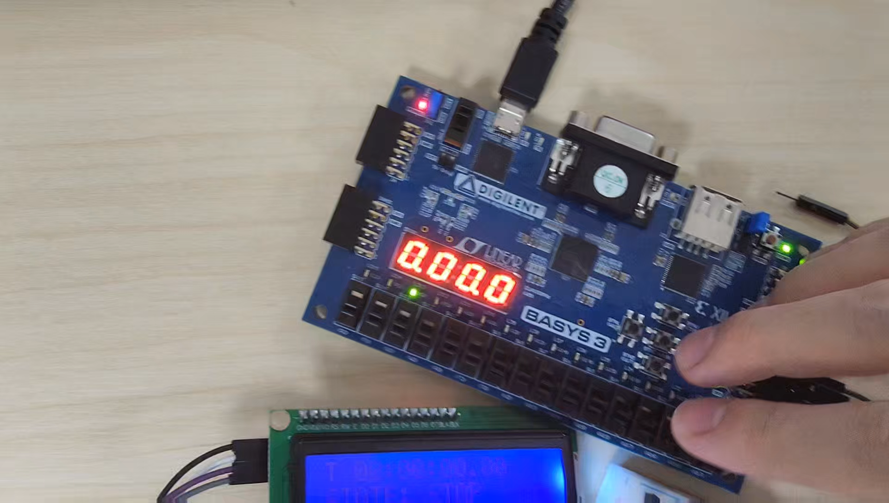
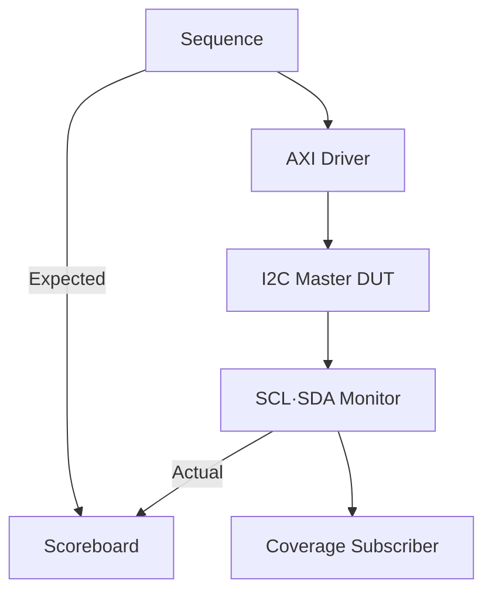
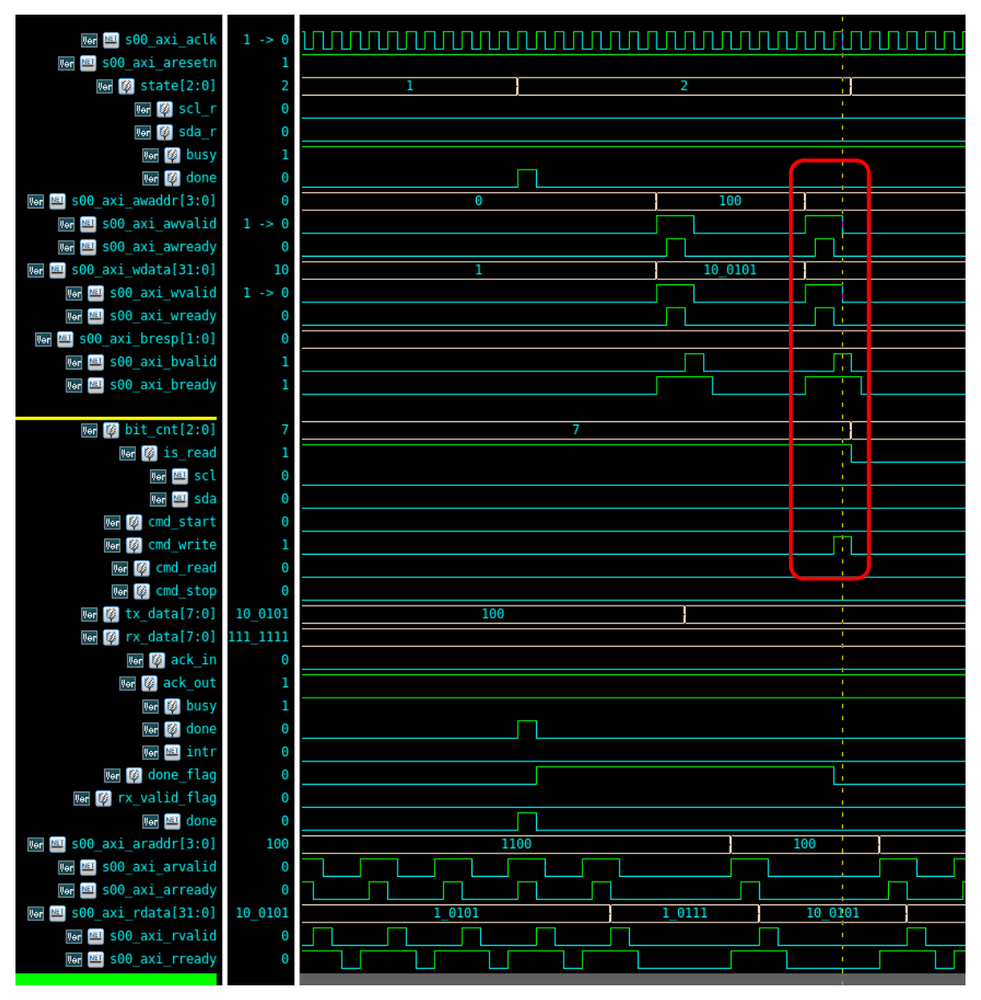
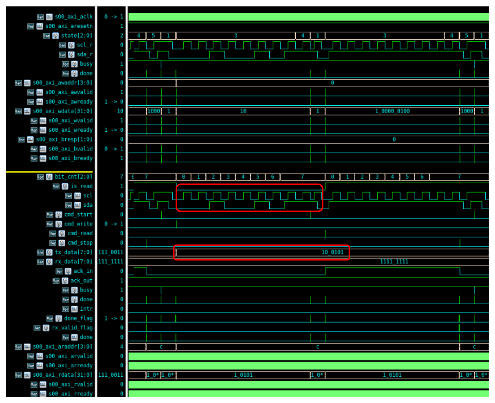
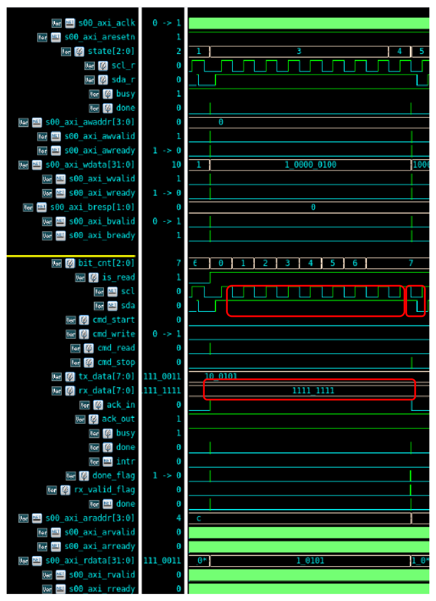

# AXI4-Lite 주변장치 설계 및 MicroBlaze 연동

[전체 프로젝트](../README.md#프로젝트) · [Notion 상세·시연](https://app.notion.com/p/3d423ec941b78121b0b0fb1912eee9e2)

대한상공회의소 온디바이스AI 시스템반도체 설계교육 · 팀 · 2026.06.01 – 2026.06.30



> **대한상공회의소 · 2인 SPI/I2C 분담 과제 · 개인 담당: 공통 주변장치·I2C**
>
> **핵심 결과:** AXI 기반 I2C 제어 · LCD 출력 · I2C IP FC 90%

## 개요

- **목표:** GPIO·Timer·UART·I2C Master Custom IP 설계, AXI4-Lite를 통한 MicroBlaze 제어
- **수행 범위:** SPI/I2C 분담 중 I2C 선택, I2C Master 설계·LCD 연동 담당
- **기여도 기준:** 선택한 I2C 구현 범위 100%

## 담당 역할

- GPIO·Timer·UART와 I2C Master IP 직접 구현
- AXI 레지스터 명령과 I2C Master의 START·WRITE·READ·STOP 제어 연결
- ACK/NACK, BUSY, DONE, RX\_VALID 등 상태 처리
- I2C IP의 프로토콜 동작을 UVM으로 검증
- 실제 I2C LCD 통신과 미출력 원인 점검

## 시스템 구성

- **HW:** MicroBlaze·AXI Interconnect·Interrupt Controller·Local BRAM과 Custom IP 연결
- **응용:** Timer 시간 계산, GPIO/FND·I2C/LCD 표시, UART 명령 제어
- **SW:** Register/Memory Map의 C 구조체 매핑, Application·Driver·HAL 계층 분리
- **공통 시간 기준:** Timer 1 ms 인터럽트로 FND 갱신·시간 계산

**AXI4-Lite Custom IP + MicroBlaze 시스템 구성도**

[상세 그림 — Notion](https://app.notion.com/p/3d423ec941b78121b0b0fb1912eee9e2#fafd78dc2998429c989c6c2798df7bf5)

MicroBlaze·AXI 버스와 GPIO·Timer·UART·I2C Custom IP의 연결

<details>
<summary>AXI4-Lite 채널과 레지스터 제어 흐름</summary>

AXI4-Lite의 5개 채널을 통해 주소·데이터·응답을 주고받고, 각 채널에서 VALID와 READY가 같은 클록 에지에 1일 때 전송이 성립하도록 구성했습니다.

| 구분 | 채널 | 역할 |
| --- | --- | --- |
| Write | AW / W / B | 쓰기 주소 전달 / 쓰기 데이터 전달 / 쓰기 응답 |
| Read | AR / R | 읽기 주소 전달 / 읽기 데이터와 응답 |

- **AXI Timing Diagram**

[상세 그림 — Notion](https://app.notion.com/p/3d423ec941b78121b0b0fb1912eee9e2#e048a397e76c4503a1d3087878e835a8)

- **C 코드에서 주변장치 출력까지의 제어 흐름**

`GPIO_WritePort(GPIOC, data)` 호출 → HAL에서 ODR 주소에 값 기록 → MicroBlaze의 AXI Write → GPIO IP의 주소 디코딩 및 레지스터 갱신 → 출력 핀 변경

I2C는 CR에 명령 비트를 쓰면 START·WRITE·READ·STOP 펄스가 발생하고, TDR·RDR·SR을 통해 송수신 데이터와 완료 상태를 확인하도록 구성했습니다.

</details>

<details>
<summary>주변장치별 Register Map 및 I2C 비트 정의</summary>

주변장치 내부 레지스터는 32비트 단위로 배치했습니다. 아래 Offset에 각 IP의 Base Address를 더한 주소를 C 코드에서 읽고 씁니다.

- **Custom IP Register 설계도**

[상세 그림 — Notion](https://app.notion.com/p/3d423ec941b78121b0b0fb1912eee9e2#efaa05b773264fd596fdfc95e788caf4)

| IP | 0x00 | 0x04 | 0x08 | 0x0C |
| --- | --- | --- | --- | --- |
| GPIO | CR: 핀별 입출력 방향 | IDR: 입력 상태 | ODR: 출력 데이터 | — |
| Timer | CR: 카운트·인터럽트 활성화 | PSC: Prescaler | ARR: 자동 재시작 기준값 | CNT: 현재 카운트 읽기·초깃값 쓰기 |
| UART | SR: 송수신 상태 | TDR: 송신 데이터 | RDR: 수신 데이터 | CR: RX 인터럽트 활성화 |
| I2C | CR: 명령·응답·인터럽트 제어 | TDR: 송신 데이터 | RDR: 수신 데이터 | SR: 동작·완료·수신 상태 |

- **주요 제어 비트**
- GPIO CR의 핀별 비트: 0은 입력, 1은 출력. IDR로 입력을 읽고 ODR로 출력을 설정했습니다.
- Timer CR: bit 0은 카운트 활성화, bit 1은 인터럽트 활성화로 사용했습니다.
- UART SR: bit 0은 TX Ready, bit 1은 RX Flag이며, CR bit 0으로 RX 인터럽트를 허용했습니다.
- **I2C CR·SR 비트 정의**

| 레지스터 | 비트 | 기능 |
| --- | --- | --- |
| CR | 0 / 1 / 2 / 3 | START / WRITE / READ / STOP 명령 |
| CR | 8: ACK\_IN | Read 후 Master 응답 선택: 0은 ACK, 1은 NACK |
| CR | 16 / 17 / 18 | IRQ\_CLEAR / IRQ\_ENABLE\_SET / IRQ\_ENABLE\_CLR |
| SR | 0 / 1 / 2 | BUSY / DONE / ACK\_OUT |
| SR | 3 / 4 / 5 | RX\_VALID / IRQ\_PENDING / IRQ\_ENABLE |

ACK\_OUT은 Write 후 수신한 응답이며 0은 ACK, 1은 NACK입니다. RDR 읽기 시 RX\_VALID이 해제되고, CR의 IRQ\_CLEAR에 1을 쓰면 Pending 상태가 해제되도록 설계했습니다.

</details>

<details>
<summary>시스템 Memory Map과 C 구조체 매핑</summary>

시스템 Memory Map은 접근할 IP를 Base Address로 구분하고, Register Map은 해당 IP 내부의 기능을 Offset으로 구분합니다.

- **UART·I2C 데모별 주소 배치**

| Base Address | UART 데모 | I2C 데모 |
| --- | --- | --- |
| 0x0000_0000 | Local BRAM | Local BRAM |
| 0x4060_0000 | AXI UART Lite | AXI UART Lite |
| 0x4120_0000 | AXI Interrupt Controller | AXI Interrupt Controller |
| 0x44A0_0000 | GPIOA | GPIOA |
| 0x44A1_0000 | GPIOB | GPIOB |
| 0x44A2_0000 | GPIOC | GPIOC |
| 0x44A3_0000 | GPIOD | GPIOD |
| 0x44A4_0000 | Custom Timer | Custom I2C |
| 0x44A5_0000 | Custom UART | Custom Timer |

발표자료의 두 데모는 Timer와 통신 IP의 주소 배치가 다릅니다. 소프트웨어에서는 `xparameters.h`의 Base Address 매크로를 사용해 해당 하드웨어 구성에 맞춰 접근했습니다.

- **GPIO HAL의 레지스터 구조체**

```c
typedef struct {
    volatile uint32_t CR;   // Base + 0x00
    volatile uint32_t IDR;  // Base + 0x04
    volatile uint32_t ODR;  // Base + 0x08
} GPIO_TypeDef;

#define GPIOC_BASEADDR XPAR_GPIO_2_S00_AXI_BASEADDR
#define GPIOC ((GPIO_TypeDef *)GPIOC_BASEADDR)

void GPIO_WritePort(GPIO_TypeDef *GPIOx, uint32_t data)
{
    GPIOx->ODR = data;
}
```

RTL의 Offset과 C 구조체의 필드 순서를 일치시켜, HAL 함수에서 메모리 매핑된 레지스터를 제어하도록 구성했습니다.

</details>

<details>
<summary>SW Hierarchy Structure — Application·Driver·HAL</summary>

응용 동작, 장치 제어, 레지스터 접근을 계층별로 나눠 작성했습니다.

| 계층 | 구현 파일·모듈 | 담당 기능 |
| --- | --- | --- |
| Application | StopWatch | RUN·STOP·CLEAR 상태 전환, 시간 계산, 표시 데이터 갱신 |
| Driver | Button / LED / FND / LCD\_I2C | 버튼 이벤트 판별, LED 패턴, FND 표시, LCD 명령·문자열 출력 |
| HAL | GPIO / TMR / UART / I2C | 레지스터 접근과 주변장치 제어 함수 |
| 공통 모듈 | interrupt / delay | Interrupt Controller·ISR 연결, Tick 및 시간 함수 |

- **LED 제어 호출 예시**

StopWatch의 상태별 LED 처리 → `LED_WritePort8()` → `GPIO_WritePort()` → GPIO ODR 갱신

- **LCD 출력 호출 예시**

메인 루프에서 시간 데이터 조회 → `LCD_ShowStopWatch()` → LCD Driver에서 문자열·4비트 데이터 구성 → I2C HAL에서 START·WRITE·STOP 명령 실행

상위 응용 프로그램은 장치 제어 함수를 호출하고, Base Address와 레지스터 비트 접근은 HAL에서 처리하도록 분리했습니다.

</details>

<details>
<summary>Timer 주기 생성 및 인터럽트 처리</summary>

- **PSC·ARR 기반 1 ms 주기 생성**

Prescaler가 `PSC + 1` 클록마다 카운트용 Tick을 생성하고, CNT가 ARR에 도달하면 CNT를 0으로 되돌리면서 인터럽트 펄스를 발생시키도록 설계했습니다.

`T = (PSC + 1) × (ARR + 1) / fclk`

100 MHz에서 PSC를 99, ARR을 999로 설정해 `100 × 1000 / 100,000,000 = 1 ms` 주기를 구성했습니다.

```c
TMR_SetPSC(TMR0, 100 - 1);
TMR_SetARR(TMR0, 1000 - 1);
TMR_StartInterrupt(TMR0);
TMR_StartTimer(TMR0);
```

- **MicroBlaze 인터럽트 연결**

각 IP의 intr → Concat → AXI Interrupt Controller → MicroBlaze 인터럽트 처리 → 등록한 ISR 실행

`XIntc_Initialize()` → `XIntc_Connect()`로 Vector와 ISR 연결 → `XIntc_Start()` → 채널 활성화 → MicroBlaze 예외 핸들러 등록 및 전역 인터럽트 허용 순서로 구성했습니다.

| 인터럽트 | 발생 조건 | ISR·응용 프로그램의 처리 |
| --- | --- | --- |
| Timer | CNT가 ARR에 도달하고 인터럽트가 활성화된 경우 | ISR에서 FND\_Execute()와 incTick() 실행. 응용에서는 Tick 차이로 10 ms 단위 시간을 계산 |
| UART RX | 1바이트 수신 완료 | ISR에서 RDR의 데이터를 rx\_data에 저장. 응용에서 수신 문자를 RUN·CLEAR 명령으로 처리 |
| I2C | 명령 완료로 IRQ\_PENDING이 설정되고 IRQ\_ENABLE이 활성화된 경우 | ISR에서 완료 이벤트를 기록하고 IRQ\_CLEAR로 Pending 해제. LCD 전송은 메인 루프에서 수행 |

Timer는 주기 펄스 방식이고, I2C는 Pending을 소프트웨어에서 해제할 때까지 인터럽트 상태를 유지하도록 구현했습니다. I2C HAL은 완료 이벤트를 확인하는 대기 함수에 상태 확인과 타임아웃도 포함했습니다.

FPGA에서는 1 ms Tick과 FND 갱신, UART 명령에 따른 스톱워치 상태 전환을 확인했습니다.

</details>

## I2C 설계·UVM 검증

- **레지스터 제어:** 전송 명령·완료·수신 상태를 C 코드와 연결
- **UVM 관측:** SCL·SDA에서 START·BYTE·ACK/NACK·STOP 복원
- **자동 비교:** 이벤트 종류·데이터·9번째 비트를 순서대로 Scoreboard 비교
- **Coverage:** Read ACK/NACK Directed Sequence 보완, 100회 테스트 FC 90%
- **검증 범위:** Master 단독 환경의 Read Data가 `8'hFF`로 제한됨을 확인
- **후속 과제:** Slave BFM을 추가한 Read 데이터 다양화

<details>
<summary>UVM 검증 환경과 Scoreboard 비교 방식</summary>

- **AXI 제어부터 SCL·SDA 관찰까지의 검증 구조**



| 구성 요소 | 구현·확인 내용 |
| --- | --- |
| Sequence | START·WRITE·READ·STOP 명령과 송신 데이터 생성, 예상 이벤트 전달 |
| Driver | 명령을 AXI 레지스터 Write·Read로 변환해 DUT 제어 |
| Monitor | SCL·SDA에서 START·BYTE·STOP 및 9번째 ACK/NACK 비트 복원 |
| Scoreboard | Expected·Actual FIFO를 사용해 이벤트 종류·순서·8비트 데이터·9번째 비트 비교 |
| Coverage Subscriber | 관찰한 프로토콜 이벤트, 데이터 구간, ACK/NACK 조건 수집 |

Driver는 AXI 인터페이스를 구동하고, Monitor는 DUT가 생성한 SCL·SDA를 관찰했습니다. 데이터 일치 여부와 함께 이벤트 누락·추가를 확인하고, 시뮬레이션 종료 시 FIFO에 남은 이벤트도 오류로 판정하도록 구성했습니다.

</details>

<details>
<summary>검증 시나리오 및 Functional Coverage 결과</summary>

- **I2C Master 검증 시나리오**

| 시나리오 | 조건·확인 내용 | 결과 |
| --- | --- | --- |
| START / STOP | SCL High에서 SDA의 하강 / 상승 전이 확인 | PASS |
| Write | 송신한 8비트 데이터와 Monitor가 복원한 값 비교 | PASS |
| Write NACK | Slave 미연결 조건에서 9번째 비트가 1인지 확인 | PASS |
| Read NACK | CR\[8\]=1, 0xFF 수신 및 Master NACK 출력 확인 | PASS |
| Read ACK | CR\[8\]=0, 0xFF 수신 및 Master ACK 출력 확인 | PASS |
| Write–Read | Write·Read 명령의 처리와 예상 이벤트 순서 확인 | PASS |
| Scoreboard 종료 확인 | Expected·Actual 비교 및 미처리 이벤트 확인 | PASS |

Read ACK 시나리오는 Master가 ACK을 출력하는 조건을 확인하기 위한 Directed Sequence입니다. Write–Read 시나리오는 Master 명령의 순차 처리를 검증한 범위이며, 실제 Slave 레지스터에 쓴 값을 다시 읽는 검증은 포함하지 않았습니다.

- **Functional Coverage 측정 항목**

| Coverpoint | 수집 항목 |
| --- | --- |
| cp\_kind | START / BYTE / STOP 이벤트 |
| cp\_data | 8비트 데이터의 구간 및 경계값 |
| cp\_ninth\_bit | ACK / NACK 응답 비트 |

| 테스트 반복 횟수 | Functional Coverage |
| --- | --- |
| 10회 | 90% |
| 100회 | 90% |

반복 횟수를 늘려도 90%에서 증가하지 않은 원인을 Slave가 없는 검증 환경과 함께 분석했습니다. Write에서는 Slave ACK이 발생하지 않고, Read 데이터는 Pull-Up에 의해 0xFF로 제한됩니다. Read 후 Master ACK은 Directed Sequence로 자극했습니다.

Functional Coverage는 위 Coverpoint와 Master 단독 환경 기준입니다.

</details>

<details>
<summary>AXI·I2C 대표 Waveform 및 동작 해석</summary>

- **AXI 레지스터 Write 및 I2C 명령 발생 파형**



세로 박스로 표시한 구간에서 AW·W 채널의 VALID/READY Handshake, B 채널 응답과 `cmd_write` 펄스를 함께 확인했습니다. TDR에 송신 데이터를 기록한 뒤 CR에 WRITE 명령을 쓰면 I2C Master의 전송 동작으로 연결됩니다.

- **I2C Write 데이터 전송 파형**



두 박스는 직렬 전송 구간과 송신 데이터 레지스터를 표시합니다. 송신값 `0x25 (0010 0101)`가 SDA에 MSB부터 출력되는지 확인했습니다. 8비트 이후 9번째 클록은 Slave 미연결 조건으로 NACK이 관찰되며, 파형에는 이어지는 Read 명령 구간도 포함되어 있습니다.

- **I2C Read 및 Master NACK 파형**



SCL·SDA의 큰 박스는 8비트 수신 구간, 오른쪽 작은 박스는 9번째 NACK, 아래 박스는 RX\_DATA 값을 표시합니다. SDA를 Release한 상태에서 Pull-Up에 의해 `0xFF (1111 1111)`를 수신하고, `ACK_IN=1`에 따라 Master NACK을 출력하는 구간을 확인했습니다. 9번째 NACK은 데이터와 구분되는 응답 비트입니다. 실제 Slave의 다양한 Read 데이터 응답은 후속 검증 범위로 남겼습니다.

</details>

## 결과 및 시연

| 항목 | 확인 결과 |
| --- | --- |
| GPIO | 버튼 입력과 LED·FND 출력 제어 |
| Timer | 1 ms 인터럽트 기반 Tick 생성 및 FND 갱신 |
| UART | Loopback 송수신 및 수신 문자에 따른 스톱워치 제어 |
| I2C | Master 단독 UVM Functional Coverage 90%, 실제 LCD에 상태·시간 출력 |

- AXI 레지스터 기반 I2C 제어, UVM 프로토콜 확인과 실제 LCD 출력 연동

**FPGA 보드 실제 구동 사진**

[상세 그림 — Notion](https://app.notion.com/p/3d423ec941b78121b0b0fb1912eee9e2#b9e33fc17cfe4197930beb749385d249)

FPGA 보드의 FND·LCD 출력과 주변장치 연동

**AXI UART 7-Segment 데모 영상**

[시연 영상 — Notion](https://app.notion.com/p/3d423ec941b78121b0b0fb1912eee9e2#6666b222f40a416d8c675e6acb6af0c3)

UART 명령에 따른 시간 제어·7-Segment 출력 시연

**AXI I2C 7-Segment 데모 영상**

[시연 영상 — Notion](https://app.notion.com/p/3d423ec941b78121b0b0fb1912eee9e2#3fe23ec941b78042843af4c486f0e18b)

AXI I2C 연동과 보드 표시 동작 시연

## Troubleshooting

- **현상:** I2C LCD 미출력
- **점검:** RTL·드라이버·주소·배선·Contrast 분리 확인
- **조치·결과:** Scanner로 0x27 주소 확인, 기존 0x3F 설정·배선·Contrast 수정 후 출력 확인

<details>
<summary>LCD 미출력 문제의 점검 과정</summary>

- **증상:** 스톱워치는 동작하지만 LCD에 시간과 상태가 표시되지 않았습니다.
- **기능 분리:** 스톱워치 실행을 제외하고 LCD 초기화와 I2C 제어부터 확인했습니다.
- **SW·통신 확인:** Slave 주소를 확인하고, 명령 완료 대기를 임시 Polling 방식으로 바꿔 완료·응답 상태를 단계별로 점검했습니다.
- **외부 연결 확인:** SCL·SDA 배선과 LCD Contrast를 점검·조정했습니다.
- **결과:** 주소 설정과 외부 연결·표시 조건을 수정한 뒤 LCD 출력을 확인하고 스톱워치 기능과 재통합했습니다.

</details>


## 관련 링크

- [AXI Custom IP 모음](https://github.com/Min-star-prog/ondeviceai/tree/main/window/OndeviceAI2/ip_repo)
- [I2C Master IP](https://github.com/Min-star-prog/ondeviceai/tree/main/window/OndeviceAI2/ip_repo/i2c_1.0)
- [MicroBlaze·Timer·I2C 시스템](https://github.com/Min-star-prog/ondeviceai/tree/main/window/OndeviceAI2/260628_microblaze_timer_i2c)

[← 전체 프로젝트](../README.md#프로젝트)

