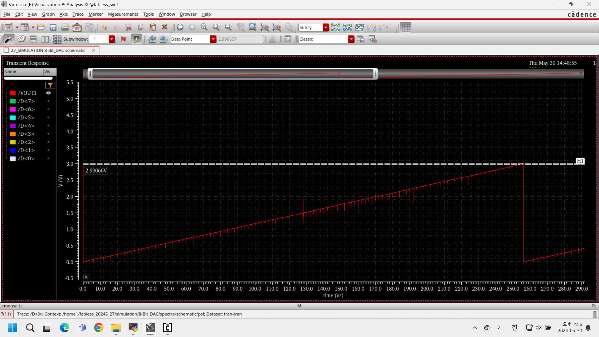

# DDI 구성 블록 설계·시뮬레이션

[전체 프로젝트](../README.md#프로젝트) · [Notion 상세·시연](https://app.notion.com/p/3e123ec941b781a48a16f467e40bd690)

성남시-가천대 반도체 팹리스 아카데미 · 개인 · 2024.04.18 – 2024.06.06

> **디스플레이 구동 IC의 논리·순차·전압 변환 블록을 트랜지스터 수준으로 설계·시뮬레이션**

## 프로젝트 개요

- **범위:** INV/NAND/NOR·TG·DFF·8단 Shift Register·8-bit Decoder/DAC·Level Shifter
- **환경:** Cadence Virtuoso·Spectre, Schematic/Symbol 작성과 DC·Transient 분석
- **형태:** 성남시·가천대학교 팹리스 아카데미 개인 실습 · 2024.04.18\~06.06
- **확인 범위:** 각 구성 블록의 Schematic 시뮬레이션

**8-bit DAC 테스트 회로**

[상세 그림 — Notion](https://app.notion.com/p/3e123ec941b781a48a16f467e40bd690#b9cff78f93654117bc57fd37a0a09274)

입력 코드·보수 신호·기준 전압망을 연결한 전압 변환 블록

## 담당 역할

- 구성 블록별 회로 설계·테스트 입력 설정·파형 분석
- NMOS/PMOS Width 조정, 하위 셀 재사용과 상위 회로 구성

## 기본 게이트·스위칭 회로

- **논리 게이트:** 소자 연결 구조와 VTC를 비교해 Sizing 조정

Inverter 설계·VTC 조정

**Inverter Schematic**

[상세 그림 — Notion](https://app.notion.com/p/3e123ec941b781a48a16f467e40bd690#0665d43bb6184b3cbfc2c99e1e569489)

NMOS·PMOS와 입력·출력 노드를 구성한 실습 회로입니다.

NMOS와 PMOS를 연결해 Inverter를 구성하고, VDD=1 V 조건에서 입력 전압을 Sweep했습니다. 입력이 0.5 V일 때 출력도 0.5 V 부근이 되도록 Width를 조정했습니다.

| 항목 | 실습 결과 |
| --- | --- |
| NMOS Width | 120 nm |
| PMOS Width | 145 nm |
| 확인한 입력 전압 | 500 mV |
| 해당 입력에서 출력 | 500.925 mV |

**Inverter DC 전달 특성**

[상세 그림 — Notion](https://app.notion.com/p/3e123ec941b781a48a16f467e40bd690#bc094c63d29e44188b3404d2cc1690bc)

입력 500 mV·출력 500.925 mV의 DC 커서값

회로 구조만 확인하는 데서 그치지 않고, 소자 크기 변화가 실제 DC 전달 특성에 미치는 영향을 파형의 커서값으로 확인했습니다.

NAND·NOR 논리 검증과 Sizing

각 입력 조합의 논리 출력은 TRAN으로 확인하고, DC Sweep에서는 전환점 부근의 출력을 확인했습니다. Inverter의 Width를 단순 배수로 적용한 초기값에서 출발한 뒤, 실제 VTC에 맞춰 추가 조정했습니다.

| 블록 | NMOS Width | PMOS Width | 조정 내용 |
| --- | --- | --- | --- |
| NAND | 240 nm | 290 nm | 초기 예상보다 작게 나타난 전환점에 대해 PMOS Width 확대 |
| NOR | 205 nm | 290 nm | 초기 예상보다 크게 나타난 전환점에 대해 NMOS Width 확대 |

**NAND VTC·입력 0.5 V 부근 출력**

[상세 그림 — Notion](https://app.notion.com/p/3e123ec941b781a48a16f467e40bd690#2bc713f39c55419c910fb99b12f73dc1)

Width 조정 후 DC Sweep에서 약 0.5 V 부근의 출력을 확인했습니다.

**NOR VTC·입력 0.5 V 부근 출력**

[상세 그림 — Notion](https://app.notion.com/p/3e123ec941b781a48a16f467e40bd690#cd88d5f275b34a5eb233bca8109bcc46)

원본 커서값은 약 497.638 mV이며, 전환 특성을 비교한 화면입니다.

NAND는 NMOS 직렬 경로, NOR는 PMOS 직렬 경로를 포함합니다. 연결 구조를 고려한 초기 Sizing과 시뮬레이션 결과를 대조하면서, 게이트별 조정이 필요함을 확인했습니다.

VTC에서는 입력 0.5 V 부근의 출력을 확인했으며, NAND는 약 502 mV, NOR는 약 498 mV 수준의 커서값이 나타납니다.

Transmission Gate·Symbol·스위칭 현상

NMOS·PMOS를 상보적인 선택 신호 SEL/SELB로 제어하는 Transmission Gate를 구성했습니다. SEL·SELB·VIN·VOUT을 함께 표시해 선택 조건에 따른 신호 전달을 확인했습니다.

**Transmission Gate 전달 파형**

[상세 그림 — Notion](https://app.notion.com/p/3e123ec941b781a48a16f467e40bd690#334d5b1d13104f6b8ffa6102092176f0)

SEL/SELB와 VIN/VOUT을 함께 확인해 선택 조건에 따른 전달을 살펴봤습니다.

기본 게이트와 TG를 Symbol로 만들고, 이후 DFF 구성에서 하위 블록으로 재사용했습니다.

**기본 게이트·TG Symbol**

[상세 그림 — Notion](https://app.notion.com/p/3e123ec941b781a48a16f467e40bd690#e11bdcec6e0a477bac73348af68ddefa)

INV·NAND·NOR·TG를 상위 회로에서 재사용하기 위한 Symbol입니다.

**관찰한 비이상적 파형**

별도 TRAN 파형에서 VDD=1 V보다 높은 약 1.1\~1.2 V 수준의 출력이 나타났습니다. 스위칭 시 전하 주입(Charge Injection)·Clock Feedthrough가 영향을 줄 수 있다는 관점에서 해석했습니다.

**TG의 VDD 초과 출력 파형**

[상세 그림 — Notion](https://app.notion.com/p/3e123ec941b781a48a16f467e40bd690#f40e59f4b94547bf859c6b5877161d29)

VDD=1 V를 넘는 출력이 나타난 구간입니다. 전하 주입·Clock Feedthrough의 기여는 분리 측정하지 않았습니다.

두 현상의 기여를 분리하는 실험이나 정량 분석은 추가로 진행하지 않았습니다. 출력의 과도 변화가 저장·전달 동작에 미치는 영향을 추가로 확인할 과제로 남겼습니다.

## 순차 회로·데이터 전달

- **데이터 전달:** ResetB DFF를 8단 연결, 클록별 저장·전달 동작 확인

TG 기반 DFF·데이터 저장·지연 측정

**TG 기반 DFF Schematic**

[상세 그림 — Notion](https://app.notion.com/p/3e123ec941b781a48a16f467e40bd690#8f4214dcae1c46c78878e2692c722129)

TG와 Inverter를 조합하고 D·CLK·Q를 연결한 회로입니다.

TG와 Inverter를 조합해 DFF를 구성하고, D·CK\_EX·Q 파형으로 클록에 따른 데이터 저장과 유지를 확인했습니다. 만들어 둔 하위 셀의 Symbol을 사용해 상위 순차 회로로 확장했습니다.

| 확인 항목 | 실습 내용 |
| --- | --- |
| 데이터 저장 | 클록의 유효 전이 후 입력 D에 대응하는 Q 변화 확인 |
| 데이터 유지 | 다음 유효 전이 전까지 저장한 상태 유지 |
| L-to-H 지연 | 0.048805 ns |
| H-to-L 지연 | 0.042575 ns |

**DFF 데이터 저장 파형**

[상세 그림 — Notion](https://app.notion.com/p/3e123ec941b781a48a16f467e40bd690#aee3c613290043ca888babfc30d62aa0)

D·CK\_EX·Q를 함께 표시해 클록에 따른 출력 갱신을 확인했습니다.

지연값은 해당 테스트 회로에서 파형의 50% 교차점을 기준으로 확인한 결과입니다. 회로 기능과 함께 상승·하강 전이의 시간 차이를 살펴봤습니다.

ResetB를 포함한 DFF 확장

**ResetB를 추가한 DFF Schematic**

[상세 그림 — Notion](https://app.notion.com/p/3e123ec941b781a48a16f467e40bd690#d6a266a3e77d489e9376af78fe06f98c)

NAND 기반 ResetB 경로를 포함한 DFF 테스트 회로입니다.

DFF에 NAND 기반 ResetB 경로를 추가했습니다. ResetB가 0인 구간에서는 Q를 초기화하고, ResetB를 1로 해제한 뒤 클록에 맞춰 데이터를 저장하는지 확인했습니다.

| 입력 조건 | 출력 확인 |
| --- | --- |
| ResetB=0 | D·CLK 변화와 관계없이 Q의 초기화 상태 유지 |
| ResetB=1 | 클록의 유효 전이에 따라 D 저장 |
| 해당 테스트의 L-to-H 지연 | 0.051891 ns |
| 해당 테스트의 H-to-L 지연 | 0.040875 ns |

**ResetB DFF 초기화·해제 파형**

[상세 그림 — Notion](https://app.notion.com/p/3e123ec941b781a48a16f467e40bd690#ea2f0d325ba4417fbfeb8b1a4b204fb3)

RSB=0에서의 Q 유지와 해제 후 클록에 따른 저장 동작을 확인했습니다.

Reset을 단순한 초기값 설정으로만 두지 않고, 입력·클록이 동작하는 중 ResetB를 바꾸는 구간도 파형에서 확인했습니다.

8단 Shift Register·순차 데이터 전달

**8단 Shift Register Schematic**

[상세 그림 — Notion](https://app.notion.com/p/3e123ec941b781a48a16f467e40bd690#7f2cbd49357547699837dc05212ecf06)

ResetB DFF 8개를 공통 클록과 ResetB로 연결한 회로입니다.

ResetB가 포함된 DFF를 8단으로 연결하고, 앞단 Q가 다음 단 D로 전달되도록 구성했습니다. 공통 클록과 ResetB를 인가해 입력 펄스가 Q1부터 Q8까지 한 클록씩 이동하는지 확인했습니다.

**8단 Shift Register 데이터 전달 파형**

[상세 그림 — Notion](https://app.notion.com/p/3e123ec941b781a48a16f467e40bd690#11b4d3cfe95b43298463dce77fd14766)

단계별 출력을 비교해 입력 데이터가 클록에 따라 다음 단으로 전달되는 것을 확인했습니다.

| 확인 항목 | 결과 |
| --- | --- |
| 단계 수 | 8단 · Q1\~Q8 |
| 전달 조건 | 클록마다 다음 DFF로 데이터 전달 |
| 실습 파형의 L-to-H 지연 | 0.05188 ns |
| 실습 파형의 H-to-L 지연 | 0.04086 ns |

단일 저장 셀을 상위 회로에서 재사용하며, 각 단의 연결과 클록·Reset 조건이 전체 전달 동작에 미치는 영향을 확인했습니다.

## 8-bit DAC 구현·결과

- **DAC:** 입력 코드 증가에 따른 계단형 출력, 최대 약 2.991 V 확인

**8-bit DAC 출력**

[상세 그림 — Notion](https://app.notion.com/p/3e123ec941b781a48a16f467e40bd690#814d59b3044441199dee96e945036a3f)

코드 증가·순환에 따른 출력 변화와 코드 전환 글리치 관찰

8-bit Decoder·DAC 테스트 회로

**8-bit Decoder 구성 화면**

[상세 그림 — Notion](https://app.notion.com/p/3e123ec941b781a48a16f467e40bd690#47269a5ec2184be187c57529e407c864)

입력 비트·보수 신호와 기준 전압을 연결한 Decoder 하위 셀 구성입니다.

8-bit 입력 코드와 보수 신호를 Decoder에 연결하고, 코드에 대응하는 기준 전압이 출력으로 선택되도록 DAC 테스트 회로를 구성했습니다. 회로 화면에서 기준 전압망, Decoder, 입력 신호원을 함께 확인할 수 있습니다.

**8-bit DAC 테스트 회로**

D\<0:7> 입력, 보수 신호, 기준 전압망과 Decoder를 연결한 테스트 회로입니다.

- 입력 코드가 시간에 따라 증가하도록 각 비트의 입력 신호를 설정했습니다.
- Decoder의 선택 출력과 DAC의 VOUT을 연결해 디지털 코드에 따른 아날로그 출력 변화를 확인했습니다.
- 개별 Decoder 구성과 상위 DAC 테스트 회로를 나누어 정리했습니다.

설계 확인은 회로도와 시뮬레이션 결과를 기준으로 진행했습니다.

DAC 출력·코드 순환·글리치 해석

**8-bit DAC 출력 파형**

입력 코드가 증가하면서 출력이 계단 형태로 상승하고, 최대 코드 이후 낮은 전압부터 다시 진행하는 파형입니다.

| 확인 항목 | 관찰 결과 |
| --- | --- |
| 입력 분해능 | 8 bit · 256개 코드 |
| 최대 출력 커서값 | 약 2.99066 V |
| 코드 순환 | 약 256 µs 후 낮은 코드로 복귀 |
| 코드 전환 구간 | 짧은 상승·하강 글리치 관찰 |
| 정착 후 출력 추세 | 입력 코드 증가에 따라 출력 증가 |

**DAC 반복 코드 입력에 따른 출력**

[상세 그림 — Notion](https://app.notion.com/p/3e123ec941b781a48a16f467e40bd690#37105911589840df8983a6369f360de5)

약 500 µs 구간에서 최대 코드 이후 낮은 전압부터 다시 진행하는 출력과 코드 전환 글리치를 관찰했습니다.

코드가 바뀌는 순간의 과도 파형과 다음 코드에서 정착한 출력을 구분했습니다. 코드 순서에 따른 출력 증가를 관찰했으며, DNL·INL 수치는 별도로 산출하지 않았습니다.

DNL은 코드별 정착 출력 간격을 이상적인 1 LSB와 비교해 별도로 평가할 항목입니다. 코드 전환 글리치의 원인 분리와 정착 시간 측정도 추가 검증 과제로 남겼습니다.

## Level Shifter 개선

- **초기 상태:** OUT이 약 2.17 V에 머무르는 불완전 전환
- **조정:** NMOS Width 500 nm → 1.07 µm, Sweep으로 전이 특성 비교
- **결과:** 1 V 입력에 대한 약 0\~5 V 출력 전환 확인

**Sizing 조정 후 Level Shifter 파형**

[상세 그림 — Notion](https://app.notion.com/p/3e123ec941b781a48a16f467e40bd690#00b2739824ae4a13b4661fd203f93bd8)

입력 IN/INB에 대응하는 OUT/OUTB의 상보 전환

Level Shifter·불완전한 출력 전환 개선

1 V 입력 신호를 더 높은 전압 범위로 변환하는 Level Shifter를 시뮬레이션했습니다. 초기 설정에서는 OUT이 목표 High에 도달하지 못하고 중간 전압에 머물러, NMOS Width를 조정하면서 출력 전환을 비교했습니다.

**Sizing 조정 전 Level Shifter 파형**

[상세 그림 — Notion](https://app.notion.com/p/3e123ec941b781a48a16f467e40bd690#86483c1ca9154853a464bcd2a77e0267)

OUT은 약 2.17 V 부근까지만 상승하고 OUTB도 완전한 Low로 내려가지 않는 초기 파형입니다.

**Sizing 조정 후 Level Shifter 파형**

입력 IN/INB에 대응해 OUT/OUTB가 약 0\~5 V 범위로 전환되는 것을 확인했습니다.

| 비교 항목 | 조정 전 | 조정 후 |
| --- | --- | --- |
| NMOS Width | 500 nm | 1.07 µm 선택 |
| 출력 상태 | 목표 전압에 도달하지 못하는 불완전 전환 | 약 0\~5 V 출력 전환 확인 |

Width 변경 전후를 동일한 입출력 관점으로 비교해, 소자 크기가 전압 전환 동작에 미치는 영향을 확인했습니다.

NMOS Width Sweep·상승/하강 구간 비교

NMOS Width를 1.05\~1.08 µm 범위에서 0.005 µm, 즉 5 nm 간격으로 Sweep했습니다. 후보별 출력 전이를 겹쳐 표시하고, 목표 전압 부근에 도달하는 양상을 비교한 뒤 1.07 µm 조건을 선택했습니다.

**Level Shifter NMOS Width Sweep**

[상세 그림 — Notion](https://app.notion.com/p/3e123ec941b781a48a16f467e40bd690#5f19f52443584b15b464bb896562a04f)

Width 후보별 출력 전이 파형을 겹쳐 비교한 자료입니다. 단위는 µm이며 간격은 5 nm입니다.

**Level Shifter Low-to-High 확대 파형**

[상세 그림 — Notion](https://app.notion.com/p/3e123ec941b781a48a16f467e40bd690#99063dbea2724d82bea6a7d8ee9c19d7)

조정 후 출력 상승과 상보 출력 하강을 확대해 비교한 원본입니다.

조정 후에는 전체 파형뿐 아니라 Low-to-High와 High-to-Low 구간도 확대해 OUT/OUTB의 상보 전환을 확인했습니다.

**Level Shifter High-to-Low 확대 파형**

[상세 그림 — Notion](https://app.notion.com/p/3e123ec941b781a48a16f467e40bd690#2cd43c7cba5242158b72ad20fd60adf5)

조정 후 출력 하강과 상보 출력 상승을 확대해 비교한 원본입니다.

선택 조건에서 출력 전환을 확인했으며, 전력·면적·부하·PVT를 함께 고려한 전역 최적화는 후속 분석 범위입니다.

[← 전체 프로젝트](../README.md#프로젝트)

