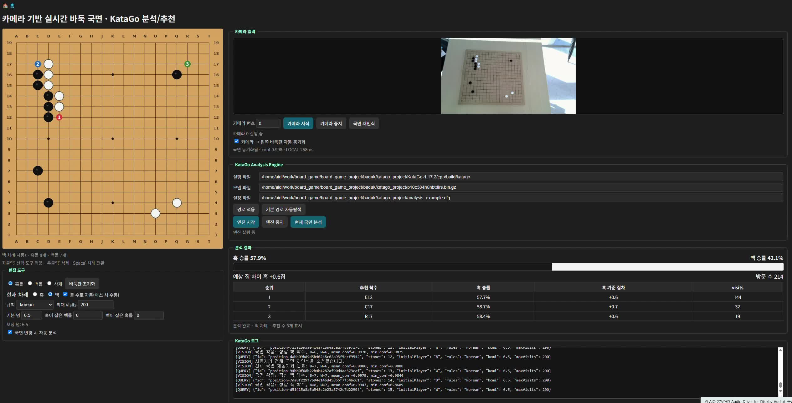

# Jetson 기반 보드게임 국면 인식 및 추천 수 분석 시스템

[전체 프로젝트](../README.md#프로젝트) · [Notion 상세·시연](https://app.notion.com/p/3dc23ec941b781ce9fe1dcd6f5ae6d93)

대한상공회의소 온디바이스AI 시스템반도체 설계교육 · 팀 · 2026.08.05 – 2026.08.19

> **대한상공회의소 · 3인 팀 프로젝트 · 2026.08.05\~08.19**
>
> **핵심 결과:** 장기 CNN Validation 정확도 99.14% · 바둑 흑돌/백돌/빈칸 테스트 170개 패치 정분류 · Jetson에서 국면 인식과 게임 엔진·GUI 연동
>
> **본인 담당:** 장기·바둑 데이터셋 제작·모델 학습·인식 파이프라인, 국면 안정화, Fairy-Stockfish·KataGo 연동, Jetson 배포 및 4종 게임 런처 통합

## 개요

- **시스템:** 실제 보드 촬영 → 디지털 국면 복원 → AI 엔진의 승률·형세·추천 수 표시
- **팀 범위:** 체스·장기·바둑·오목 4종 통합
- **개인 담당:** 장기·바둑 데이터·학습·인식 후처리·엔진/GUI 연동
- **인식 단위:** 장기 90개·바둑 361개 교차점
- **국면 확정:** 좌표 보정·연속 프레임 확인 후 엔진 입력 전달

**바둑 통합 시연 화면 — 카메라 입력·디지털 보드·분석 결과**

[상세 그림 — Notion](https://app.notion.com/p/3dc23ec941b781ce9fe1dcd6f5ae6d93#970a2afd018a4956a8ed050390147a2c)

실제 보드·인식 국면·승률·추천 착수를 함께 표시

## 담당 역할

- **데이터셋 제작:** ArUco 기준점 설정, 보드 꼭짓점 라벨링과 교차점 패치 수집·분류 스크립트 작성
- **모델 학습:** YOLO11-Pose 꼭짓점 검출, 장기 경량 CNN·바둑 ResNet18 분류기 학습 및 평가
- **인식 파이프라인:** Perspective Transform, 9×10·19×19 격자 생성, Sobel 보정, 국면 안정화
- **엔진·GUI 연동:** 장기 FEN과 바둑 행렬 변환, 차례·승률·추천 착수 동기화
- **배포·통합:** ONNX·TensorRT 변환과 Jetson Orin Nano 실행 환경 구성, 4종 게임의 로컬 웹 런처 통합

**사용 기술:** Python, OpenCV·ArUco·Sobel, PyTorch, Ultralytics YOLO11-Pose, CNN·ResNet18, ONNX·TensorRT, Fairy-Stockfish·KataGo

## 시스템 구성

**웹캠 → 꼭짓점 검출 → 투시변환·격자 보정 → 패치 분류 → 국면 안정화 → 엔진 분석 → GUI**

보드 좌표 확보와 교차점 패치 분류를 분리한 장기·바둑 공통 파이프라인

**장기 시스템 아키텍처 — 좌표 검출부터 FEN·엔진 분석까지**

[상세 그림 — Notion](https://app.notion.com/p/3dc23ec941b781ce9fe1dcd6f5ae6d93#4ee338cba22941a5aeaefeb0f620326b)

장기판 위치 검출·패치 분류·국면 확정·FEN 변환·엔진 분석

공통 처리 단계와 장기·바둑의 차이

| 단계 | 장기 | 바둑 |
| --- | --- | --- |
| 꼭짓점 검출 | YOLO11s-Pose | YOLO11n-Pose |
| 정규화·격자 | 1000×1000 기준 이미지, 9×10 교차점 | 1000×1000 기준 이미지, 19×19 교차점 |
| 패치 분류 | 96×96 RGB, 경량 CNN, 초·한 기물과 빈칸 | 32×32 RGB, ResNet18, 흑돌·백돌·빈칸 |
| 국면 안정화 | 최근 3프레임과 기물·변화 조건 확인 | 동일한 새 국면 2회 확인, 비정상 변화 보류 |
| 엔진 입력 | FEN → Fairy-Stockfish | 19×19 보드 행렬 → KataGo |
| 사용자 출력 | 차례·잡힌 기물·승률·추천 착수 | 차례·승률·예상 집 차이·추천 착수 |

체스·오목은 팀원이 개발한 모듈과 함께 통합했습니다. 아래 상세 내용은 제가 맡은 장기·바둑 인식과 시스템 연결을 중심으로 정리했습니다.

## 데이터셋 제작과 좌표계

- **학습 데이터:** ArUco 기준점·꼭짓점 라벨링, 교차점 패치 자동 수집
- **촬영 조건:** 각도·조명별 데이터 확보
- **실행:** Pose 모델로 마커 없이 보드 꼭짓점 검출

ArUco 기준점과 라벨링·패치 수집 자동화

장기판과 바둑판에 ArUco 마커를 배치해 기준 좌표를 확보했습니다. 보드 꼭짓점 좌표를 설정한 뒤 정규화 이미지와 격자를 생성해, 꼭짓점 검출용 라벨과 기물 분류용 패치를 제작했습니다.

장기의 `janggi_pose_labeler.py`, `janggi_patch_collector.py`와 바둑의 `baduk_pose_labeler.py` 등을 사용해 반복적인 데이터 제작 과정을 줄였습니다.

장기는 90개 교차점의 패치를 기물별 폴더에 저장하도록 구성했고, 바둑은 361개 교차점에서 흑돌·백돌·빈칸 패치를 수집했습니다. 수집 단계의 기준점과 실행 단계의 자동 검출 결과가 같은 좌표계로 이어지도록 맞췄습니다.

**장기 데이터 수집 — ArUco 기준점을 배치한 촬영 이미지**

[상세 그림 — Notion](https://app.notion.com/p/3dc23ec941b781ce9fe1dcd6f5ae6d93#008a757badd242c294997df50f00f194)

수집 단계에서 마커를 이용해 장기판의 기준 좌표를 확보했습니다.

**바둑 데이터 수집 — 기준점과 19×19 보드**

[상세 그림 — Notion](https://app.notion.com/p/3dc23ec941b781ce9fe1dcd6f5ae6d93#e7fd618d338f43c8a419025ab8e51ede)

보드 좌표를 기준으로 교차점 패치를 수집하고 꼭짓점 학습용 데이터를 제작했습니다.

Perspective Transform과 교차점 격자 생성

검출한 네 꼭짓점으로 기울어진 보드를 1000×1000 기준 좌표계에 정규화한 뒤, 장기의 9×10과 바둑의 19×19 교차점을 생성했습니다.

꼭짓점의 작은 오차가 보드 전체의 패치 위치에 영향을 주므로, Sobel Edge로 실제 선 위치를 확인해 격자를 보정했습니다. 장기는 96×96, 바둑은 32×32 크기로 각 교차점 주변을 잘라 분류기에 전달했습니다.

바둑에서 먼저 구성한 기준점·정규화·격자 생성 경험을 장기 시스템으로 확장했습니다.

**장기 격자 생성 — 9×10 교차점**

[상세 그림 — Notion](https://app.notion.com/p/3dc23ec941b781ce9fe1dcd6f5ae6d93#d8111b6f890b47768782f1d0bf8298ec)

정규화된 장기판의 교차점 좌표와 기물 패치 위치를 맞췄습니다.

**바둑 격자 생성 — 19×19 교차점**

[상세 그림 — Notion](https://app.notion.com/p/3dc23ec941b781ce9fe1dcd6f5ae6d93#bc1b1fe9d91b406c908c30d9c9d0037b)

정규화된 보드에서 361개 교차점을 생성하고 각 위치를 분류기 입력으로 연결했습니다.

## 장기 인식

- **모델:** YOLO11s-Pose 위치 검출·경량 CNN 기물/빈칸 분류
- **결과:** 꼭짓점 평균 오차 17.21 px, 기물 Validation 정확도 99.14%

장기판 꼭짓점 검출 — 모델 변경과 위치 오차 확인

초기 YOLO11n-Pose의 위치 오차를 줄이기 위해 YOLO11s-Pose로 변경하고, Shear 3° 등의 데이터 증강을 추가했습니다. 최종 발표자료의 데이터 구성은 Train Image 905장·Validation Image 229장입니다.

별도 Pixel Error 평가 화면은 **135개 이미지·검출 실패 0개·평균 오차 17.21 px**를 기록했습니다. 해당 화면은 꼭짓점 순서를 화면 기준으로 정렬한 뒤 계산한 결과이며, 학습 데이터 분할 개수와 구분해 제시했습니다.

Pose mAP50은 0.989로 정리됐습니다. 보드 인식의 실제 좌표 정밀도를 보기 위해 mAP와 Pixel Error를 함께 확인했습니다.

**장기 꼭짓점 Pixel Error — 135개 이미지·평균 17.21 px**

[상세 그림 — Notion](https://app.notion.com/p/3dc23ec941b781ce9fe1dcd6f5ae6d93#aa471bd2183f4744b7d6796d40a3aa7a)

화면 기준 꼭짓점 순서 정렬 후 평균·중앙값·P90·위치별 오차 평가

장기 기물 분류 — 패치 수집과 경량 CNN 구조

90개 교차점에서 96×96 RGB 패치를 추출해 **초·한의 7종 기물과 빈칸, 총 15개 클래스**로 분류했습니다. `janggi_patch_collector.py`에서 격자 위치를 기준으로 패치를 추출하고 클래스별 학습 폴더에 저장했습니다.

경량 CNN은 Conv2D·Batch Normalization·ReLU·MaxPool2D를 조합해 특징을 추출하도록 구성했습니다. 보드 전체의 기물 위치를 각각 탐지하는 대신, 좌표가 정해진 작은 패치를 분류하는 방식으로 인식 흐름을 만들었습니다.

**장기 패치 수집 화면 — 교차점별 기물 데이터 제작**

[상세 그림 — Notion](https://app.notion.com/p/3dc23ec941b781ce9fe1dcd6f5ae6d93#004c9616637f42ee824fa9ff433f0d86)

기물·빈칸의 위치를 격자 좌표에 맞춰 수집하고 학습용 클래스 폴더에 저장했습니다.

**장기 경량 CNN — 실제 모델 구조**

[상세 그림 — Notion](https://app.notion.com/p/3dc23ec941b781ce9fe1dcd6f5ae6d93#8270699aabe7473e945474bd7c05aaee)

Conv2D·Batch Normalization·ReLU·MaxPool2D를 반복하는 분류기 구조입니다.

장기 CNN 학습 조건·정확도·혼동행렬

학습 설정은 입력 96×96, Batch 64, 최대 40 Epoch, Learning Rate 1e-3, Weight Decay 1e-4였습니다. 원본 결과 화면의 Best Epoch는 23입니다.

최종 Validation 결과는 **Overall Accuracy 99.14%·Macro Accuracy 99.06%**였습니다. Accuracy·Loss Curve로 학습 추이를 확인하고, 클래스별 정확도와 Normalized Confusion Matrix로 오분류가 남는 기물을 점검했습니다.

전체 정확도뿐 아니라 각 기물의 결과를 확인했고, 가장자리의 작은 기물인 ‘사’가 잘 구분되지 않던 문제는 클래스 가중치 조정과 재학습으로 보완했습니다.

**장기 CNN Accuracy Curve — Train·Validation 비교**

[상세 그림 — Notion](https://app.notion.com/p/3dc23ec941b781ce9fe1dcd6f5ae6d93#501a02d14316455292628cd80d9f78b1)

학습에 따른 전체·클래스 평균 정확도 추이를 확인했습니다.

**장기 CNN Loss Curve — 학습·검증 손실**

[상세 그림 — Notion](https://app.notion.com/p/3dc23ec941b781ce9fe1dcd6f5ae6d93#d7bf7b2a232e428584a78794956d10e9)

Train과 Validation의 손실 변화로 학습 과정을 점검했습니다.

**장기 기물 Normalized Confusion Matrix**

[상세 그림 — Notion](https://app.notion.com/p/3dc23ec941b781ce9fe1dcd6f5ae6d93#d9e405f7e8dd46898b9013a32be8717c)

클래스별 오분류 비율 비교

**장기 CNN 결과 — Overall 99.14%·Macro 99.06%**

[상세 그림 — Notion](https://app.notion.com/p/3dc23ec941b781ce9fe1dcd6f5ae6d93#ae8709f11413476186b5e5ff51e9d441)

Best Epoch 23·기물별 Validation 정확도

## 바둑 인식

- **모델:** YOLO11n-Pose·Sobel 격자 보정·ResNet18 분류
- **결과:** 꼭짓점 평균 오차 17.48 px
- **별도 패치 테스트:** 흑돌 25·빈칸 120·백돌 25개 정분류

바둑판 꼭짓점 검출 — 추가 데이터와 최종 위치 오차

새로운 장소·조명 조건에서 촬영한 **189장**의 보드 이미지를 추가 라벨링하고, Train 80%·Validation 20%로 나눠 기존 데이터에 보강했습니다.

개발 초기 30 px 이상이던 오차는 데이터 보강 후 일지에서 20\~30 px 수준으로 기록됐고, 최종 발표자료의 Pixel Error 평균은 **17.48 px**, Pose mAP50은 **0.948**이었습니다.

추가 데이터 학습과 격자 후처리를 함께 적용했으며, 최종 위치 오차 수치를 Sobel 필터 단독의 개선 효과로 해석하지 않았습니다.

**바둑 꼭짓점 Pixel Error — 평균 17.48 px**

[상세 그림 — Notion](https://app.notion.com/p/3dc23ec941b781ce9fe1dcd6f5ae6d93#b5d3ae0b28b54f73b7009379e2efdf2c)

전체와 꼭짓점별 위치 오차를 기록한 최종 발표자료의 평가 화면입니다.

바둑 ResNet18 — Batch 추론·학습 곡선·170개 패치 테스트

19×19 교차점에서 **32×32 패치 361개**를 추출해 ResNet18에 Batch로 전달하고, 각 위치를 흑돌·빈칸·백돌로 분류했습니다.

학습 과정의 Accuracy·Loss Curve를 확인한 뒤, 별도 테스트의 Confusion Matrix와 클래스별 결과를 점검했습니다. 테스트 샘플은 흑돌 25개·빈칸 120개·백돌 25개, 총 170개입니다.

원본 Final Test는 **Accuracy 1.0000·Balanced Accuracy 1.0000**이며, 혼동행렬의 대각선에 25·120·25가 기록됐습니다. 이 결과는 해당 패치 테스트의 성능이며, 카메라 입력 전체의 361개 교차점이 모든 환경에서 같은 정확도로 인식된다는 의미와 구분했습니다.

**바둑 ResNet18 Accuracy Curve**

[상세 그림 — Notion](https://app.notion.com/p/3dc23ec941b781ce9fe1dcd6f5ae6d93#81244032ba664e368b601c9ea581db07)

Train·Validation 정확도 변화와 학습 중 변동을 함께 확인했습니다.

**바둑 ResNet18 Loss Curve**

[상세 그림 — Notion](https://app.notion.com/p/3dc23ec941b781ce9fe1dcd6f5ae6d93#220d42c1230c4ea9b9f3d65e37643bbf)

학습 과정의 손실 변화를 확인한 원본 그래프입니다.

**바둑 패치 분류 Normalized Confusion Matrix**

[상세 그림 — Notion](https://app.notion.com/p/3dc23ec941b781ce9fe1dcd6f5ae6d93#a7ae88bc5083411fbb7e58edc75a32be)

흑돌·빈칸·백돌의 클래스별 테스트 결과입니다.

**바둑 Final Test — 흑돌 25·빈칸 120·백돌 25 정분류**

[상세 그림 — Notion](https://app.notion.com/p/3dc23ec941b781ce9fe1dcd6f5ae6d93#7db27ece55e04c9c9047a9a66b93e418)

170개 패치의 Accuracy·Balanced Accuracy와 표본 수를 함께 표시한 원본 결과입니다.

## 국면 안정화와 엔진·GUI 연동

- **안정화:** 연속 프레임·국면 변화 조건으로 순간 오인식 반영 억제
- **엔진 입력:** 장기 FEN·바둑 19×19 행렬 변환
- **GUI:** 승률·형세·추천 착수와 차례 동기화

국면 안정화 — 연속 프레임 확인·차례 갱신·복구

| 기능 | 장기 | 바둑 |
| --- | --- | --- |
| 국면 확정 | 최근 3프레임의 교차점 인식 결과를 기반으로 안정화 | 동일한 새 국면이 2회 연속 나타나는지 확인 |
| 유효성 확인 | 궁 위치, 기물 최대 개수, 낮은 Confidence와 변경 교차점 점검 | 손 가림 등 비정상 변화 추정 시 확정 국면 유지 |
| 차례 관리 | 이전·현재 국면의 변경점을 비교해 실제 착수와 차례 갱신 | 국면 변화와 흑·백 차례의 일관성을 확인 |
| 복구 | 국면 재인식 모드·수동 차례 변경 | 재인식·수동 차례 변경, 재동기화 시 전체 국면 3회 확인 |

바둑의 비정상 국면은 최대 5프레임 재확인하는 옵션도 구성했습니다. 진행 중인 대국의 국면을 읽는 경우와 처음부터 착수를 추적하는 경우를 함께 고려했습니다.

Fairy-Stockfish·KataGo 입력 변환과 분석 결과 표시

- **장기:** 기물 배치를 FEN으로 구성해 Fairy-Stockfish에 전달하고, 초·한 승률·형세 평가·추천 착수 1\~3순위를 표시했습니다.
- **바둑:** 확정된 19×19 보드 행렬을 KataGo에 전달하고, 승률·예상 집 차이·Visits·추천 착수 1\~3순위를 추출했습니다.

카메라 입력, 디지털 보드, 현재 차례, 엔진 경로와 분석 결과를 한 화면에 연결했습니다. 장기는 잡힌 기물도 갱신하고, 무승부 비중이 크게 보이던 평가 결과의 표시 방식을 초·한 중심으로 재구성했습니다.

엔진의 추천 수를 화면에 표시할 때까지 인식 좌표·기물 클래스·국면 표현·차례 정보가 일관되도록 연결했습니다.

**장기 통합 GUI — 카메라·기물 배치·엔진 분석**

[상세 그림 — Notion](https://app.notion.com/p/3dc23ec941b781ce9fe1dcd6f5ae6d93#2299a3d5992d42eaa0f19da79e79413a)

FEN 기반으로 재구성한 디지털 보드, 인식 화면과 분석 결과를 함께 표시했습니다.

## Jetson 배포와 4종 게임 통합

- **배포:** 분류 모델 ONNX·TensorRT 변환, Jetson Orin Nano 실행 환경 구성
- **통합:** 독립 스크립트를 로컬 웹 런처로 연결, 4종 게임 선택·실행

모델 배포·게임 런처·보드별 실행 환경

학습 가중치와 분류용 TensorRT Engine을 GUI에서 연결하고, OpenCV 카메라 입력·모델 추론·게임 엔진 분석이 이어지도록 실행 환경을 구성했습니다.

런처는 게임 선택에 따라 해당 프로세스를 실행하고, 카메라를 공유하므로 한 번에 하나의 게임을 사용하도록 구성했습니다. 장기·바둑에서 구현한 인식과 GUI를 팀의 체스·오목 모듈과 연결했습니다.

다른 Jetson에서 특정 게임이 실행되지 않는 문제는 게임별 패키지·엔진·경로 의존성을 재점검하고 필요한 환경을 맞춰 해결했습니다. 실행 안내에는 런처와 게임 프로세스가 같은 Python 가상환경을 사용하도록 정리했습니다. 보드를 옮길 때 확인할 항목으로 **TensorRT 엔진의 GPU·TensorRT 버전 호환성과 카메라 보정값**을 명시했습니다.

## 문제 해결

- **위치 오차:** 데이터 189장 추가·Sobel 격자 보정
- **기물 오분류:** 작은 장기 기물의 클래스 가중치 조정·추가 학습
- **손 가림 오인식:** 처리 주기 조정·국면 안정화 적용

인식 정확도 개선 — 데이터 보강·Sobel 보정·‘사’ 재학습

**바둑 꼭짓점:** 조명과 장소가 달라지면 위치 오차가 커져 추가 이미지 189장을 라벨링하고 재학습했습니다. Pose 검출 뒤 Sobel Edge를 적용해 실제 선에 맞춰 격자를 보정했습니다.

**장기 기물:** 가장자리에 놓인 작은 ‘사’가 잘 구분되지 않아 해당 클래스의 학습 가중치를 약 1.05배 조정하고 재학습했습니다. 개별 기물 인식을 다시 확인한 뒤 전체 Validation 결과도 점검했습니다.

**장기 꼭짓점:** YOLO11n-Pose에서 YOLO11s-Pose로 변경하고 Shear 증강을 추가해 위치 정밀도를 개선했습니다.

개별 모델의 학습 지표와 격자 후처리, 실제 영상 입력에서의 동작을 함께 확인했습니다.

**Sobel 보정 전 — 교차점 좌표의 어긋남**

[상세 그림 — Notion](https://app.notion.com/p/3dc23ec941b781ce9fe1dcd6f5ae6d93#9eb50c3608674b72bff06c6495e3ed10)

발표자료의 Before 화면으로, 보드 선과 예측한 교차점이 어긋난 구간을 확인할 수 있습니다.

**Sobel 보정 후 — 실제 선에 맞춘 교차점**

[상세 그림 — Notion](https://app.notion.com/p/3dc23ec941b781ce9fe1dcd6f5ae6d93#f05d78c070e04b5eb7515baf0f3234ac)

발표자료의 After 화면으로, 보드 선을 기준으로 보정한 격자를 표시했습니다.

사용성 개선 — 반영 지연·손 가림·화면 크기·초기 구동

- **반영 지연:** 초기에는 국면의 UI 반영에 약 12초, 엔진 분석에 추가 약 3초가 걸렸습니다. UI Update와 엔진에 보내는 Capture 주기를 조정했습니다.
- **손 가림 오인식:** 주기를 줄이자 손이 지나가는 중간 화면이 임의의 돌 배치로 반영돼, 비정상 변화 보류와 연속 국면 확인을 적용했습니다. 복구가 어려운 경우를 위한 재인식 모드도 구성했습니다.
- **초기 엔진 준비:** 실행 초기에 엔진을 미리 켜 Warm-up하도록 조정했습니다.
- **화면 크기 변화:** OpenCV 카메라 출력 크기를 고정하고, 통합 후 다시 나타난 같은 문제에도 수정 내용을 적용했습니다.

개선 후 지연 시간·FPS는 별도 정량 측정하지 않았습니다.

## 검증 결과

| 대상 | 결과 | 평가 단위 |
| --- | --- | --- |
| 장기 꼭짓점 · YOLO11s-Pose | 평균 오차 17.21 px · Pose mAP50 0.989 | 원본 Pixel Error 화면: 135개 이미지, 꼭짓점 순서 정렬 후 평가 |
| 장기 기물 · 경량 CNN | Overall 99.14% · Macro 99.06% | Validation 패치 분류 |
| 바둑 꼭짓점 · YOLO11n-Pose | 평균 오차 17.48 px · Pose mAP50 0.948 | 최종 발표자료의 평가 결과 |
| 바둑 돌 · ResNet18 | 170개 패치 정분류 | 흑돌 25·빈칸 120·백돌 25의 별도 테스트 |

- **평가 구분:** 꼭짓점 검출·패치 분류·통합 시연을 별도 결과로 표기
- **남은 과제:** 각도·조명별 전체 보드 인식 편차의 추가 데이터·실환경 검증

## 결과 및 시연

- **완성 흐름:** 데이터 제작·학습 → 좌표 보정·국면 안정화 → 엔진·GUI
- **통합 결과:** Jetson 장기·바둑 분석, 팀의 체스·오목과 런처 연결

**장기 시연 영상 — 실제 국면 인식과 Fairy-Stockfish 분석**

[시연 영상 — Notion](https://app.notion.com/p/3dc23ec941b781ce9fe1dcd6f5ae6d93#02b9448d50a9433bb3dd52af224fa064)

장기 기물 이동에 따른 디지털 보드·추천 착수 변화 시연 · 약 48초

**바둑 시연 영상 — 실제 국면 인식과 KataGo 분석·추천 착수**

[시연 영상 — Notion](https://app.notion.com/p/3dc23ec941b781ce9fe1dcd6f5ae6d93#a6edc230f18740abb93b4248efa8d7f9)

바둑 국면 인식·디지털 보드·KataGo 분석 결과 연동 시연

[← 전체 프로젝트](../README.md#프로젝트)

