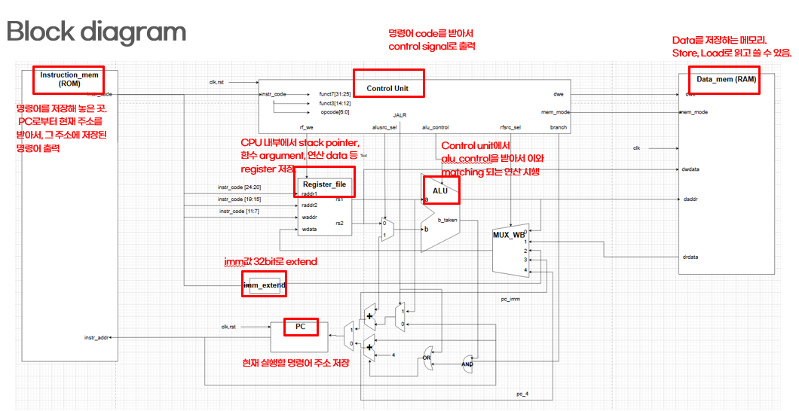

# RV32I Single-Cycle CPU 설계 및 Bubble Sort 실행 검증

[전체 프로젝트](../README.md#프로젝트) · [노션 상세·시연 자료](https://app.notion.com/3d423ec941b7815d9825ccf432bcf0bf)

> 37개 명령어 확인 · 함수 호출·분기·메모리 정렬 추적

<p align="center"></p>

| 구분 | 내용 |
| --- | --- |
| 기술 분야 | RTL·FPGA 시스템 설계 |
| 수행 기관 | 대한상공회의소 온디바이스AI 시스템반도체 설계교육 |
| 수행 형태 | 개인 |
| 담당 역할 | CPU RTL·명령어 시뮬레이션 · Bubble Sort 선택 과제 |
| 기간 | 2026.05.19 – 2026.05.27 |
| 구성·범위 | 대한상공회의소 · 개인 프로젝트 · Bubble Sort 선택 과제 |

## 개요

교육 과정의 개인 과제로 32-bit RV32I Single-Cycle CPU를 설계하고 명령어 동작을 시뮬레이션했습니다. 프로그램 검증은 Bubble Sort와 Sum 중 Bubble Sort를 선택해, 함수 호출·분기·Load/Store가 연결된 실행 흐름과 정렬 결과를 확인했습니다.

## 구현 범위

Instruction Memory와 Data Memory를 분리한 Harvard 구조에서 PC, Register File, ALU, Immediate Generator, Control Unit과 Write Back 경로를 구성했습니다. 산술·논리, Load/Store, Branch, LUI/AUIPC, JAL/JALR를 포함한 37개 명령어를 대상으로 제어 신호와 PC·레지스터·메모리 변화를 확인했습니다.

## Bubble Sort 검증

Bubble Sort C 코드를 RV32I Assembly로 변환해 `main → sort → swap → return` 실행 흐름을 추적했습니다. Stack Pointer와 복귀 주소 저장, 배열 시작 주소·크기 전달, 중첩 반복문의 분기, 두 원소의 교환과 함수 복귀를 파형으로 확인했습니다.
최종 파형에서 `0, 1, 3, 5, 7, 9`와 함수 복귀 후 `a=0x12345678` 저장을 관찰했습니다. 완료보고서의 배열 개수 설명과 최종 파형이 일치하지 않아, 결과는 관찰한 파형 기준으로 제시합니다.

## 점검·수정

- JALR의 점프 주소 `(rs1 + immediate)`에 `& ~32'd1`을 적용해 bit 0을 0으로 처리했습니다.
- x0은 쓰기를 차단하고 읽기 값이 항상 0이 되도록 확인했습니다.
- 명령어 추가 후 발생한 Syntax Error는 Header File까지 확인해 수정했습니다.

## 결과와 검증 범위

단일 명령어 검증을 프로그램 실행 분석으로 확장했습니다. 검증은 Directed Simulation과 프로그램 실행 파형 분석으로 진행했습니다.
<details>
<summary>구현 코드</summary>

```verilog
assign pc_imm = (imm_extend + pc_jalr) & ~32'd1;
```
```verilog
always @(posedge clk) begin
    if (rf_we && (waddr != 5'd0)) begin
        register_file[waddr] <= wdata;
    end
end
assign rdata1 = (raddr1 != 0) ? register_file[raddr1] : 32'd0;
```
```verilog
`R_TYPE: begin
    rf_we       = 1'b1;
    alusrc_sel  = 0;
    alu_control = {funct7[5], funct3};
    ...
end
```

</details>

<details>
<summary>세부 확인 항목</summary>

| 검증 대상 | 핵심 확인 항목 |
| --- | --- |
| R/I 산술·논리 | ALU 결과와 rd 저장, SLT/SLTU의 Signed/Unsigned 차이, SRL/SRA의 빈 비트 채움 차이 |
| Load/Store | SB·SH·SW 저장 위치, LB·LH·LW·LBU·LHU의 데이터 선택과 Sign/Zero Extension |
| Branch | 비교 조건의 성립·불성립에 따른 PC+Immediate 또는 PC+4 선택 |
| LUI/AUIPC | 상위 Immediate 생성 및 PC 상대 주소 계산 |
| JAL/JALR | PC+4 복귀 주소 저장, 점프 주소 선택, JALR bit 0 제거 |

</details>

## 코드·결과 자료

- [RV32I RTL·Testbench](https://github.com/Min-star-prog/ondeviceai/tree/main/linux/20260527_RV32I_singlecycle_source_code)
- [파형·상세 그림·시연 자료 — 노션](https://app.notion.com/3d423ec941b7815d9825ccf432bcf0bf)

[← 전체 프로젝트](../README.md#프로젝트)
