# SPI·I2C 통신 IP UVM 검증

[전체 프로젝트](../README.md#프로젝트) · [Notion 상세·시연](https://app.notion.com/p/3d423ec941b781efae15feac9005b06a)

대한상공회의소 온디바이스AI 시스템반도체 설계교육 · 개인 · 2026.05.01 – 2026.06.30

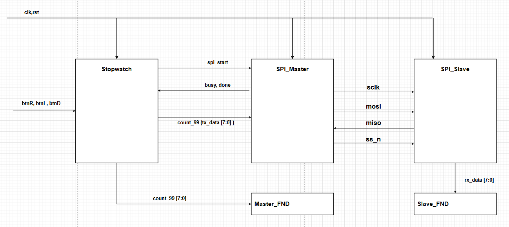

> **대한상공회의소 · 개인 프로젝트 · SPI와 I2C 모두 UVM 검증**
>
> **핵심 결과:** SPI 반복 실행 FC 96%·Directed 보완 100% / I2C FC 100%

## 개요

- **구성:** SPI·I2C Master–Slave Loopback, 프로토콜별 UVM 자동 비교 환경
- **검증 요소:** Sequence·Driver·Monitor·Scoreboard·Coverage
- **SPI:** MOSI·MISO 양방향 데이터 정합성 확인
- **I2C:** Write/Read 데이터·SDA 제어 주체 전환 확인
- **검증 확장:** Random 미도달 Bin의 Directed 보완, FPGA·Logic Analyzer 실물 점검

## 담당 역할

- **UVM 환경 구성:** SPI·I2C 각각 Sequence·Driver·Monitor·Scoreboard·Coverage 연결
- **자동 비교:** SPI 송수신 레지스터·직렬 버스 데이터 비교, I2C Write/Read 기대값·실제값 비교
- **관측 시점 분석:** SPI SCLK Sampling과 완료 시점, I2C 수신 Valid·Read 완료 시점 구분
- **문제 해결·Coverage 보완:** SPI Slave의 선택 해제 처리 수정, 미도달 Cross Bin·Read 경계값에 Directed Sequence 적용
- **실물 검증:** Master Stopwatch/FND와 Slave FND 연동, Logic Analyzer 파형 확인

## UVM 검증 환경

- **입력·구동:** Sequence 생성 → Driver의 DUT 구동
- **수집·판정:** Monitor 관측 → Scoreboard 비교·Coverage 집계
- **프로토콜별 조정:** 전송 종료 조건과 기대값·실제값 수집 시점

**SPI·I2C UVM 검증 구조와 데이터 흐름**

[상세 그림 — Notion](https://app.notion.com/p/3d423ec941b781efae15feac9005b06a#63cebaf1807c49419c53e111ba3d6890)

Sequence 입력·DUT 구동·Monitor 관측·Scoreboard 비교·Coverage 집계

UVM Component 역할과 Analysis Port 연결

| 구성 | 구현 내용 |
| --- | --- |
| Sequence·Sequencer | Write, Read, Write&Read 시나리오와 송신 데이터 생성 |
| Driver | SPI start·clk\_div·TX 데이터 또는 I2C START·주소·Data·Read·STOP 명령 구동 |
| Monitor | SPI SS\_n·SCLK·송수신 데이터, I2C 명령 종류·수신 Valid·완료 시점 관측 |
| Scoreboard | SPI는 한 Transaction의 4개 데이터 관계 비교, I2C는 기대값 큐와 실제 동작·데이터 비교 |
| Coverage Subscriber | Monitor의 Transaction을 받아 기능별 Bin과 Cross Bin 수집 |

SPI는 `Monitor.ap`를 Scoreboard와 Coverage에 연결했습니다. I2C는 `Monitor.exp_ap`와 `act_ap`를 Scoreboard의 두 입력에 연결하고, 실제 수신 결과인 `act_ap`를 Coverage에도 전달했습니다.

검증 대상은 프로토콜별 Master–Slave Loopback DUT입니다. **두 UVM 환경은 직접 구성했으며, I2C Slave는 개발일지에 기록된 팀원 공유 RTL을 활용**했습니다.

Write·Read·Write&Read 시나리오와 입력 구성

| 대상 | 시나리오 | 입력·확인 방법 |
| --- | --- | --- |
| SPI | Write | Slave TX를 0으로 두고 Master의 0x55·0xA5·0xF0 전송 확인 |
| SPI | Read | Master TX를 0으로 두고 Slave의 0x11·0x22·0x33 수신 확인 |
| SPI | Write&Read | Master·Slave 데이터를 각각 Random 생성하고 동시에 비교. clk\_div는 5\~50 범위로 변경 |
| I2C | Write | START → Address+W → Data → STOP |
| I2C | Read | START → Address+R → 1Byte Read → Master NACK → STOP |
| I2C | Write&Read | Write 후 Repeated START로 주소 방향을 바꾸고 Read 수행 |

SPI의 Write/Read는 검증 시나리오를 구분한 이름입니다. 실제 전송에서는 MOSI·MISO가 동시에 동작하므로 사용하지 않는 방향에 0을 넣어 한쪽 데이터 경로를 확인했습니다.

I2C 시뮬레이션 주소는 `7'h40`으로 고정했습니다. Address Byte와 Data Byte를 구분하고, 마지막 1Byte Read에는 NACK를 보내 종료하도록 Driver를 구성했습니다.

## SPI 양방향 데이터 검증

- **조건:** Mode 0(CPOL=0·CPHA=0), 8회 SCLK Sampling으로 1Byte 교환
- **비교 경로:** Master TX↔Slave RX, Slave TX↔Master RX
- **버스 대조:** MOSI·MISO 직접 복원값과 레지스터 데이터 비교

SPI Loopback 구조·Scoreboard 비교와 데이터 전달 파형

- **SPI Master–Slave 연결과 양방향 데이터 경로**

| 비교 관계 | 판정 목적 |
| --- | --- |
| Master TX = Slave RX | MOSI 경로에서 전송 데이터가 정확히 전달되는지 확인 |
| Slave TX = Master RX | MISO 경로에서 전송 데이터가 정확히 전달되는지 확인 |
| Capture MOSI = Master TX | 직렬 MOSI에서 재구성한 값과 송신 데이터 비교 |
| Capture MISO = Slave TX | 직렬 MISO에서 재구성한 값과 송신 데이터 비교 |

네 관계를 모두 만족하면 해당 Transaction을 PASS로 판정했습니다.

- **SPI Loopback 파형 — 송신 값과 반대편 수신 값 비교**

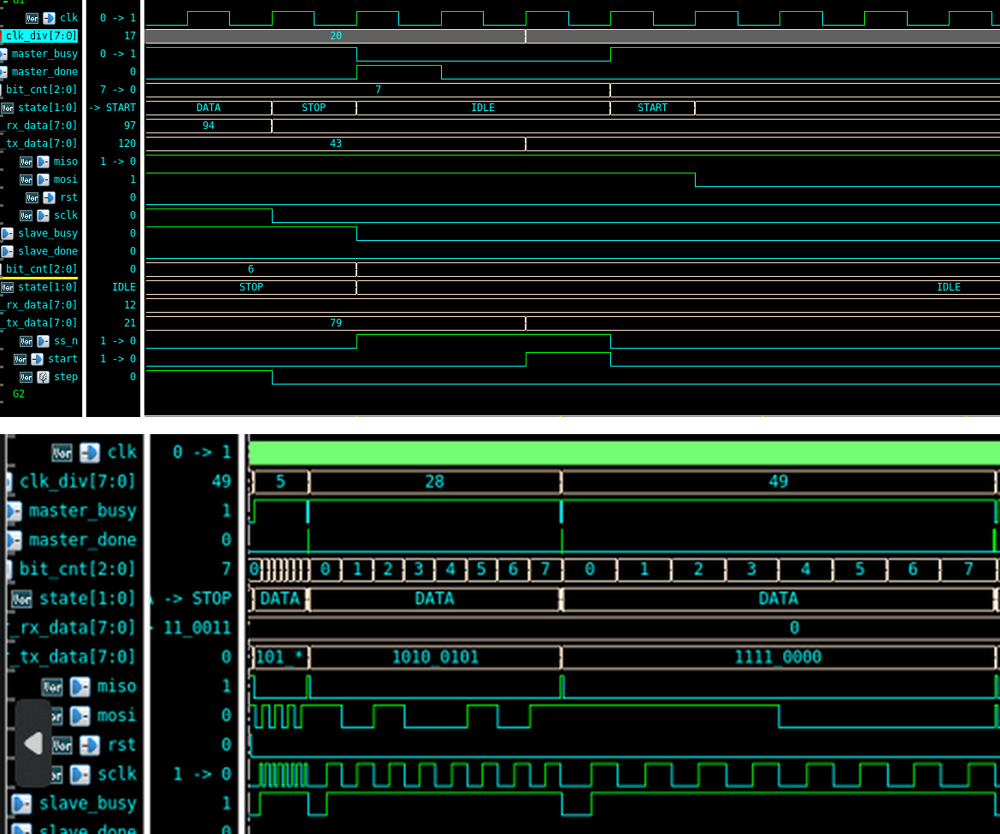

빨간 박스와 화살표는 Master·Slave의 송신 값이 각각 반대편 수신 레지스터로 전달되는 구간을 가리킵니다. 같은 Transaction의 값과 수신 완료 시점을 함께 확인했습니다.

SPI Driver·Monitor Timing과 완료 시점 Capture

Driver는 데이터와 `clk_div`를 설정한 뒤 `start`를 1클럭 발생시키고, `master_done`을 기다린 후 다음 Transaction으로 넘어갑니다.

Monitor는 `ss_n=0`에서 송신 값을 저장하고 **SCLK 상승 에지 8회**에 MOSI·MISO를 Sampling합니다. 이후 `master_done`에서 수신 레지스터를 읽어 Analysis Port로 전달하고, `ss_n=1`을 확인합니다.

- **SPI 구동·Sampling·Scoreboard 전달 시점**

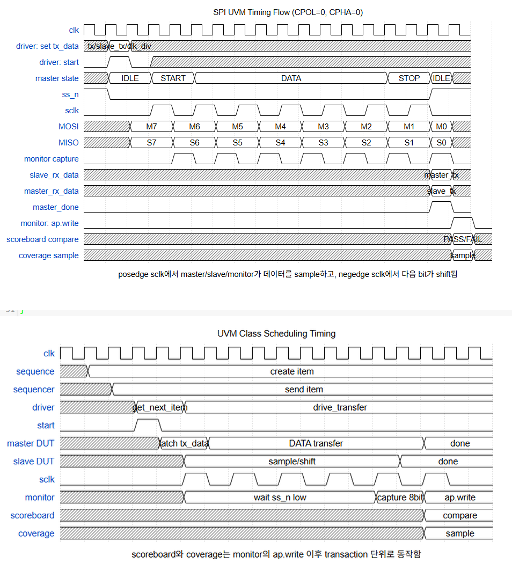

이 DUT에서 수신 데이터 갱신과 done 발생의 순서를 확인해 Monitor가 완성된 값을 읽도록 맞췄습니다. 현재 DUT의 데이터 갱신 순서에 맞춰 수집 시점을 정했습니다.

## I2C Write·Read와 SDA 제어

- **Write 수집:** `slave_rx_valid`
- **Read 수집:** `pending_read && master_done`
- **파형 확인:** 주소·Data·ACK/NACK 구간, SDA 구동·Release 시점

I2C Loopback·Open-Drain과 Write/Read 파형

- **I2C Master–Slave 연결과 Write/Read 데이터 경로**

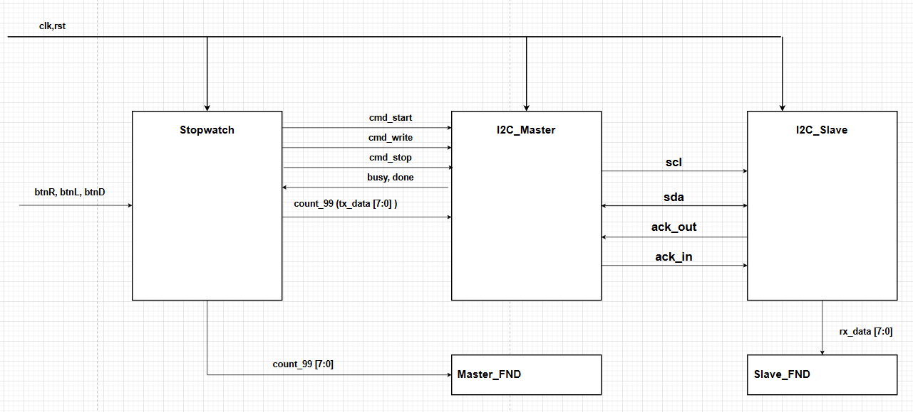

공유 SDA는 Low 구동과 Release로 제어합니다. Write Data에서는 Master가 구동하고 Slave가 수신하며, Slave ACK 구간에는 Master가 SDA를 Release합니다. Read Data에서는 Slave가 구동하고 Master가 수신합니다.

- **I2C Write 파형 — 명령 입력과 Slave RX\_DATA 진입**

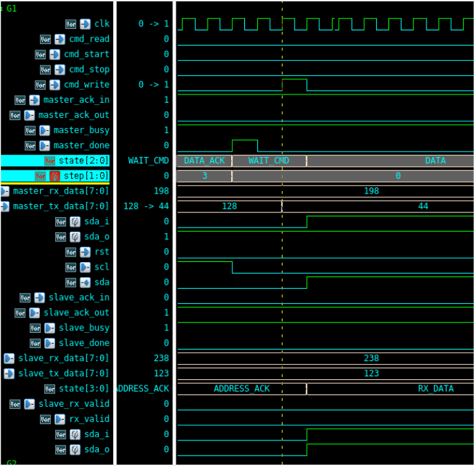

`cmd_write`와 상태 전이, SDA 출력 제어를 함께 관찰했습니다. Address ACK 이후 Data를 보내는 흐름을 구분했습니다.

- **I2C Read 파형 — Master SDA Release와 Slave TX\_DATA 진입**

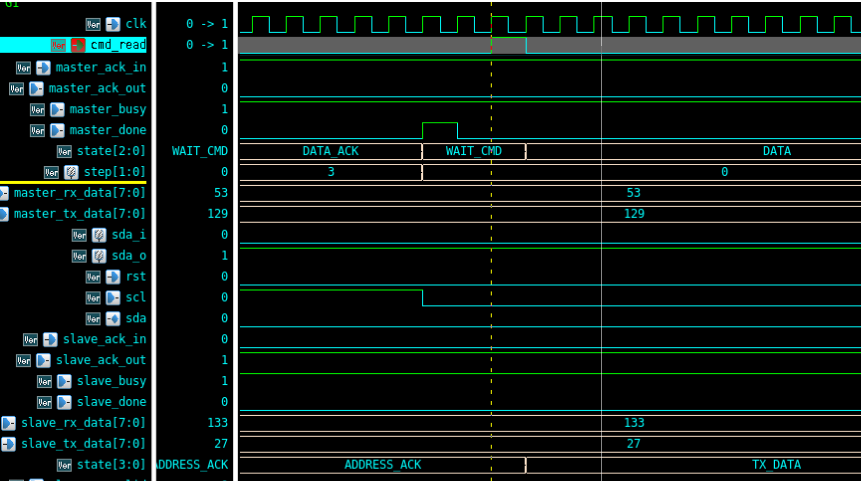

Master의 `sda_o=1`은 Open-Drain SDA를 Release하는 상태입니다. Read 구간의 공통 SDA는 Slave가 구동하며, Master가 Slave 데이터를 자신의 `sda_o`에 출력하는 구조가 아닙니다.

I2C Monitor 상태와 pending\_read 기반 수신 완료 관측

| 구간 | 기대값 | 실제값 수집 조건 |
| --- | --- | --- |
| Address | START 직후 첫 cmd\_write를 주소로 구분 | 로그·파형으로 확인, Data Scoreboard 비교에서는 제외 |
| Write Data | MON\_DATA 상태의 cmd\_write에서 Master TX 저장 | slave\_rx\_valid에서 Slave RX 수집 |
| Read Data | cmd\_read에서 Slave TX 저장하고 pending\_read 설정 | pending\_read와 master\_done이 함께 참일 때 Master RX 수집 |
| STOP | Transaction 종료 | Monitor 상태와 pending\_read 초기화 |

- **I2C Write·Read의 구동·완료·Capture 시점**

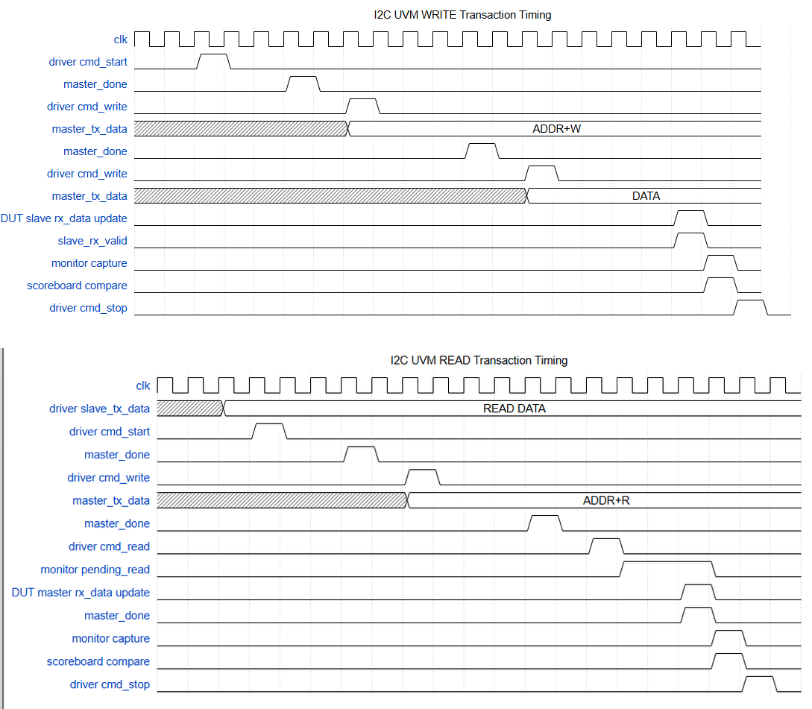

`cmd_read` 직후에는 수신 데이터가 완성되지 않으므로 결과를 바로 읽지 않았습니다. 명령 발생과 수신 완료 사이를 `pending_read`로 유지하고, Read 완료에서 실제 데이터를 전달했습니다.

Scoreboard는 큐에 저장한 기대값과 실제값의 **동작 종류(ACT\_WRITE/ACT\_READ) 및 Data**를 비교합니다. Address·ACK/NACK·START/STOP 전체를 별도 참조 모델로 자동 판정하는 구조와는 범위가 다릅니다.

Address Byte·Data Byte 구분과 비트 해석

- **I2C 직렬 파형 — 주소 0x80과 Data 0xBC 구분**

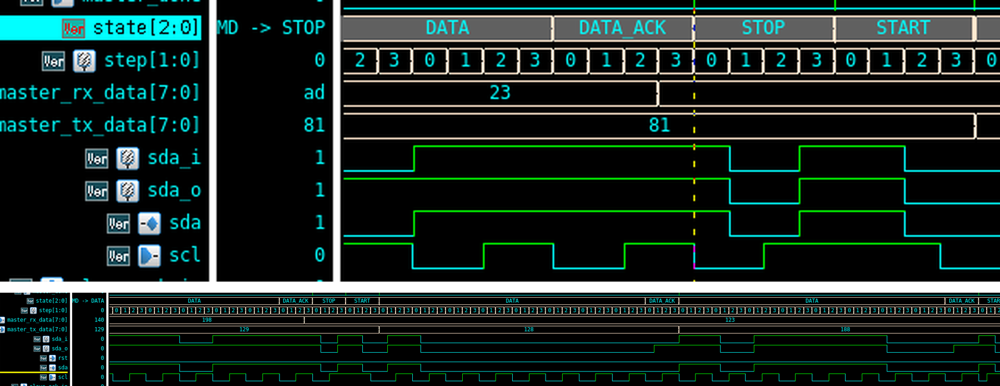

`0x80 = 1000_0000`은 `7'h40` 주소에 Write Bit(0)를 붙인 Address Byte입니다. 다음 `0xBC = 1011_1100`은 별도의 Data Byte이며, 각 Byte 뒤에는 ACK 구간이 있습니다.

처음 Logic Analyzer에서 같은 값이 반복되는 것을 Data 오류로 판단했지만, 첫 Byte가 주소라는 점을 확인해 Address와 Data를 구분했습니다. 이후 시뮬레이션과 실물 파형에서 주소·방향·데이터의 순서로 해석했습니다.

## Functional Coverage와 검증 결과

- **보완 방식:** 미도달 Bin 분석 후 필요한 입력을 Directed Sequence로 생성
- **SPI:** Random WR 500회 FC 96%, 남은 Cross Bin 보완
- **I2C:** Read Data=0 경계값과 관련 Cross Bin 보완

| 대상 | 반복 실행 결과 | 보완·해석 |
| --- | --- | --- |
| SPI | WR 100회 79.82% → 400회 95.43% → 500회 96% | 6/14 개발일지·완료보고서에 Directed Sequence 보완 후 100% 달성 기록 |
| I2C | WR 10회 80% → 100회 94.44% → 200회 100% | 6/16 개발일지에 Read Data=0 및 Cross Bin을 Directed Sequence로 보완한 과정 기록 |

SPI Coverpoint·Cross Bin 분석과 Directed 보완

Master·Slave TX는 `zero / low / mid / high / ff`의 5개 영역으로 나누고, 두 TX의 **25개 조합을 Cross Coverage**로 수집했습니다. Master·Slave RX와 Capture MOSI·MISO도 Coverpoint로 관측했습니다.

- **SPI Coverage 캡처 — 400회 실행의 95.43%와 미도달 Cross Bin**

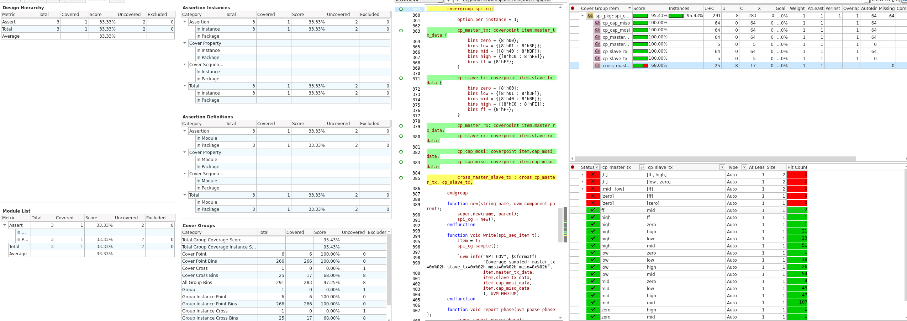

발표 캡처는 400회 실행 시점의 결과입니다. 개별 Data Coverpoint는 도달했지만 Master TX와 Slave TX의 특정 조합은 남아 있어, Cross Bin을 확인하고 해당 조합을 직접 생성했습니다.

500회 반복에서의 96%와 Directed 보완 후 100%는 서로 다른 실행 단계입니다. Directed 보완 후 100%는 개발일지·완료보고서에 남긴 별도 실행 결과입니다.

| WR 반복 횟수 | 발표자료의 Functional Coverage |
| --- | --- |
| 100 | 79.82% |
| 200 | 89.64% |
| 300 | 92.00% |
| 400 | 95.43% |
| 500 | 96.00% |
| Directed 보완 | 100% — 개발일지·완료보고서 기록 |

I2C Read 경계값·동작별 Cross Coverage 보완

Write/Read 동작, 동작별 Data 구간, 단일 Slave 주소를 수집했습니다. Write·Read Data에는 4개 구간과 `0x00`, `0xFF` 경계값 Bin을 정의하고, 동작 종류와 Data 구간의 Cross Coverage를 구성했습니다.

- **I2C Coverage 캡처 — 100회 실행의 94.44%와 Read zero 미도달**

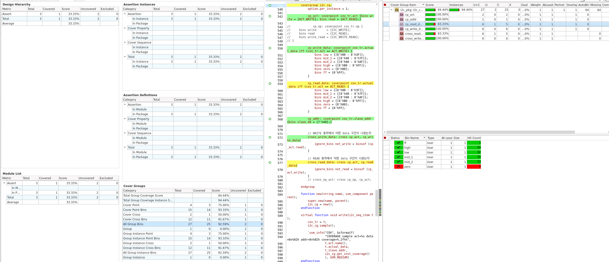

100회 실행에서 Read Data의 0 경계값과 연결된 Cross Bin이 남은 것을 확인했습니다. 해당 값을 만드는 Directed Sequence로 보완한 과정을 개발일지에 기록했습니다.

| WR 반복 횟수 | 발표자료의 Functional Coverage |
| --- | --- |
| 10 | 80.00% |
| 100 | 94.44% |
| 200 | 100.00% |

여기서 100%는 **정의한 Covergroup의 Bin을 충족했다는 의미**입니다. 주소는 `7'h40` 하나로 수집했으며, 모든 Slave 주소나 I2C 전체 사양의 검증 완료를 의미하지 않습니다.

Scoreboard PASS 로그와 실행별 결과 구분

- **SPI 기본 실행 로그 — TOTAL 106·PASS 106·FAIL 0**

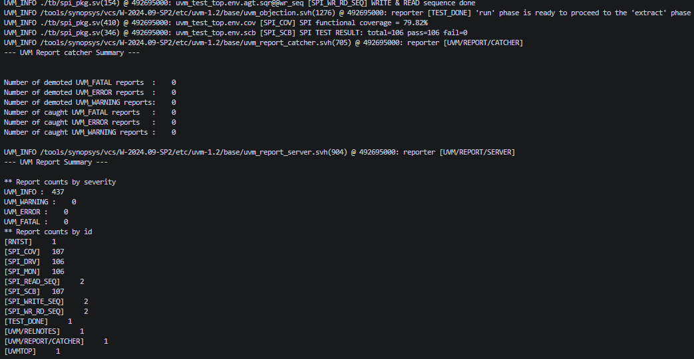

이 로그의 Functional Coverage는 79.82%입니다. Write 3건·Read 3건과 WR 100회가 포함된 기본 실행 결과이며, WR 500회 또는 Directed 보완 실행과 구분합니다.

- **I2C 기본 실행 로그 — TOTAL 206·PASS 206·FAIL 0**

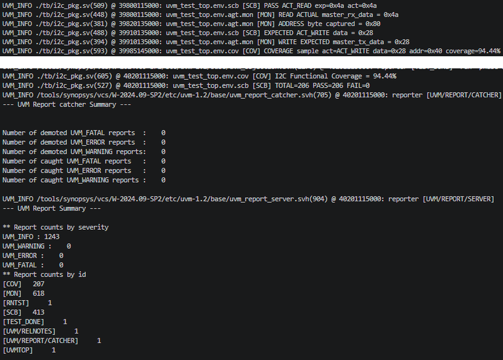

이 로그의 Functional Coverage는 94.44%입니다. Write 3건·Read 3건과 WR 100회의 Write/Read 각 1건을 합친 **206개 동작 비교** 결과입니다. WR 200회·Coverage 100%와는 별도 실행입니다.

- **기존 Functional Coverage 요약 자료**

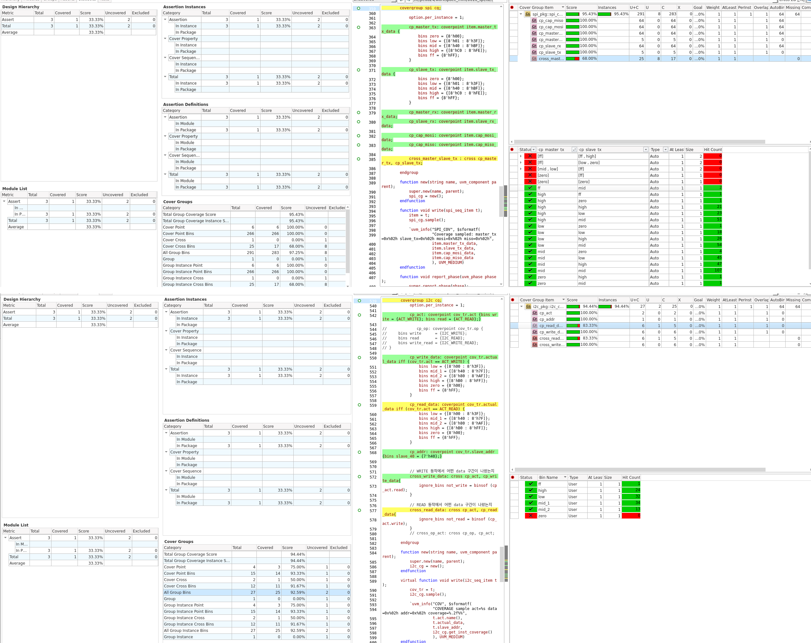

PASS 건수는 Scoreboard의 비교 단위, Coverage는 정의한 기능 Bin의 도달 정도입니다. 각 로그의 실행 조건에 맞춰 두 결과를 함께 해석합니다.

## 문제 해결

- **현상:** MISO가 `0x80`으로 반복 수집, Scoreboard FAIL
- **원인·조치:** Slave 선택 해제·전송 종료 조건 분석, `ss_n` 상승 에지 처리 추가
- **확인 구분:** Monitor Capture 시점 점검과 DUT 종료 처리 수정

SPI SS\_n 종료 처리 누락 — 원인·RTL 수정·결과

| 단계 | 내용 |
| --- | --- |
| 증상 | MISO 재구성 값이 8'b1000\_0000으로 반복되어 Scoreboard FAIL |
| 원인 | Slave가 SS\_n 해제 시점을 제대로 처리하지 못해 전송 종료 후 상태·송신 제어가 정리되지 않음 |
| 수정 | SPI Slave RTL의 SS\_n 상승 에지와 선택·해제 조건 처리 보완 |
| 확인 | MISO 데이터 전달과 Scoreboard 비교를 다시 확인하고 정상 송수신 로그 확보 |

- **SPI 오류 로그와 SS\_n 이벤트 처리 수정 지점**

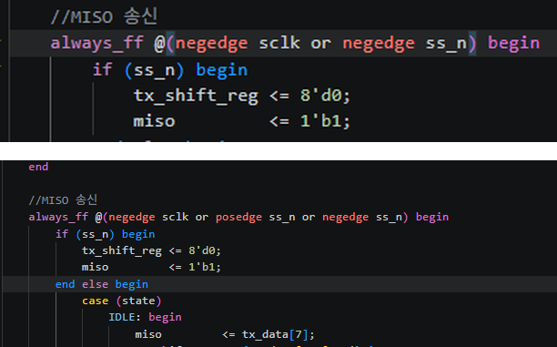

최종 첨부 RTL의 MOSI 수신부는 `posedge sclk or posedge ss_n`, MISO 송신부는 `negedge sclk or posedge ss_n or negedge ss_n` 이벤트를 사용합니다. 선택 시 첫 Bit 준비, SCLK에 따른 Shift, 해제 시 초기화의 역할을 구분했습니다.

## FPGA 실물 검증

- **보드:** Master Stopwatch/FND와 Slave FND 표시 값 비교
- **계측:** Logic Analyzer로 SPI·I2C 전송 데이터·프로토콜 순서 확인
- **시연:** 실제 표시 동작과 직렬 파형을 함께 대조

**SPI Master–Slave FND 시연 영상**

[시연 영상 — Notion](https://app.notion.com/p/3d423ec941b781efae15feac9005b06a#335aa65b69bd40a48cc0aee869a33e3f)

Master·Slave FND 표시를 통한 SPI 데이터 전달 확인

**I2C Master–Slave FND 시연 영상**

[시연 영상 — Notion](https://app.notion.com/p/3d423ec941b781efae15feac9005b06a#2765c81946d24e039f58ebc7206e17e3)

Master·Slave FND 표시를 통한 I2C 데이터 전달 확인

FPGA 연결 사진·Logic Analyzer 파형과 측정 값

- **SPI 실물 연결과 Logic Analyzer — 전송 데이터 84**

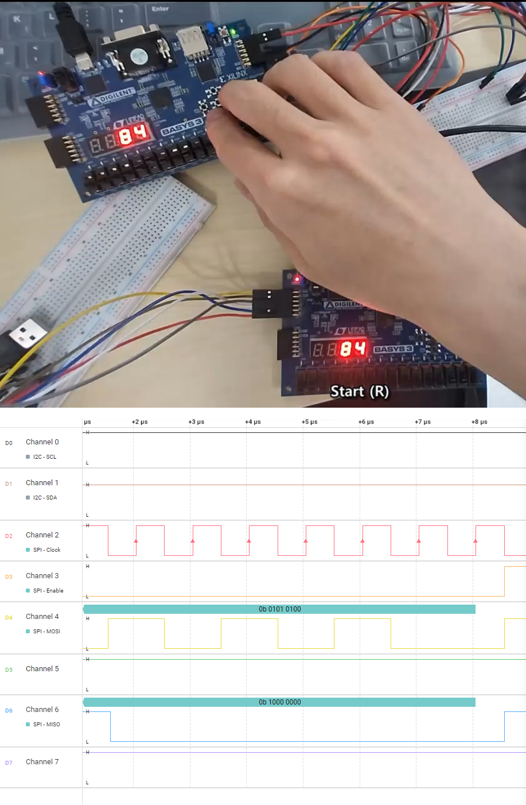

실물 시연의 FND 값과 직렬 버스에서 측정한 값을 대응시켰습니다. SCLK Sampling과 MOSI·MISO, Slave Select 구간을 함께 관찰했습니다.

- **I2C 실물 연결과 Logic Analyzer — 주소 55·Data 14**

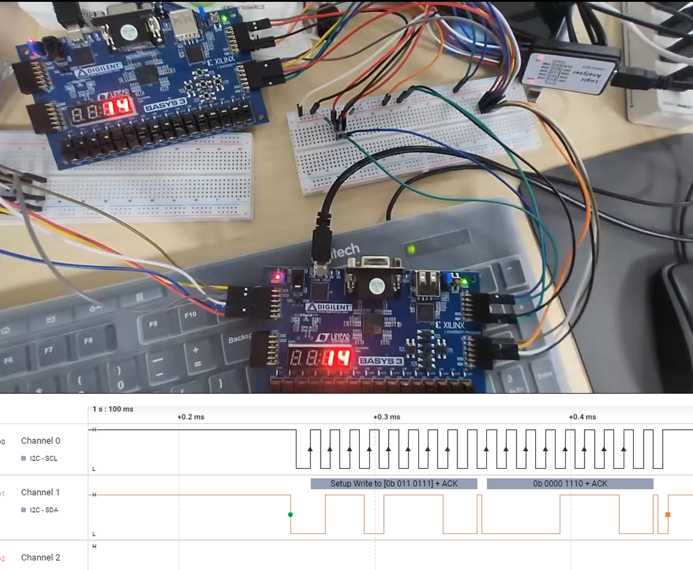

이 실물 예시는 **7비트 주소 55와 Data 14**를 사용합니다. UVM Loopback의 주소 `7'h40`과는 별도의 설정이며, 7비트 주소·R/W Bit로 구성된 첫 Byte와 뒤따르는 Data Byte를 구분해 확인했습니다.

검증 범위

- **SPI:** Mode 0·단일 Slave·8비트 송수신, 데이터 4개 관계 자동 비교
- **I2C:** 단일 주소 Master–Slave의 Write·Read·Write&Read, 동작 종류·송수신 Data 자동 비교
- **프로토콜:** Address·ACK/NACK·START/STOP은 파형 확인, 해당 항목의 Scoreboard·SVA 판정은 미적용
- **실물:** FND 표시와 Logic Analyzer로 대표 통신 동작 확인

## 관련 링크

- [SPI RTL·UVM](https://github.com/Min-star-prog/ondeviceai/tree/main/linux/0616_spi)
- [I2C RTL·UVM](https://github.com/Min-star-prog/ondeviceai/tree/main/linux/0616_i2c)

[← 전체 프로젝트](../README.md#프로젝트)

