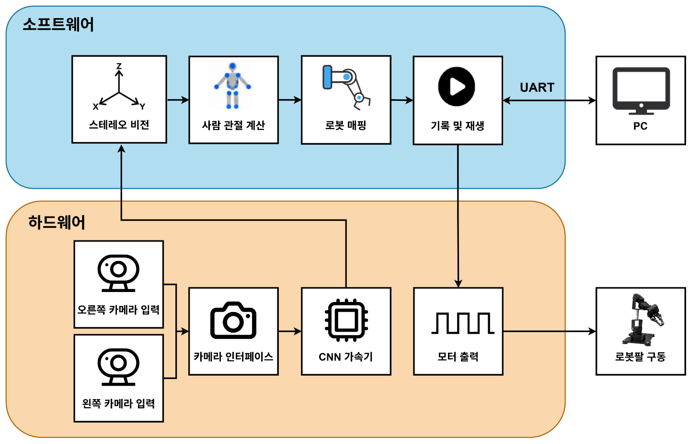

# 스테레오 비전 기반 3D 동작 추종 로봇팔

[전체 프로젝트](../README.md#프로젝트) · [노션 상세·시연 자료](https://app.notion.com/3f723ec941b7816881c9fe81751f1529)

> 실물 로봇팔의 스테레오 추종·동작 녹화·재생 확인

| 구분 | 내용 |
| --- | --- |
| 기술 분야 | 임베디드 제어 |
| 수행 기관 | 대한상공회의소 온디바이스AI 시스템반도체 설계교육 |
| 수행 형태 | 팀 |
| 담당 역할 | 스테레오 3D 좌표·사람 팔 각도 계산, UART 설계·시스템 통합 |
| 구성·범위 | 대한상공회의소 · 7인 팀 프로젝트 (CNN 4명 / Robot 3명) |

## 프로젝트 개요

사람의 팔 움직임을 로봇의 제어 명령과 동작 데이터로 만드는 CNN 모션 인식 SoC 플랫폼 프로젝트입니다. 좌우 카메라의 관측으로 3D 좌표를 복원하고, 전완·손목·손가락의 움직임을 로봇팔의 5개 제어 채널로 변환했습니다.
전체 시스템은 CNN 관절 인식, 스테레오 좌표 생성, 사람 목표값 계산, 로봇 보정·출력, 녹화·재생, Unity 가상환경으로 구성했습니다. 저는 로봇팀에서 스테레오 좌표 생성과 사람 각도 계산을 맡고 UART 및 모듈 간 통합을 수행했습니다.

## 담당 역할

| 담당 부분 | 구현 내용 |
| --- | --- |
| 스테레오 3D 좌표 생성 | 좌우 영상의 대응 관절·마커 좌표로 시차를 계산하고, 카메라 기준의 3D 위치로 복원 |
| 사람 팔 각도 계산 | 팔꿈치·손목·엄지·검지 좌표로 전완·손목·그리퍼 목표값을 계산하고 좌표축·부호·각도 연속성을 정리 |
| UART 설계 | 좌표·제어 명령·상태 응답의 송수신 프레임을 처리하고 PC와 좌우 보드의 통신 경로를 연결 |
| 시스템 통합 | CNN 입력, 사람 목표값, 로봇 보정, PWM 출력, 녹화·재생 모듈의 데이터 형식과 실행 주기를 맞춰 연동 |

## 시스템 구조와 개발 환경

팀의 CNN 가속기가 추정한 17개 관절 중 상체의 6개 관절 좌표와 컬러 마커의 손 위치를 Motion Data로 사용했습니다. 로봇 제어 소프트웨어는 Main Control 아래에 Pose Mapping, Motion Control, Record/Replay, Servo Control을 두고 UART·Timer·PWM Driver와 HAL을 통해 하드웨어에 연결했습니다.

**사용 환경:** Zybo Z7-20 / Zynq-7020 ARM Cortex-A9, Pcam 5C, MG996R·Yahboom 서보, C·Python, Vitis. CNN IP·AXI Timer·PWM IP와 Unity 테스트 환경을 연동했습니다.

## 스테레오 비전 기반 3D 좌표 생성

1. 좌우 영상에서 같은 관절·마커의 대응점을 찾고 수평 픽셀 시차 `d = xL - xR`를 계산했습니다.
2. 카메라 보정 정보와 초점거리 f, 카메라 간 거리 B로 깊이 Z를 구한 뒤 X·Y 위치를 복원했습니다.
3. 3D 입력은 왼쪽 카메라 원점 기준 mm 단위로 유지하고, 좌표의 유효성·양의 깊이·프레임 대응을 확인해 각도 계산 단계로 전달했습니다.

보정된 스테레오 영상에서 사용하는 기본 깊이 관계는 다음과 같습니다. f와 d는 픽셀 단위, B와 Z는 같은 거리 단위입니다.

$$
Z \simeq \frac{f B}{d}
$$

## 사람 팔·손목·그리퍼 목표값 계산

팔꿈치 E와 손목 W의 3D 위치로 전완 벡터를 구했습니다. 각도 기준은 사람의 오른쪽·위쪽·전방에 맞추고, 마주 보는 카메라 배치에 맞춰 카메라 기준 X·Z 부호를 반전했습니다. Elbow Roll/Pitch는 이 전완 벡터의 방위각과 고도각을 나타냅니다.

$$
\mathbf{f}_{camera} = \mathbf{W} - \mathbf{E}, \qquad
\mathbf{f}_{person} = (-f_x,\ f_y,\ -f_z)
$$

$$
\begin{aligned}
\theta_{roll} &= \frac{180}{\pi}\mathrm{atan2}(f_{person,x}, f_{person,z}) \\
\theta_{pitch} &= \frac{180}{\pi}\mathrm{atan2}(f_{person,y}, \sqrt{f_{person,x}^{2}+f_{person,z}^{2}})
\end{aligned}
$$

손목 목표값은 전완과 손의 방향, 엄지·검지 마커가 만드는 손 평면을 이용했습니다. 그리퍼 개방은 한 영상 안의 손가락 간격과 손 크기 비율로 계산해 좌우 픽셀을 섞지 않도록 처리했습니다.

| 목표값 | 계산 기준 | 해석 |
| --- | --- | --- |
| Elbow Roll | 팔꿈치→손목 전완 벡터의 수평 방향 | 사람 전방을 0°로 두고 좌우 방향을 방위각으로 표현 |
| Elbow Pitch | 전완의 수평면 대비 고도 | 수평 0°, 위쪽 양수, 아래쪽 음수 |
| Wrist Pitch | 전완과 손 방향 사이의 굽힘 | 엄지→검지 축을 기준으로 굽힘 부호 결정 |
| Wrist Roll | 전완 축을 중심으로 한 손 평면의 회전 | 기준 자세에서 손목의 축회전 계산 |
| Gripper | 엄지·검지 마커 간격과 손 크기의 비율 | 개방 목표를 0(닫힘)~1(열림) 범위로 표현 |

### 입력 안정화와 예외 처리

- 관절 좌표와 각도의 흔들림을 EMA·칼만 필터로 완화했습니다.
- ±180° 경계에서는 각도 unwrap을 적용하고 급격한 변화와 미세 변화를 처리했습니다.
- 수직 자세처럼 전완의 수평 방향을 관측하기 어려운 구간에서는 이전에 관측한 방위각을 유지했습니다.
- 손가락 검출 누락이나 손 평면 퇴화 시에는 전완 목표를 갱신하면서 마지막 손목 목표를 유지했습니다.
- 중복 프레임을 다시 필터링하지 않고, 팔꿈치·손목 검출 실패에는 0.35초 HOLD 후 invalid 처리 정책을 적용했습니다.

## UART 설계와 시스템 통합

| 통신 경로 | 데이터와 설정 |
| --- | --- |
| 보드 간 PS UART0 | 스테레오 관측·제어 데이터 전달 · 기본 115200 baud, 8N1 |
| PC/USB 콘솔·PS UART1 | 제어 명령과 상태 응답 · 일반 빌드 115200 baud, TRACE 빌드 921600 baud |
| 동작 명령·응답 | `R` 녹화 준비·종료 요청, `P` 목록·재생 정지, `V` 상태 조회 · `[REC_STATE]`의 ui/mode/pwm으로 상태 확인 |

수신 바이트를 버퍼에 누적해 완성된 프레임·응답 줄을 해석하고, 좌표 데이터와 명령·상태 응답을 연결했습니다. 녹화 요청과 실제 녹화 시작을 구분해 보드 응답의 ui/mode/pwm을 호스트에 전달하고, 각 모듈의 좌표 단위·각도 기준·valid 상태를 맞췄습니다.

**주기 분리:** 영상·관절 데이터가 도착하는 프레임 경로에서는 목표값을 갱신하고, AXI Timer의 20 ms 제어 Tick에서는 목표 추종·출력·동작 기록을 진행하도록 통합했습니다.

### 로봇 보정·출력·녹화 경로

| 연결 단계 | 시스템 동작 |
| --- | --- |
| 사람 목표값 → 로봇 목표값 | 각도 채널에 scale·direction·offset을 반영해 서보 장착 방향과 영점을 맞춤 |
| 보정·안전 제어 | 20 ms 주기로 목표를 추종하고, 가동범위·속도·가속도 제한과 순기구학 기반 자기충돌·테이블 충돌 검사 적용 |
| PWM 출력 | 각도·그리퍼 명령을 펄스 폭으로 변환해 AXI 레지스터를 통해 5개 서보 채널에 전달 |
| 녹화·재생 | 20 ms 간격의 제어 명령을 기록·저장하고, 선택한 동작을 시작 자세에 정렬한 뒤 반복 재생 |

## 문제 해결 — 상대 Z 기준축에 따른 회전 방향 역전

**문제 현상:** 사람이 팔을 왼쪽으로 회전했는데 로봇팔은 오른쪽으로 움직이는 현상이 나타났습니다.

**원인:** 초기 단안 방식은 양어깨로 만든 신체 기준축과 상대 Z를 사용했습니다. 몸통·어깨가 팔과 함께 회전하면 기준축도 움직이면서 팔의 상대 회전각이 축소되거나 역전됐습니다.

**수정:** 좌우 카메라의 관측으로 카메라 원점 기준 3D 좌표를 복원하고, 고정된 사람 방향 기준에서 전완 벡터의 각도를 계산하도록 바꿨습니다. 최종 스테레오 각도 경로의 어깨 검출 의존성을 제거하고 로봇의 방향·영점 보정 단계에 연결했습니다.

**결과:** 실물 로봇팔에서 스테레오 입력에 따른 동작 추종을 확인하고, 동작 녹화·저장·재생과 Unity 연동 시연까지 마무리했습니다.

## 코드·결과 자료

- [로봇팔 소스·운영 문서](https://github.com/Min-star-prog/ondeviceai/tree/main/robot_arm)
- [담당 구현·코드 읽는 순서](https://github.com/Min-star-prog/ondeviceai/blob/main/robot_arm/PORTFOLIO.md)
- [전완 목표각 계산](https://github.com/Min-star-prog/ondeviceai/blob/main/robot_arm/src/human_target_angle/forearm_mapping.c)
- [UART 계약](https://github.com/Min-star-prog/ondeviceai/blob/main/robot_arm/docs/uart_protocol_unity.md)
- [파형·상세 그림·시연 자료 — 노션](https://app.notion.com/3f723ec941b7816881c9fe81751f1529)

[← 전체 프로젝트](../README.md#프로젝트)
