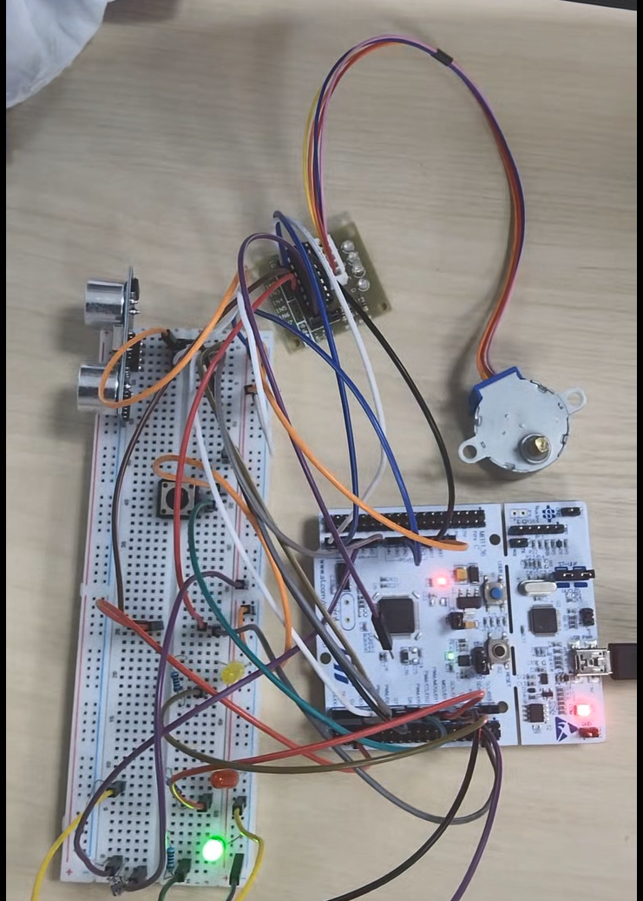

# STM32 기반 스마트 주차장 차단기 제어

[전체 프로젝트](../README.md#프로젝트) · [Notion 상세·시연](https://app.notion.com/p/3db23ec941b781ca880cec8239f21d4e)

대한상공회의소 온디바이스AI 시스템반도체 설계교육 · 개인 · 2026.07.23 – 2026.07.27

> **초음파 감지·차단기 상태 제어·야간 조명·비상 입력을 통합한 STM32 프로토타입**

## 프로젝트 개요

- **목표:** 차량 접근·이탈에 따른 차단기 자동 제어와 비상 수동 모드 구성
- **환경:** STM32F411·C·HC-SR04·조도센서·ULN2003/스테핑 모터

**실물 프로토타입**

[상세 그림 — Notion](https://app.notion.com/p/3db23ec941b781ca880cec8239f21d4e#d91b1a9a9a3142c9a8e5d334fc4b62d2)

센서·모터 구동부·상태 LED를 연결한 개인 프로젝트

실물 구성·시연·확인 결과

**스마트 주차장 실물 프로토타입**

STM32 보드에 초음파 센서·조도센서·상태 LED·ULN2003·28BYJ-48을 연결한 구성입니다.

**스마트 주차장 시연 영상**

[시연 영상 — Notion](https://app.notion.com/p/3db23ec941b781ca880cec8239f21d4e#0ead4a448aff43cc96c7376fa3b26486)

센서 입력·LED 변화·버튼 조작을 담은 실물 시연입니다. 자동 개폐는 FSM과 목표값 제어를 구현했으며, 모터 회전·전원 조건의 점검 내용은 문제 해결 항목에 정리했습니다.

| 확인 범위 | 정리한 결과 |
| --- | --- |
| 센서·표시 | 초음파 거리값과 차량 감지, 조도 변화와 야간 LED 확인 |
| 수동 입력 | PC13 비상 요청과 모드·LED 연동 점검 |
| 통합 제어 | 자동/수동 FSM, 모터 현재·목표값, UART 이벤트 연결 |

## 담당 역할

- 수업 제공 클록·UART·시작 코드 기반에 센서·모터·응용 FSM 추가
- 기능 정의·핀 배치, 센서 입력·차단기 FSM·모터 제어 구현
- GPIO·Timer·ADC·EXTI·UART 연동, 디버깅·실물 점검

## 시스템 구조·입출력

**센서 입력부터 모터·LED 출력까지의 구조**

[상세 그림 — Notion](https://app.notion.com/p/3db23ec941b781ca880cec8239f21d4e#ed04a86a66c34dcca835eb8e04df70ab)

거리·조도·비상 버튼 입력 → STM32 상태 판단 → 모터 목표값·LED 제어

시스템 구조·핀 배치

**시스템 전체 Block Diagram**

초음파·조도·비상 버튼을 입력으로 받아 STM32에서 상태를 판단하고, 스테핑 모터와 LED를 제어합니다.

| 기능 | 핀·주변장치 |
| --- | --- |
| 비상 버튼 | PC13 · Pull-up · Falling Edge EXTI13 |
| 차량 센서 | HC-SR04 · TRIG PA8 / ECHO PA0 · TIM2 |
| 조도 센서 | PA4 · ADC1\_IN4 |
| 상태·야간 LED | PA5 초록 / PA6 노랑 / PA7 빨강 |
| 모터 드라이버 | ULN2003 IN1\~IN4 → PC0·PC1·PC4·PC5 |
| 디버깅 통신 | USART2 · 115200 baud |

센서와 출력 장치의 핀을 먼저 정리하고, LED·버튼·초음파·ADC를 개별 점검한 뒤 모터와 상태 머신에 연결했습니다.

## 차량 감지·차단기 상태 제어

- **거리 판정:** 감지 25 cm·해제 32 cm, 마지막 감지 후 500 ms 유지
- **상태 제어:** 자동 4개 상태와 MANUAL 분리, 폐쇄 중 재감지 시 개방 전환

**차단기 상태 전이**

[상세 그림 — Notion](https://app.notion.com/p/3db23ec941b781ca880cec8239f21d4e#a423d2580a934e2dbd728245bf6fabc2)

차량 감지·모터 목표 도달·이탈 유지 시간을 조건으로 상태 전환

HC-SR04 거리 측정·차량 감지

**HC-SR04 거리 측정 절차**

[상세 그림 — Notion](https://app.notion.com/p/3db23ec941b781ca880cec8239f21d4e#6ec41fa5bc5a49d3893a9b1b08e437b6)

TIM2를 1 MHz Free-running Timer로 구성해 Echo 펄스 폭을 µs 단위로 측정합니다.

- TRIG를 LOW 2 µs → HIGH 10 µs → LOW로 출력한 뒤 Echo의 상승과 하강을 기다립니다.
- 거리값은 코드의 (pulse\_us + 29) / 58 계산으로 cm 단위로 환산합니다.
- Echo 상승 대기와 HIGH 유지 구간에 각각 30 ms Timeout을 두며, Timeout이면 -1을 반환합니다.
- 초음파 측정은 메인 루프에서 약 60 ms 주기로 요청합니다.

| 조건 | 차량 감지값 처리 |
| --- | --- |
| 미감지 상태에서 거리 ≤ 25 cm | 감지 상태로 전환 |
| 감지 상태에서 거리 > 32 cm | 미감지 상태로 전환 |
| 25 cm \< 거리 ≤ 32 cm | 직전 감지 상태 유지 |
| 측정 Timeout / 유효하지 않은 값 | 현재 코드에서는 미감지로 처리 |

거리 경계에서 값이 오갈 때 감지 상태가 반복 전환되지 않도록 감지·해제 기준을 분리했습니다. 모터 구동은 비동기로 처리하지만, Echo 측정 함수 자체는 Timeout이 있는 Polling 방식입니다.

자동 차단기 FSM·재감지 처리

**감지 범위:** 초음파 센서 1개로 접근·감지 영역 이탈 판단. 입출차 방향·주차 대수는 미구분.

**Parking Gate State Machine**

차량 감지, 모터 이동 완료, 마지막 감지 시각을 조건으로 자동 상태를 전환합니다.

| 상태 | 전환 조건과 동작 |
| --- | --- |
| IDLE\_CLOSED | 차량 감지 시 모터 개방 요청 → OPENING |
| OPENING | 목표 위치에 도달하면 → PASSING |
| PASSING | 감지 중 마지막 감지 시각 갱신. 미감지이고 마지막 감지 후 500 ms가 지나면 폐쇄 요청 → CLOSING |
| CLOSING | 차량 재감지 시 개방 요청 → OPENING. 닫힘 완료 시 → IDLE\_CLOSED |
| MANUAL | 자동 판단을 중지하고 버튼 개폐 요청 처리. 수동 닫힘 완료 후 자동 대기 복귀 |

모터가 이동하는 상태와 이동을 마친 상태를 구분해, 개방 중·통과 중·폐쇄 중에 적용할 조건을 명확히 했습니다. 초록 LED는 자동 대기 및 닫힘 상태, 빨간 LED는 동작 중·통과 중·수동 상태를 표시합니다.

## 모터 구동·인터럽트

- **구동 분리:** TIM4 1 ms 인터럽트, 모터 Step은 2 ms 간격 갱신

28BYJ-48·ULN2003 모터 제어

**위치 기준:** Step 누적값 사용, 전원 인가 시 닫힌 상태 전제.

ULN2003의 4개 입력을 GPIO로 제어하고, 8개 Half-step 패턴을 순차 출력했습니다. 현재 위치와 목표 위치를 따로 관리해 개방·폐쇄 요청이 모터의 목표값만 바꾸도록 구성했습니다.

| 항목 | 첨부 코드 기준 |
| --- | --- |
| Half-step 패턴 | 0x1, 0x3, 0x2, 0x6, 0x4, 0xC, 0x8, 0x9 |
| 닫힘 목표 | 0 Step |
| 개방 목표 | 1024 Step · 약 90° 기준 설정값 |
| 실제 Step 갱신 간격 | 2 ms |
| 목표 도달 후 | ULN2003 출력 OFF · 코일 Hold 해제 |

개방 각도는 기구 연결과 모터 조건에 맞춰 GATE\_OPEN\_STEPS로 조정하도록 했습니다. 위치는 Step 누적값으로 관리하며, 실제 끝 위치를 읽는 센서는 사용하지 않았습니다.

TIM4 인터럽트·메인 루프 역할 분리

**TIM4 기반 비동기 모터 제어**

[상세 그림 — Notion](https://app.notion.com/p/3db23ec941b781ca880cec8239f21d4e#edd564dcb7c4498099bf76a1aabe4016)

메인 루프는 목표 위치를 지정하고, TIM4 ISR은 시간 기준과 모터 Step 갱신을 담당합니다.

- TIM4\_IRQHandler는 1 ms마다 g\_ms\_ticks를 증가시키고 StepMotor\_Timer\_Handler를 호출합니다.
- 모터 핸들러는 내부 분주값으로 2 ms마다 한 Step씩 진행합니다. **1 ms는 ISR 주기이며 실제 Step 주기와 다릅니다.**
- 메인 루프는 비상 요청 → 조도 → 자동 모드의 초음파 → 상태 판단 → LED → UART 순으로 처리합니다.
- 여러 Step을 한 번에 기다리는 모터 지연을 제거해 센서·버튼·상태 처리와 모터 이동을 분리했습니다.

| 작업 | 코드의 시간 기준 |
| --- | --- |
| TIM4 ISR | 1 ms |
| 모터 Step | 2 ms |
| 초음파 측정 요청 | 60 ms |
| 조도 샘플링 | 100 ms |
| 비상 버튼 Debounce | 200 ms |
| 차량 통과 판정 | 마지막 감지 후 500 ms |
| 주기 상태 출력 | 1000 ms |

RTOS를 사용한 병렬 태스크가 아니라, 공통 Tick을 기준으로 메인 루프의 실행 시점을 검사하는 구조입니다.

## 야간 조명·비상 수동 제어

- **야간 조명:** ADC 조도 입력과 점등·소등 히스테리시스
- **비상 입력:** PC13 버튼·MANUAL 모드, 200 ms 디바운싱

ADC 조도 측정·독립 야간 조명

ADC1\_IN4에서 조도센서 값을 읽고, 야간 여부를 차단기 상태와 별도로 관리했습니다. 차량 통과 중에도 주변이 어두우면 빨간 LED와 노란 LED가 함께 켜질 수 있습니다.

| 조건 | 노란 LED |
| --- | --- |
| ADC ≤ 800 | ON |
| 800 \< ADC \< 1000 | 직전 상태 유지 |
| ADC ≥ 1000 | OFF |

위 수치는 첨부 main.c의 DARK\_ON\_ADC=800, DARK\_OFF\_ADC=1000 기준입니다. 센서 배선·주변 조명에 따라 UART로 값을 확인하며 조정할 수 있게 상수로 분리했습니다.

**핀 충돌 해결**

기존 ADC 실습은 PA6 / ADC1\_IN6을 사용했지만, 통합 과정에서 노란 LED의 PA6과 겹쳤습니다. ADC 입력을 PA4로 옮기고 채널 선택도 ADC1\_IN4로 변경해 두 기능을 함께 사용할 수 있도록 했습니다.

PC13 비상 버튼·수동 모드

PC13을 Pull-up 입력으로 설정하고 Falling Edge에서 EXTI13을 발생시켰습니다. EXTI15\_10\_IRQHandler에서는 Pending Flag를 지우고 g\_emergency\_request만 설정합니다.

실제 모드 전환과 개폐 요청은 메인 루프의 Emergency\_Button\_Task에서 처리합니다. 마지막 유효 입력 후 200 ms 이내의 요청은 무시해 버튼 채터링으로 인한 중복 동작을 줄였습니다.

- 유효 버튼 입력 → MANUAL로 전환하고 자동 판단 중지
- 현재 목표가 개방이면 폐쇄 요청, 닫힘이면 개방 요청
- 수동으로 열린 상태는 다음 버튼 입력까지 유지
- 수동 폐쇄가 끝나면 IDLE\_CLOSED로 복귀

수동 모드에서도 조도 측정과 LED·UART 처리는 이어집니다. ISR 안에서 모터 전체 회전을 기다리지 않도록 요청 처리와 구동을 분리했습니다.

## 문제 해결·확인 결과

- **핀 충돌:** PA6의 LED·ADC 중복 사용 확인, ADC 입력을 PA4로 재배치
- **입력 안정화:** 거리·조도 히스테리시스와 버튼 200 ms 디바운싱 적용
- **실물 확인:** 센서·LED·비상 입력·UART 상태 출력 점검
- **모터 확인 범위:** FSM·목표값 제어 구현, 회전·전원 조건은 추가 점검 항목

UART 디버깅·기능별 점검

UART2를 115200 baud로 설정하고 printf 출력을 Tera Term으로 확인했습니다. 상태·거리·조도·모터 목표값을 함께 확인해 입력 문제와 상태 전이 문제를 구분했습니다.

| 출력 종류 | 확인 항목 |
| --- | --- |
| 시작 메시지 | 프로젝트 시작과 각 장치의 핀 배치 |
| 주기 상태 · 1000 ms | state, manual, distance, car, light, dark, gate 현재값/목표값 |
| AUTO 이벤트 | 차량 감지·개방 완료·통과 후 폐쇄·대기 복귀 |
| SAFETY 이벤트 | 폐쇄 중 재감지에 따른 개방 요청 |
| EMERGENCY 이벤트 | 수동 개방·폐쇄 요청과 자동 모드 복귀 |

LED → 버튼 → 초음파 → ADC 순으로 개별 기능을 확인한 뒤 모터·FSM을 통합했습니다. 최종 점검은 차량 접근·통과, 야간 조명, 비상 버튼 순으로 진행했습니다. 점검은 센서 입력과 상태 전이가 예상한 조건대로 연결되는지에 초점을 맞췄습니다.

통합 문제 해결 과정

| 문제·검토 사항 | 조치와 확인 범위 |
| --- | --- |
| ADC와 노란 LED의 PA6 핀 충돌 | ADC 입력을 PA4 / ADC1\_IN4로 재배치 |
| 여러 Step을 한 번에 구동할 때 메인 처리 지연 가능 | 목표값 설정과 TIM4의 Step 진행을 분리 |
| 순간 미감지로 통과 완료를 너무 일찍 판단 | 마지막 감지 후 500 ms 유지 조건 추가 |
| 거리·조도 경계값 부근의 상태 흔들림 | 감지·해제, 점등·소등에 서로 다른 임계값 적용 |
| 기계식 버튼의 중복 입력 | 200 ms 시간 기반 Debounce 적용 |
| 폐쇄 중 차량 재접근 | CLOSING에서 재감지 시 OPENING으로 전환 |
| 정지 중 코일의 전류 소모 | 목표 도달 후 ULN2003 출력 OFF |

**모터 회전·전원 점검**

개발일지에는 모터의 진동은 느껴지지만 육안으로 회전이 잘 보이지 않았던 기록이 있습니다. 전원 공급 여유 등을 원인 후보로 검토하고 Step 간격·목표 Step 수를 조정할 수 있도록 분리했습니다. 실제 전류 측정과 외부 전원을 통한 구동 조건 점검은 후속 과제로 정리했습니다.

## 관련 링크

- [차단기 제어 C 소스](https://github.com/Min-star-prog/ondeviceai/tree/main/%EC%9E%84%EB%B2%A0%EB%94%94%EB%93%9C%20%EC%8B%9C%EC%8A%A4%ED%85%9C/1602.project)

[← 전체 프로젝트](../README.md#프로젝트)

