# FPGA Stopwatch·Watch 통합 시간 시스템

[전체 프로젝트](../README.md#프로젝트) · [Notion 상세·시연](https://app.notion.com/p/40123ec941b78144ab92cde56827cb4d)

대한상공회의소 온디바이스AI 시스템반도체 설계교육 · 2인 팀 · 2026.04.16–2026.04.20

## 개요

- **시스템:** Stopwatch·Watch를 하나의 Basys3 FPGA와 4자리 FND로 통합
- **본인 담당:** Watch FSM·Datapath 설계, Testbench 작성·파형 분석
- **핵심 구현:** 시·분·초 선택 및 증가·감소, 100 Hz Tick과 단위별 카운터, 모드별 출력 선택
- **확인 결과:** Watch 상태 전환·시간 조정·표시 전환의 시뮬레이션 및 실물 시연
- **기술:** Verilog · Vivado · Basys3 · FSM · Testbench

**Watch 실물 동작**

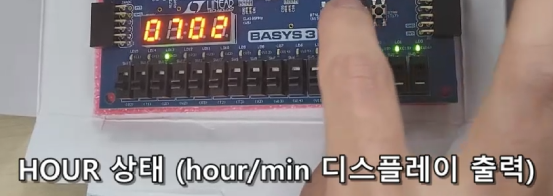

선택한 시간 단위에 버튼 입력을 반영하고, 스위치로 초·1/100초 또는 시·분 표시 전환

## 시스템 구성과 역할

- **입력:** 버튼 디바운싱, 모드 스위치에 따른 제어 입력 선택
- **처리:** Stopwatch·Watch별 Control Unit과 Datapath 분리
- **출력:** 시간 데이터 MUX와 공통 FND Controller로 표시부 공유
- **역할 분담:** 이민 — Watch 설계·검증 / 팀원 — Stopwatch 설계·검증

**Stopwatch·Watch 통합 구조**

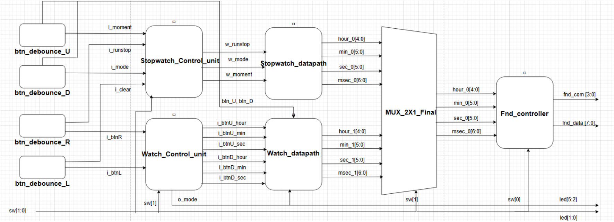

모드 선택과 공통 출력 경로

- `sw[1]=0`: Stopwatch, `sw[1]=1`: Watch 선택
- `sw[0]`: 초·1/100초와 시·분 표시 선택
- 디바운싱한 버튼 입력을 선택된 기능에 전달
- 두 Datapath의 시간 데이터를 MUX로 선택하여 하나의 FND Controller에 전달
- 팀 시스템 기능: Stopwatch Run·Stop·Clear·Up/Down·Moment Capture/Hold, Watch 시간 누적·수동 조정

## Watch 제어와 시간 카운터

- **FSM:** NORMAL·HOUR·MIN·SEC 상태, 좌우 버튼으로 조정 단위 선택
- **시간 조정:** 선택된 시·분·초 카운터에 Up/Down 입력 전달, NORMAL에서는 수동 조정 비활성
- **Datapath:** 100 MHz 시스템 클럭에서 100 Hz Tick 생성, 1/100초·초·분·시 카운터 연결

**Watch Datapath**

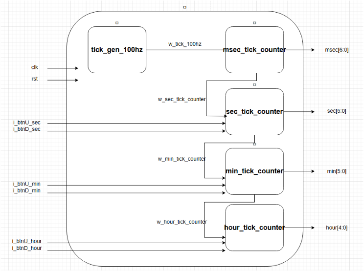

FSM과 입력 제어

**Watch Control Unit**

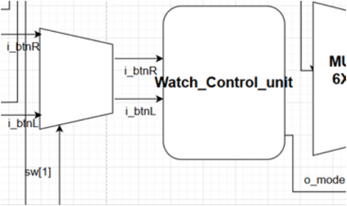

- 상태값을 `o_mode`와 LED로 출력하여 현재 조정 단위 표시
- Watch 모드에서 활성화된 좌우 버튼으로 상태 전환
- 선택 단위에만 Up/Down 입력을 전달하도록 제어부·Datapath 연결

**NORMAL 상태의 입력 처리**

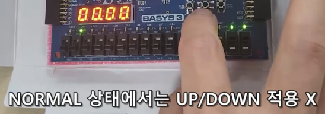

Tick·시간 단위와 버튼 디바운싱

| 구분 | 범위·구성 |
| --- | --- |
| 시스템 클럭 | 100 MHz |
| 시간 기준 Tick | 100 Hz, 10 ms 간격 |
| 1/100초 | 0–99, 7 bit |
| 초·분 | 각각 0–59, 6 bit |
| 시 | 0–23, 5 bit |

- 하위 카운터의 자리올림 신호를 상위 카운터의 Tick 입력으로 전달
- 자료·코드의 `msec` 신호는 1 ms가 아닌 **1/100초 단위**
- 버튼 입력: 샘플링·8단 Shift Register·Edge Detector로 단일 펄스 생성

**버튼 디바운싱 구조**

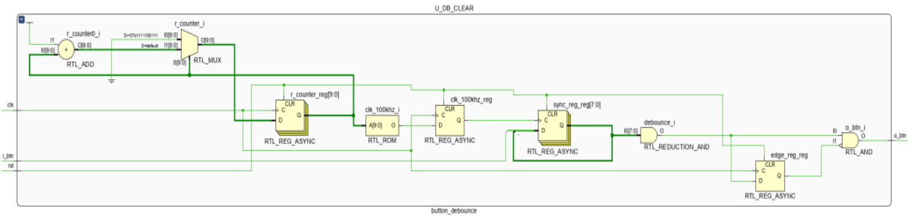

## 시뮬레이션과 FPGA 확인

- **Testbench:** 모드 선택, 좌우 상태 전환, 선택 단위의 Up/Down 입력 시나리오 구성
- **파형 확인:** Tick·상태값·카운터 변화를 대조하고 NORMAL 입력 차단 확인
- **보드 확인:** 상태 LED, 시간 조정, 표시 단위 전환을 Basys3에서 시연

**Watch 시연 영상**

[Watch 전체 시연 — 약 51초](../assets/stopwatch-watch/watch-demo.mp4)

시간 누적·조정·상태 전환 파형

**Tick과 시간 카운터**

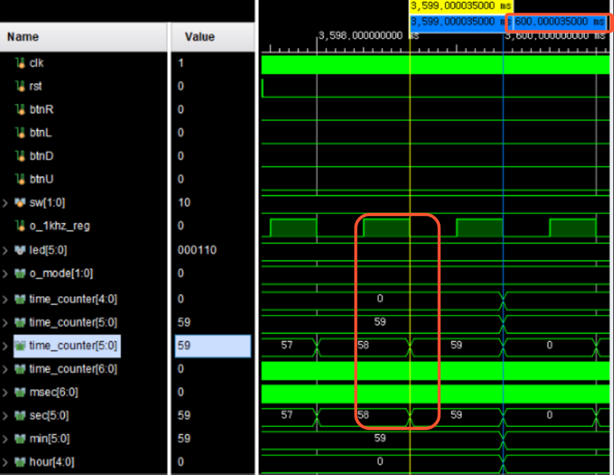

시뮬레이션 시간을 줄이기 위해 분주 카운트를 축소한 조건의 파형. 보드 시간 기준은 100 Hz Tick.

**선택 단위의 시간 조정**

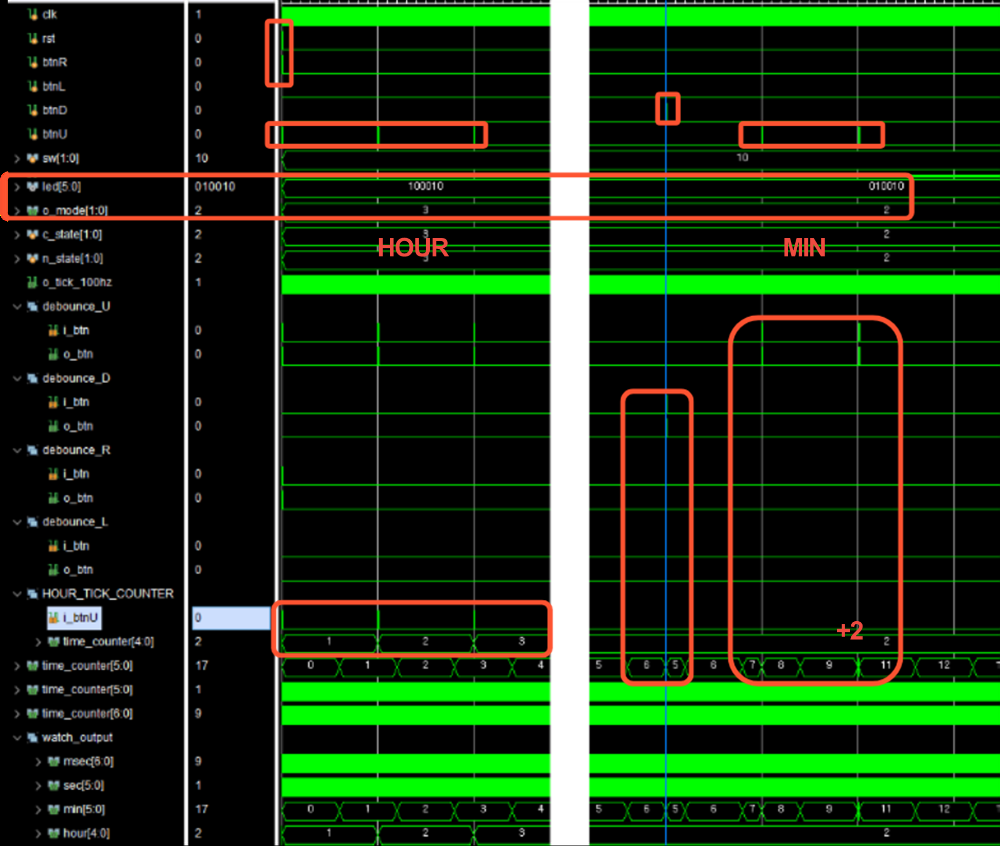

HOUR·MIN 선택 상태에서 입력 횟수와 시간값 변화 대조

**상태 전환과 NORMAL 입력 차단**

입력 간격이 좁아 일부 구간이 겹쳐 보이는 파형. 개별 이벤트는 확대하여 해석.

## 문제 해결

**Tick과 수동 증가 입력의 동시 발생 처리**

- **현상:** `i_tick`과 `i_btnU`가 동시에 들어올 때 OR 조건에서 `+1`만 반영
- **원인:** 자동 증가와 수동 증가를 하나의 참·거짓 조건으로 합친 분기
- **변경:** 두 입력이 함께 활성화된 조건을 먼저 검사하는 `+2` 분기 추가
- **개선 범위:** 일반 카운트 구간에서 두 증가 이벤트를 함께 반영

동시 입력 처리 전후와 통합 구조 정리

**변경 전 — OR 조건의 단일 증가**

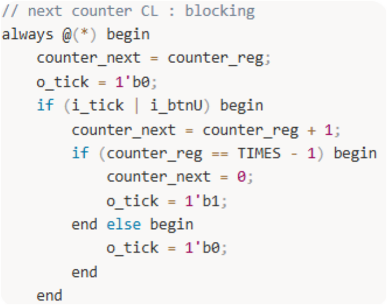

**변경 후 — 동시 활성화 조건 우선 처리**

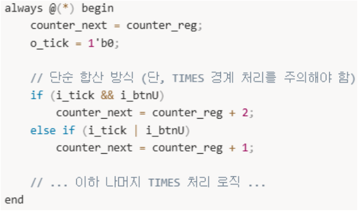

**통합 과정의 I/O 정리**

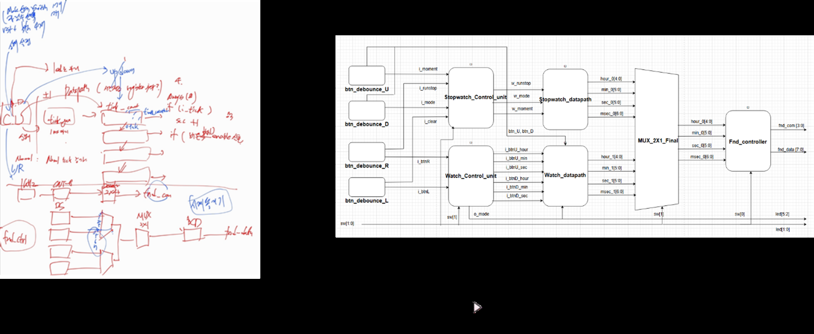

배선 수가 늘면서 흐름 파악이 어려워진 부분을 모듈별 I/O와 블록도로 정리

## 관련 링크

- [Watch RTL·Testbench·보드 제약 파일](../sources/stopwatch-watch)
- [팀 시스템 Stopwatch 시연 — 약 24초](../assets/stopwatch-watch/stopwatch-demo.mp4)
- [UART·센서까지 확장한 후속 프로젝트](uart-sensor.md)

[← 포트폴리오 첫 화면](../README.md)
