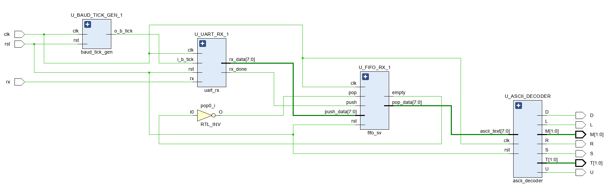
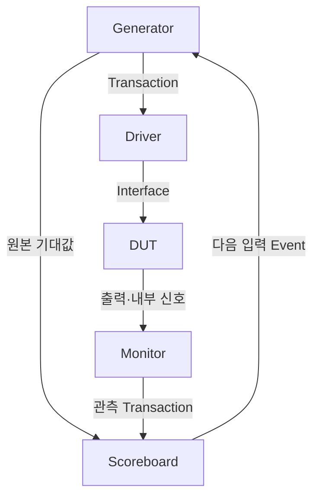

# UART·FIFO·ASCII Decoder SystemVerilog 검증

[전체 프로젝트](../README.md#프로젝트) · [Notion 상세·시연](https://app.notion.com/p/3d423ec941b781a4b293d7d2a599bd54)

대한상공회의소 온디바이스AI 시스템반도체 설계교육 · 개인 · 2026.05.12 – 2026.05.18



> **대한상공회의소 · 개인 프로젝트 · 2026.05.12\~05.18**
>
> **핵심 결과:** FIFO 유효 Pop 비교 66건 PASS · UART Loopback 및 Decoder 통합 검증 각 10건 PASS · Monitor 관측 시점 오류 수정
>
> **본인 담당:** 검증 범위·시나리오 정의, Class 기반 Testbench 구성, Reference Model·Scoreboard 구현, 파형 분석 및 디버깅

## 개요

- **목표:** UART·FIFO·ASCII Decoder의 SystemVerilog Class 기반 자동 검증
- **범위 확장:** FIFO 단위 → UART Loopback → Decoder 통합
- Generator·Driver·Monitor·Scoreboard 역할 분리
- 입력 생성·출력 수집·기대값 비교·PASS/FAIL 자동 판정 연결

## 담당 역할

- **검증 계획:** FIFO Full/Empty·Random Push/Pop, UART RX/TX, UART·FIFO·Decoder의 단계별 시나리오 구성
- **Testbench 구현:** Transaction, Interface, Generator, Driver, Monitor, Scoreboard, Environment 작성 및 Mailbox·Event 연결
- **자동 비교:** FIFO Queue 기반 Reference Model, UART 원본 바이트 비교, Decoder 명령별 기대 출력·상태 모델 구현
- **문제 해결:** 원본 데이터 전달용 Mailbox 추가, DUT 갱신 순서에 맞춘 Monitor Sampling 조정

**사용 기술:** SystemVerilog Class·Randomization·Constraint·Mailbox·Event·Virtual Interface, Vivado Simulator

## 검증 환경과 범위

- **단계:** FIFO → UART RX/TX Loopback → UART·FIFO → UART RX·FIFO·Decoder
- **확인 방식:** 단계별 관측 신호·기대값 정의, 내부 파형과 Scoreboard 결과 대조

**UART·FIFO·ASCII Decoder 검증 대상과 데이터 경로**

[상세 그림 — Notion](https://app.notion.com/p/3d423ec941b781a4b293d7d2a599bd54#4e93211d3c084c03bb7dda253476a381)

FIFO 단위 검증에서 UART 직렬 입출력·ASCII 명령 판정으로 확장하는 경로

<details>
<summary>Class 기반 검증 환경 — 데이터 생성·구동·관측·비교</summary>

Generator에서 만든 Transaction을 Driver와 Scoreboard로 전달하고, Monitor가 관측한 결과를 별도의 Mailbox로 전달했습니다. Scoreboard가 비교를 마치면 Event로 다음 입력 생성을 허용했습니다.

| 구성 | 구현 내용 |
| --- | --- |
| Transaction | Random 입력과 DUT 관측값을 하나의 객체로 구성 |
| Generator | FIFO Push/Pop·데이터 또는 UART 바이트 생성. Decoder 검증은 7개 유효 명령으로 제한 |
| Driver | FIFO 제어 입력 인가, UART Start·8 Data·Stop 프레임 생성 |
| Monitor | FIFO 상태·출력, UART 수신값·직렬 TX, Decoder 출력을 각 동작 시점에 수집 |
| Scoreboard | Queue 또는 원본 Transaction으로 기대값을 만들고 관측 결과와 비교 |
| Environment | 객체·Mailbox·Event 생성과 연결, Reset 및 병렬 실행, 결과 집계 |



Class별 역할과 Mailbox·Event의 연결을 직접 구성하며, 입력 생성과 관측·판정을 분리한 검증 흐름을 구현했습니다.

</details>

<details>
<summary>검증 시나리오와 단계별 비교 기준</summary>

| 검증 대상 | 입력·시나리오 | 판정 기준 |
| --- | --- | --- |
| FIFO | Push Only 16회, Pop Only 16회, Random Push/Pop·데이터 100회 | Reset 상태, Full/Empty 전이, Queue 모델과 Pop 데이터 순서 비교 |
| UART Loopback | 대문자 A\~Z 범위의 Random 바이트 10개 | Generator 원본 = RX 수신값 = 직렬 TX에서 복원한 바이트 |
| UART·FIFO | UART RX에서 RX FIFO·TX FIFO를 거쳐 UART TX로 전달 | 통합 경로 파형과 원본·RX·TX 복원값 비교 구조 확인 |
| UART·FIFO·Decoder | R/L/U/D/M/T/S 중 Random 명령 10개 | 원본·RX·FIFO 출력 일치 및 R/L/U/D/S 출력, M/T 상태의 기대값 비교 |

- **UART·FIFO·ASCII Decoder 통합 Schematic**

[상세 그림 — Notion](https://app.notion.com/p/3d423ec941b781a4b293d7d2a599bd54#22210827f11d41f5b1618e481456626c)

UART·FIFO Loopback과 UART·FIFO·Decoder는 서로 다른 DUT 구성입니다. TX 복원값 비교와 Decoder 출력 비교를 각각의 검증 경로에 맞춰 수행했습니다.

</details>

## FIFO 단위 검증

- **시나리오:** Push Only/Full·Pop Only/Empty·Random Push/Pop
- **Reference Model:** Queue로 유효 데이터의 저장·출력 순서 비교
- **원본 로그:** Total 137 / PASS 66 / FAIL 0
- **집계 기준:** Total은 Monitor 관측 건수, PASS는 유효 Pop 데이터 비교 통과 횟수

<details>
<summary>FIFO 시나리오 — Reset·Full·Empty·Random Push/Pop</summary>

- **Reset:** 초기화 후 `empty=1`, `full=0`을 Immediate Assertion으로 확인했습니다.
- **Push Only:** Pop 없이 16개 데이터를 입력하고 Write Pointer 이동과 Full 활성화를 확인했습니다.
- **Pop Only:** 저장한 데이터를 순서대로 꺼내고 Read Pointer 이동과 Empty 활성화를 확인했습니다.
- **Random Test:** Push·Pop·8비트 데이터를 100회 Random으로 생성해 데이터 출력 순서를 비교했습니다.
- **FIFO Push Only 파형 — 16회 입력 후 Full 활성화**

[상세 그림 — Notion](https://app.notion.com/p/3d423ec941b781a4b293d7d2a599bd54#ffcef65a6039429493712b17726fc988)

Write Pointer의 순환과 Full 전이, Console의 Push Only 통과 결과를 함께 확인했습니다.

- **FIFO Pop Only 파형 — 저장 순서와 Empty 전이**

[상세 그림 — Notion](https://app.notion.com/p/3d423ec941b781a4b293d7d2a599bd54#050e06554bc54d01bd41470d048cb775)

저장된 바이트가 입력 순서대로 출력되고 Read Pointer가 Write Pointer에 도달하면 Empty가 활성화되는 것을 확인했습니다.

- **FIFO Random Push/Pop 파형 — Queue 모델과 데이터 비교**

[상세 그림 — Notion](https://app.notion.com/p/3d423ec941b781a4b293d7d2a599bd54#24158b26fad04dfa8edf587028961269)

Random 제어 입력에서 Pop 데이터와 Reference Model의 기대값을 비교했습니다. 아래 결과 로그에서 유효 비교 건수와 최종 집계를 확인할 수 있습니다.

- **FIFO Push/Pop 동작 파형**

[상세 그림 — Notion](https://app.notion.com/p/3d423ec941b781a4b293d7d2a599bd54#f63b0bf56a1645ad874e50e7d4ddf1b1)

</details>

<details>
<summary>FIFO Scoreboard — Queue Reference Model과 집계 기준</summary>

Scoreboard는 `push && !full`일 때 입력 데이터를 Queue에 저장하고, `pop && !empty`일 때 먼저 들어온 값을 꺼내 DUT의 `pop_data`와 비교합니다.

```verilog
if (tr.push && !tr.full)
    fifo_queue.push_front(tr.push_data);
if (tr.pop && !tr.empty) begin
    compare_data = fifo_queue.pop_back();
    if (tr.pop_data == compare_data) pass_cnt++;
    else fail_cnt++;
end
```

FIFO Monitor는 Clock의 하강 엣지에서 입력·출력·상태를 수집했습니다. `total_cnt`는 Transaction을 수신할 때마다 증가하고, `pass_cnt/fail_cnt`는 유효한 Pop 비교에서만 증가하므로 두 집계의 합이 같을 필요는 없습니다.

- **FIFO Scoreboard 결과 — Total 137 / PASS 66 / FAIL 0**

[상세 그림 — Notion](https://app.notion.com/p/3d423ec941b781a4b293d7d2a599bd54#10ba508aacf44e30a25a1d01d3f9405e)

Total은 관측 건수, PASS는 유효한 Pop 데이터 비교 횟수입니다. 화면의 Queue 삽입·출력 코드와 함께 집계 기준을 표시했습니다.

원본 로그의 66건 PASS는 Directed Test와 Random Test를 이어서 실행한 결과입니다. Random 입력 100회 전체가 각각 데이터 비교 1건에 대응한다고 해석하지 않았습니다.

</details>

## UART 송수신과 FIFO 연동 검증

- **Driver:** UART 입력 프레임 생성
- **Monitor:** TX 직렬 출력을 비트 중앙에서 Sampling, 바이트 복원
- **비교:** UART 내부 병렬 값과 실제 직렬 출력의 원본 데이터 일치 확인
- **조건·결과:** 9600 bps·8N1·LSB First, 원본·RX·TX 비교 10건 PASS·FAIL 0

<details>
<summary>UART RX/TX — 16배 Baud Tick과 비트 중앙 Sampling</summary>

Driver의 `send_uart_byte()`는 Start(0), 8비트 데이터, Stop(1)을 순서대로 입력하고, 1비트마다 `b_tick` 16회를 기다립니다. 데이터는 `send_data[0]`부터 전송합니다.

Monitor는 TX의 하강 엣지로 Start를 찾은 뒤 Tick 8회로 Start 중앙까지 이동하고, 이후 Tick 16회 간격으로 데이터 8비트를 읽습니다.

```verilog
@(negedge uart_vif.tx);
repeat (8) @(posedge uart_vif.b_tick);
for (int i = 0; i < 8; i++) begin
    repeat (16) @(posedge uart_vif.b_tick);
    data[i] = uart_vif.tx;
end
```

- **UART RX 파형 — LSB First 수신과 0x4C 복원**

[상세 그림 — Notion](https://app.notion.com/p/3d423ec941b781a4b293d7d2a599bd54#f60f4615a13f4cc7b970933528e80d8a)

Start 이후 데이터 비트가 Shift Register에 반영되고 rx\_done 시점에 병렬 바이트가 완성되는 것을 확인했습니다.

- **UART TX 파형 — 0x4C의 직렬 전송**

[상세 그림 — Notion](https://app.notion.com/p/3d423ec941b781a4b293d7d2a599bd54#e20447466b914a738e08e323602c36eb)

TX 데이터가 Start·Data·Stop 순서로 나가며, 비트 중앙에서 재구성한 바이트가 원본과 일치하는지 비교했습니다.

원본 파형에서는 수신된 `0x4C = 0100 1100`이 직렬 TX에서도 같은 바이트로 전달되는지 확인했습니다. 병렬 값의 비트 표기와 시간 순서에 따른 LSB First 전송을 구분했습니다.

위 코드는 원본 Monitor의 Sampling 흐름을 설명하기 위해 Interface 이름을 줄여 정리한 예시입니다.

</details>

<details>
<summary>UART·FIFO 통합 — RX FIFO·TX FIFO 경로와 데이터 전달</summary>

UART 수신 완료 데이터를 RX FIFO에 저장하고, RX FIFO 출력이 TX FIFO를 거쳐 UART TX로 전달되는 경로를 연결했습니다.

- **UART·FIFO 통합 검증 파형**

[상세 그림 — Notion](https://app.notion.com/p/3d423ec941b781a4b293d7d2a599bd54#2abe515bd045456795267ed7ca55b98f)

파형에서는 RX 수신 완료·FIFO Push/Pop·TX 시작 신호를 시간 순서로 확인했습니다. Testbench는 Generator 원본, `rx_data`, TX 직렬 복원값을 비교하며, FIFO 경로의 내부 신호는 파형으로 대조했습니다.

- **UART·FIFO 데이터 전달 파형 — RX FIFO에서 UART TX까지**

[상세 그림 — Notion](https://app.notion.com/p/3d423ec941b781a4b293d7d2a599bd54#318fff6254aa47a089a9cbd21984f800)

원본의 ①\~③ 표시로 UART RX → RX FIFO, RX FIFO → TX FIFO, TX FIFO → UART TX의 연결 시점을 구분했습니다.

UART 단독 Loopback 로그와 FIFO를 포함한 통합 경로 파형을 구분해 제시했습니다.

</details>

## UART·FIFO·ASCII Decoder 통합 검증

- **통합 경로:** UART 수신 → FIFO → ASCII 명령 출력
- **입력 모델:** 7개 유효 명령 생성
- **기대값 모델:** 명령별 출력과 M/T의 이전 상태 유지
- **결과:** 최종 로그 10건 PASS·FAIL 0
- **판정:** R/L/U/D/S 제어 출력·M/T 상태와 기대값 비교

<details>
<summary>ASCII 명령 Constraint와 상태를 유지하는 기대값 모델</summary>

| 명령 | ASCII | Scoreboard 기대값 |
| --- | --- | --- |
| R / L / U / D | 0x52 / 0x4C / 0x55 / 0x44 | 해당 방향 출력 활성화, 나머지 방향 출력 해제 |
| S | 0x53 | Send 요청 출력 활성화 |
| M | 0x4D | 2비트 Mode 상태 증가 및 유지 |
| T | 0x54 | 2비트 선택 상태 증가 및 유지 |

`ascii_expected()`는 각 입력에서 R/L/U/D/S 기대값을 먼저 0으로 초기화한 뒤 해당 명령만 활성화합니다. M/T는 이전 값을 보존하고, 해당 명령을 받을 때만 증가시킵니다.

- **UART·FIFO·Decoder 통합 파형 — 명령 전달과 제어 출력**

[상세 그림 — Notion](https://app.notion.com/p/3d423ec941b781a4b293d7d2a599bd54#07274f22b1b14ef6b65612e706f299be)

수신 바이트가 FIFO에서 Decoder로 전달되는 과정과 해당 명령의 제어 출력이 생성되는 시점을 확인했습니다.

실제 Decoder RTL에서도 S는 R/L/U/D와 같은 제어 출력이며, M/T가 상태를 유지하는 2비트 출력입니다. 명령이 1클럭 유효하게 전달되는 조건에서 Pulse가 나타나는지 파형으로 확인했습니다.

</details>

<details>
<summary>Monitor 관측 시점 — RX 완료·FIFO 출력·Decoder 출력</summary>

통합 Monitor는 각 단계의 갱신 순서에 맞춰 관측값을 모았습니다.

| 관측 순서 | 수집 시점 | 수집 대상 |
| --- | --- | --- |
| 1 | rx\_done 상승 엣지 | UART rx\_data |
| 2 | 다음 clk 상승 엣지 후 1 ns | FIFO pop\_data |
| 3 | 그다음 clk 상승 엣지 후 1 ns | R/L/U/D/S 및 M/T |

Scoreboard는 `rx_data`와 `pop_data`를 원본 바이트에 비교하고, Decoder의 각 출력은 `ascii_expected()`의 기대값에 개별 비교합니다.

원본 Console의 `ascii_data=%c` 항목은 코드상 FIFO의 `mon_tr.pop_data`를 표시합니다. Decoder 제어 출력의 정합성은 Scoreboard에서 R/L/U/D/M/T/S를 각각 비교해 판정했습니다.

</details>

## 문제 해결

- **현상:** DUT의 NBA 갱신 전 Monitor 수집으로 잘못된 FAIL 발생
- **조치:** 해당 환경의 `pop_data`·Decoder 출력 Sampling을 상승 엣지 이후 1 ns로 이동
- **원본 비교 경로:** Generator→Scoreboard Mailbox 추가, TX 복원값과 Random 원본 대조

<details>
<summary>Sampling 오류 — DUT의 NBA 갱신 이후 값 수집</summary>

**문제:** UART·FIFO·Decoder 통합 검증에서 데이터 전달은 정상으로 보이는데 Scoreboard가 FAIL을 출력하는 현상을 확인했습니다.

**원인 분석:** Clock 상승 엣지에서 DUT의 순차 로직과 Testbench가 함께 실행되며, Monitor가 DUT의 NBA 갱신 이전 값을 수집할 수 있었습니다. FIFO와 Decoder의 데이터가 갱신되는 단계도 서로 달랐습니다.

**수정:** 각 관측 단계에서 `@(posedge clk); #1;` 후 값을 Capture하도록 조정했습니다. 원본의 `timescale 1ns / 1ps`에서 `#1`은 1 ns입니다.

**확인:** 수정 전·후 로그를 대조하고, 최종 Decoder 통합 실행에서 10건 PASS·0건 FAIL을 확인했습니다.

- **Monitor Sampling 수정 전·후 — 관측 시점 조정과 PASS 확인**

[상세 그림 — Notion](https://app.notion.com/p/3d423ec941b781a4b293d7d2a599bd54#3c8a1489c45d4739b61cd483fb05e286)

DUT 갱신 이전에 Capture하던 경로에 1 ns 지연을 적용하고, 수정 전 FAIL과 수정 후 PASS 로그를 대조했습니다.

</details>

<details>
<summary>원본 데이터 전달 — Generator와 Scoreboard의 비교 경로 분리</summary>

**문제:** TX 직렬 신호를 Monitor에서 바이트로 복원했지만, 비교할 원본 Random Transaction을 Monitor의 DUT 관측 경로만으로는 확보하기 어려웠습니다.

**수정:** Generator의 Transaction을 `gen2drv_mbox`와 `gen2scb_mbox`로 나눠 전달했습니다. Scoreboard는 원본과 `mon2scb_mbox`의 관측 Transaction을 받아 비교하고, 완료 Event로 다음 입력 생성을 진행했습니다.

**효과:** Driver가 인가한 값과 Monitor가 복원한 값을 분리해 관리하면서, UART RX/TX와 Decoder 검증에 같은 비교 구조를 적용할 수 있었습니다.

</details>

## 검증 결과

- **FIFO:** Push Only·Pop Only 통과, 원본 집계 Total 137 / 유효 Pop 비교 PASS 66 / FAIL 0
- **UART Loopback:** 원본·RX 수신값·TX 복원값 비교 10건 PASS / FAIL 0
- **UART·FIFO·Decoder:** 수신·FIFO 데이터와 명령 출력·상태 비교 10건 PASS / FAIL 0

<details>
<summary>결과 수치의 집계 기준과 검증 범위</summary>

- **UART Loopback Console — 10건 PASS / 0건 FAIL**

[상세 그림 — Notion](https://app.notion.com/p/3d423ec941b781a4b293d7d2a599bd54#f3266a7d362243ecba1d597a59754bfc)

각 바이트의 Generator 원본, RX 수신값, TX 직렬 복원값을 비교한 실행 결과입니다.

- **UART·FIFO·Decoder Console — 10건 PASS / 0건 FAIL**

[상세 그림 — Notion](https://app.notion.com/p/3d423ec941b781a4b293d7d2a599bd54#8f159b39668a4dc5be8b48ba32590680)

원본 바이트·UART 수신값·FIFO 출력과 Decoder의 기대 출력·상태를 비교한 최종 실행 결과입니다.

FIFO·UART Loopback·Decoder 통합 수치는 각각 별도 실행 결과입니다.

**수행 범위:** SystemVerilog Class 기반 기능 시뮬레이션·Timing 분석, FIFO Reset의 Immediate Assertion 확인.

</details>


## 관련 링크

- [관련 UART·FIFO RTL](https://github.com/Min-star-prog/ondeviceai/tree/main/window/OndeviceAI2/uart_fifo/uart_fifo.srcs)

[← 전체 프로젝트](../README.md#프로젝트)

