# UART 기반 Watch·Sensor 통합 FPGA 시스템

[전체 프로젝트](../README.md#프로젝트) · [Notion 상세·시연](https://app.notion.com/p/3dc23ec941b7811f8fe9c1f251297953)

대한상공회의소 온디바이스AI 시스템반도체 설계교육 · 팀 · 2026.05.01 – 2026.05.06

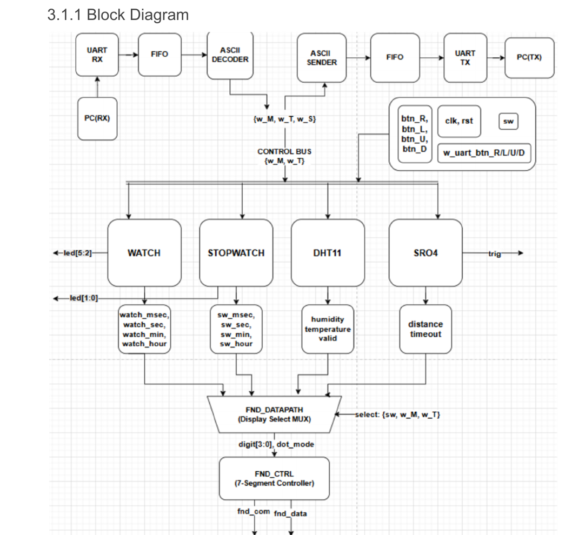

> **대한상공회의소 · 3인 팀 프로젝트**
>
> **핵심 결과:** SR04 무응답 약 30 ms Timeout 처리 · 4개 모드 전환 및 UART 출력 확인
>
> **본인 담당:** SR04 상태 제어·측정 데이터 경로·Testbench, Top 통합

## 개요

- **시스템:** Stopwatch·Watch·DHT11·HC-SR04를 UART·FIFO와 통합
- **입출력:** PC ASCII 명령 제어, Basys3 FND·PC 터미널 결과 표시
- **개인 담당:** SR04 측정·Timeout·Testbench 구현, `top_4module` 통합

## 담당 역할

- **SR04 Datapath·Control Unit:** 1 μs Tick, 측정 카운터, 거리 레지스터, 4-state FSM 구현
- **예외 처리:** Echo 무응답 및 High 지속 상황의 Timeout과 IDLE 복귀 처리
- **검증:** SR04 Testbench 작성 및 상태·카운터·출력 파형 대조
- **Top 통합:** UART 명령·모드 신호, 각 기능의 데이터, FND·UART 출력 경로 연결

## 시스템 구성

- **수신:** PC → UART RX → RX FIFO → ASCII Decoder → 기능 제어
- **송신:** 기능 데이터 → ASCII Sender → TX FIFO → UART TX → PC

**UART·FIFO 기반 Watch·Sensor 통합 블록도**

[상세 그림 — Notion](https://app.notion.com/p/3dc23ec941b7811f8fe9c1f251297953#3f263184dcd74779bb108355c6177548)

UART 명령·모드 제어와 시간·센서 데이터의 FND/UART 출력 경로

Top 모듈 계층과 4개 모드 연결

통신부에서 생성한 `w_M[1:0]`을 공통 모드로 사용했습니다. `{sw, w_M, w_T}`를 기능 모듈과 FND에 전달해 제어 기준을 맞추고, 시간·온습도·거리 출력을 표시부와 통신부로 연결했습니다.

| 모드 M | 기능 | Top에서 연결한 주요 데이터 |
| --- | --- | --- |
| 00 | Stopwatch | 시·분·초·하위 시간 단위, 동작 상태 LED |
| 01 | Watch | 시·분·초·하위 시간 단위, 설정 상태 LED |
| 10 | DHT11 | 온도·습도와 소수부, 측정 valid |
| 11 | HC-SR04 | 9비트 거리값, timeout, Trigger·Echo |

- `TOP_sr04_controller`: 버튼/UART 시작 신호, 1 μs Tick, SR04 제어기를 연결
- `watch`, `top_stopwatch_watch`, `dht11`: 팀에서 구현한 기능 모듈 연결
- `fnd_ctrl_final`: 선택한 시간 데이터와 센서 데이터를 공통 FND로 출력
- `uart_fifo_whole`: PC 명령을 제어 신호로 전달하고 기능별 데이터를 UART로 전송

Stopwatch/Watch의 시간 데이터는 `w_M`에 따라 선택한 뒤 공통 `w_hour, w_min, w_sec, w_msec` 경로로 전달했습니다.

ASCII 명령표와 Decoder 검증

| 명령 | ASCII | 의도한 동작 |
| --- | --- | --- |
| R / L / U / D | 0x52 / 0x4C / 0x55 / 0x44 | 보드 버튼에 대응하는 제어 신호 생성. SR04의 R은 거리 측정 시작 |
| S | 0x53 | 선택한 모드의 데이터 송신 시작 |
| M | 0x4D | 2비트 모드값 증가: Stopwatch → Watch → DHT11 → SR04 → 순환 |
| T | 0x54 | 2비트 세부 선택값 증가. 모드 안의 표시·동작 항목 선택 |

Decoder 단위 검증에서는 ASCII 문자를 1클럭씩 인가해 R/L/U/D/S 제어 출력과 M/T 상태값 증가·유지를 확인했습니다.

- **ASCII Decoder 파형 — 명령별 제어 출력과 M/T 상태 변화**

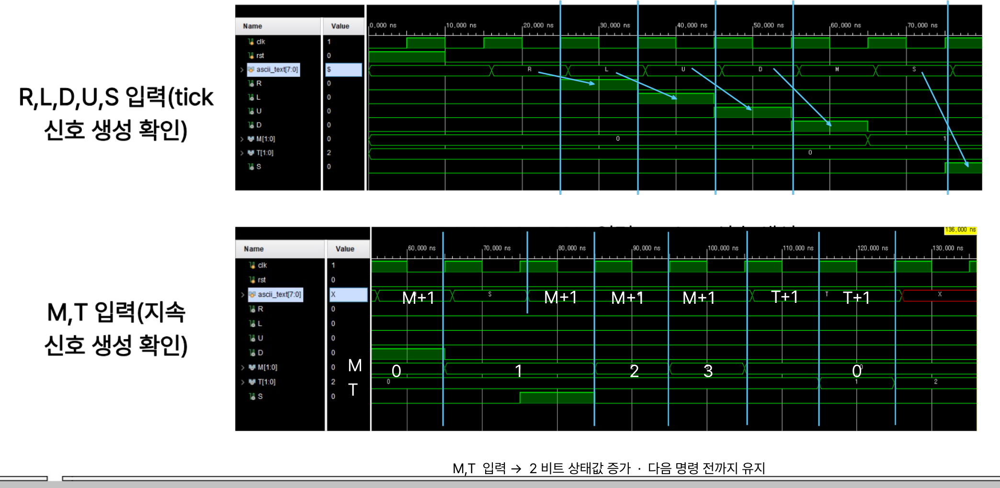

단위 Testbench의 1클럭 자극에서는 제어 출력이 펄스로 나타납니다. 실제 FIFO 연결에서는 **유효한 새 바이트인지 판별하는 valid 조건이 필요**하며, 이 조건이 빠진 연속 명령 문제는 아래의 남은 이슈에 기록했습니다.

## SR04 설계 및 검증

- **거리 계산:** 1 μs Tick으로 Echo High 폭 측정, 계수값÷58로 cm 환산
- **상태 제어:** IDLE·START·WAIT·RESPONSE의 4-state FSM
- **무응답 처리:** 약 30 ms Timeout 후 IDLE 복귀
- **High 지속 처리:** 약 23.2 ms에서 측정 종료
- **파형 확인:** Trigger·정상 거리 갱신·두 Timeout 경로를 Testbench로 대조

SR04 측정 원리·Datapath·FSM

Trigger를 High로 유지해 측정을 시작하고, Echo가 High인 시간을 1 μs 단위로 세어 거리로 환산했습니다. 왕복 시간을 거리로 바꾸는 근사식은 `distance_cm = echo_time_us / 58`이며, RTL에서는 정수 나눗셈을 사용했습니다.

| 구성 | 구현 |
| --- | --- |
| 1 μs Tick | 100 MHz 입력 클럭을 100회 계수해 1클럭 폭의 tick\_us 생성 |
| 측정 카운터 | 15비트 tick\_us\_cnt\_reg. 상태별 시간 계수와 전이 시 초기화 |
| 거리 출력 | 9비트 distance\_reg. 정상 측정 종료 시 count / 58로 갱신 |
| 상태 제어 | IDLE(0), START(1), WAIT(2), RESPONSE(3) |
| 측정 상태 | timeout으로 비정상 종료 구분. 다음 측정 시작 시 해제 |

- **SR04 상태 전이 — 정상 측정과 두 가지 Timeout 경로**

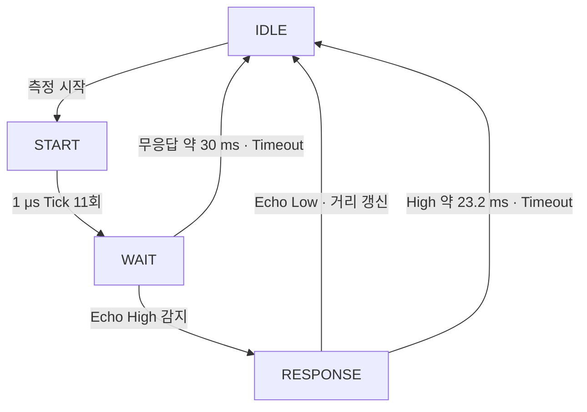

SR04 모드에서 벗어나면 제어기와 측정값을 초기화하도록 연결했습니다. 버튼 시작 신호와 UART R 명령은 같은 측정 시작 경로로 전달했습니다.

정상 동작 검증 — Trigger·Echo 응답·거리 갱신

Testbench에서 시작 신호와 Echo를 인가하고, `c_state`, `tick_us_cnt_reg`, `trig`, `distance`를 함께 관찰했습니다.

- **Trigger 생성 파형 — 카운터 0\~10 계수 후 START → WAIT**

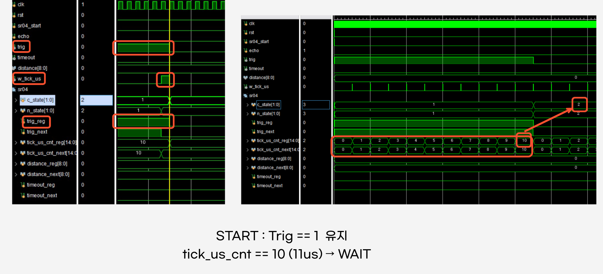

START에서 Trigger를 유지하고 1 μs Tick을 11회 세어 약 11 μs의 Trigger 구간을 만들었습니다. 카운터가 10인 Tick에서 Trigger를 Low로 내리고 WAIT로 전이하는 것을 확인했습니다.

- **Echo 응답 파형 — WAIT → RESPONSE와 측정 카운터 초기화**

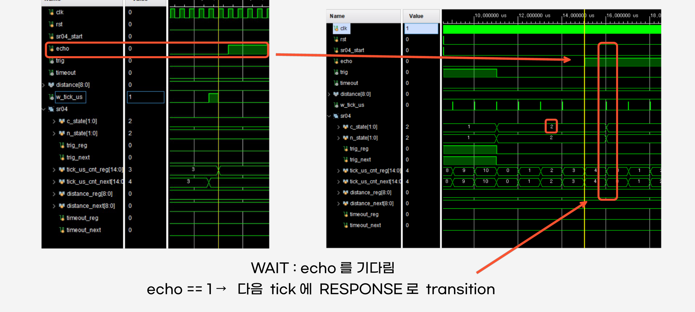

WAIT에서 Echo High를 Tick 시점에 감지하면 RESPONSE로 전이하고 카운터를 0으로 초기화해 Echo 폭 측정을 시작했습니다.

- **거리 환산 파형 — Echo 종료 후 distance = 344 cm 갱신**

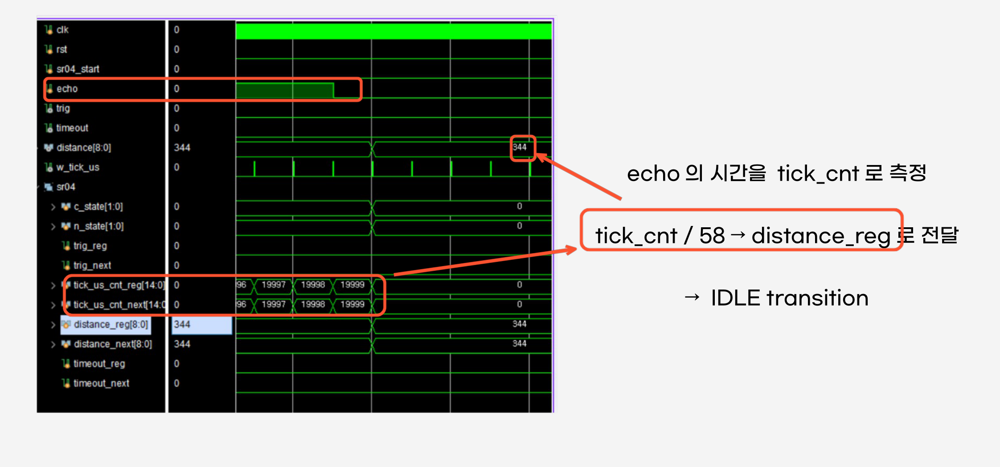

Echo가 Low로 내려오면 계수값을 58로 나눠 거리 레지스터에 저장하고 IDLE로 복귀했습니다. 제시한 파형에서는 카운터 19,999를 나눈 정수 결과인 **344 cm**가 출력되는 것을 확인했습니다.

예외 동작 검증 — 무응답·Echo High 지속

| 시나리오 | RTL 조건 및 동작 | 파형 확인 항목 |
| --- | --- | --- |
| Echo 무응답 | WAIT에서 echo=0, count >= 30,000이면 timeout=1 및 IDLE 복귀 | 카운터 30,000 부근, WAIT(2) → IDLE(0), timeout 상승 |
| Echo High 지속 | RESPONSE에서 echo=1인 채 count=23,199이면 다음 Tick에서 비정상 종료 | RESPONSE(3) → IDLE(0), 카운터 초기화, timeout 상승 |

- **무응답 Timeout 파형 — 약 30 ms 대기 후 IDLE 복귀**

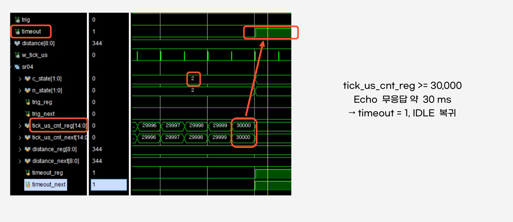

- **Echo High 지속 파형 — 약 23.2 ms 측정 한도에서 Timeout**

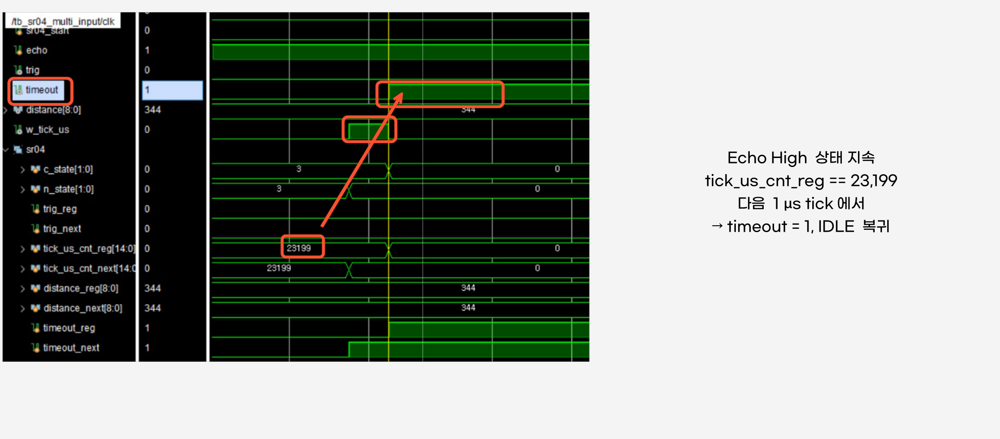

Timeout 경로에서는 거리 레지스터에 이전 값이 남을 수 있으므로, 숫자만으로 정상 측정 여부를 판단하지 않고 `timeout`을 함께 표시부에 전달했습니다. Timeout은 다음 측정 시작 시 해제합니다.

문제 해결 — Echo 미수신 시 WAIT 고착 방지

**문제:** 기존 WAIT 로직에는 Echo 수신 조건만 있어 센서가 응답하지 않으면 카운터 증가를 반복하며 측정을 끝내지 못했습니다.

**수정:** Echo 응답을 먼저 검사하고, 무응답 상태에서 `tick_us_cnt_reg >= 30_000`이면 `timeout=1`, 카운터 초기화, IDLE 복귀를 수행하도록 분기를 추가했습니다.

**확인:** 무응답 파형에서 상태 복귀와 Timeout 출력을 대조해, 센서 응답이 없는 경우에도 대기를 종료하는 것을 확인했습니다.

- **SR04 WAIT 로직 수정 전·후 — 무응답 Timeout 분기 추가**

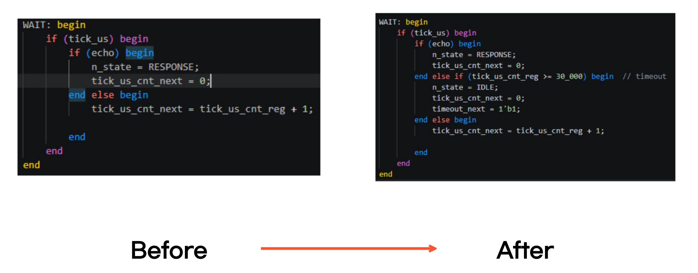

## 통합 동작 및 통신 검증

- **통합:** 모드·기능 명령을 시간·온습도·거리 데이터 선택과 연결
- **표시·전송:** FND 출력과 모드별 ASCII 라벨·수치 생성
- **UART:** 9600 bps 기준 약 1.042 ms 간격의 바이트 전송
- **통신 확인:** R 명령의 제어 신호 연결, Sender 문자·push부터 UART TX까지 파형 대조
- **직렬 전송:** LSB First 순서 확인

ASCII Sender — 모드별 라벨·수치 선택과 송신 FSM

팀의 ASCII Sender를 각 기능의 출력과 연결했습니다. 수치를 십진 자릿수로 분리한 후 `8'h30`을 더해 ASCII 숫자로 바꾸고, 모드별 라벨과 함께 전송했습니다.

| 모드 | UART 출력 구성 |
| --- | --- |
| Stopwatch / Watch | 시·분·초를 h/m/s 문자와 결합 |
| DHT11 | T 선택에 따라 온도, 습도, 두 값 또는 none 구성 |
| SR04 | 거리 세 자리와 cm 단위 결합 |

Sender의 `IDLE → START → POP → STOP` FSM은 시작 요청을 받고, 바이트 주기에 맞춰 문자와 `push`를 TX FIFO 경로에 전달합니다.

- **ASCII Sender FSM — 시작 요청과 바이트 단위 출력 순서**

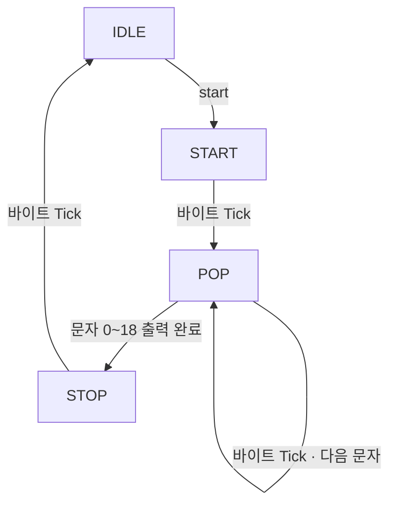

- **모드별 ASCII 선택 파형 — Stopwatch와 온도 출력 전환**

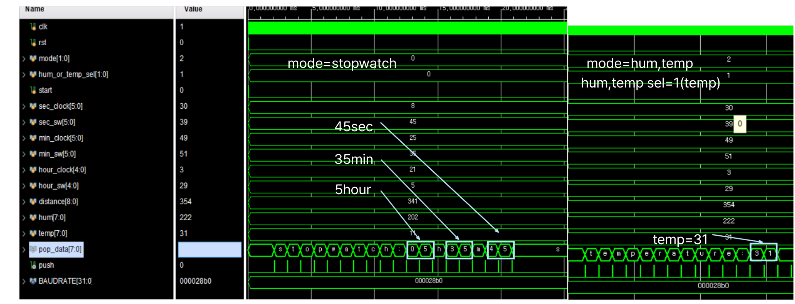

현재 RTL은 문자 레지스터를 매 클럭 갱신하므로, 송신 중 데이터 일관성과 연속 S 요청 처리는 미해결 항목입니다.

UART 통합 파형 — 수신 명령·바이트 간격·LSB first

통합 검증 자료에서 수신 바이트가 명령으로 연결되는 과정과, Sender 출력이 UART 직렬 데이터로 전달되는 과정을 확인했습니다.

- **UART RX → Decoder 파형 — R(0x52) 수신 후 제어 출력**

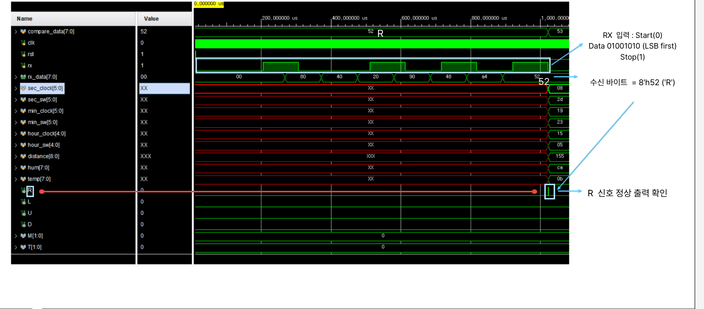

R의 ASCII 코드는 `8'h52`입니다. 프레임은 Start(0), 데이터 8비트, Stop(1)로 구성되며 데이터는 LSB부터 전송됩니다.

- **Sender 바이트 주기 파형 — 9600 bps에서 약 1.042 ms 간격**

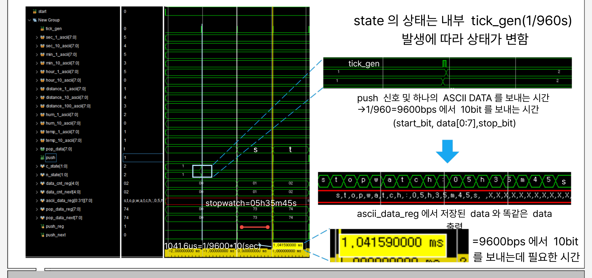

9600 bps의 8N1 전송은 1바이트당 총 10비트를 사용하므로 `10 / 9600 ≈ 1.04167 ms`가 필요합니다. 파형에서는 문자와 push가 약 1.04159 ms 간격으로 출력되는 것을 확인했습니다.

- **Sender → UART TX 파형 — s(0x73)의 LSB first 전송**

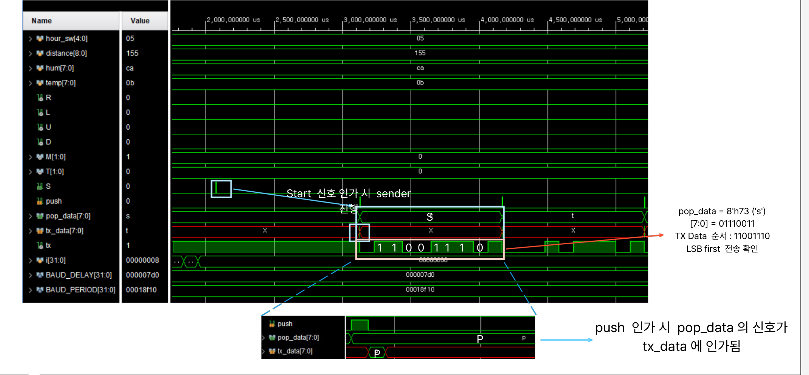

`s = 8'h73 = 01110011[7:0]`이며, 직렬 데이터 비트의 시간 순서는 `11001110`입니다. 병렬 바이트 값과 직렬 전송 순서를 구분해 파형을 대조했습니다.

FND 통합 출력과 모드별 데이터 선택

Stopwatch/Watch의 시간 출력과 DHT11·SR04 데이터를 공통 Display 경로에 연결했습니다.

- 시간 모드에서는 선택한 시·분·초·하위 시간 데이터를 전달
- DHT11 모드에서는 온도·습도와 소수부를 전달
- SR04 모드에서는 거리값과 Timeout 상태를 함께 전달

팀의 FND 구조는 기능별 데이터를 Datapath에서 digit으로 변환하고, 4-digit 선택과 dot 출력을 제어하도록 구성했습니다. 저는 Top에서 모드 선택과 각 데이터·상태 신호를 연결해 표시부가 현재 모드에 맞는 출력을 받도록 통합했습니다.

## 결과 및 시연

- **보드 결과:** 4개 모드 전환·FND 출력·PC 명령 동작·UART 수신 확인
- **SR04 결과:** 정상 측정과 무응답·High 지속 Timeout 경로 확인
- **남은 이슈:** 연속 명령에서 동일 데이터 반복 출력
- **개선 방향:** RX FIFO valid 연결, Sender busy/ready 추가

**UART Watch·Sensor 통합 시연 영상 — PC 명령 제어와 보드 출력**

[시연 영상](../assets/project-media/uart-watch-sensor-demo.mp4)

Stopwatch 동작·표시 고정, Watch 전환·시간 조정, 온습도·거리·범위 밖 상태 표시 시연

보드 검증 사진과 확인 항목

- **SR04 보드 결과 — 정상 거리와 범위 밖 상태의 FND 표시**

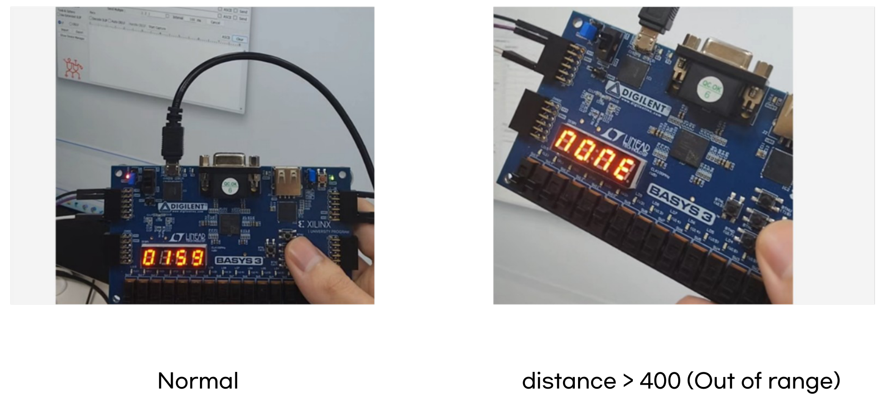

| 확인 항목 | 확인한 결과 |
| --- | --- |
| 공통 제어 | PC ASCII 명령에 따른 모드 전환과 기능 제어 |
| 시간 기능 | Stopwatch/Watch의 동작 및 표시 |
| 센서 기능 | 온습도·거리의 FND 표시와 PC 수신 |
| SR04 예외 처리 | 정상 거리 표시와 범위 밖 상태 표시 |

남은 이슈와 개선 방향 — FIFO 잔류값·연속 송신 요청

**관찰한 현상:** FIFO 깊이가 4일 때 4바이트 입력 뒤 원치 않는 반복 출력이 나타났고, 32로 늘리면 발생 시점이 늦춰졌지만 32회 이상 연속 명령 입력 시 동일 데이터가 반복 출력되는 현상이 남았습니다. **FIFO 깊이 확대만으로 해결한 것으로 판단하지 않았습니다.**

**원인 분석:** RX FIFO가 empty여도 `pop_data`에 이전 문자가 남을 수 있습니다. 확인한 Decoder RTL에는 valid 입력이 없어 이전 문자를 계속 명령으로 해석할 수 있고, 이전 S가 송신 시작 요청으로 반복 인식될 가능성이 있습니다. M/T 역시 입력이 유지되면 매 클럭 증가할 수 있습니다.

**후속 개선 방향**

- 실제 FIFO Pop 성공 시점에만 `cmd_valid`를 발생시키고, valid일 때만 명령 해석
- Sender에 busy/ready를 추가해 송신 중 S 요청의 수락·대기 정책 정의
- 송신 시작 시 모드와 측정값을 스냅샷으로 저장해 한 메시지의 데이터 일관성 확보

위 3개 항목은 **미구현 개선안**입니다.

## 관련 링크

- [센서·UART 통합 RTL](https://github.com/Min-star-prog/ondeviceai/tree/main/window/OndeviceAI2/fifo_sensor/fifo_sensor.srcs/sources_1/new)

[← 전체 프로젝트](../README.md#프로젝트)

