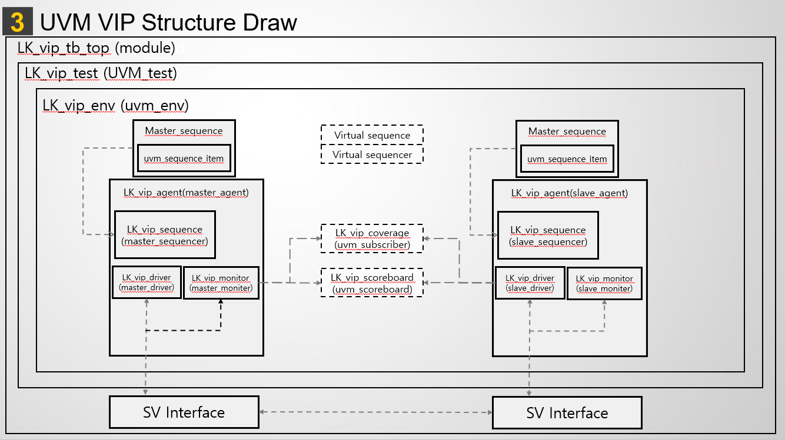

# UBUS Master–Slave UVM VIP 개발·검증

[전체 프로젝트](../README.md#프로젝트) · [Notion 상세·시연](https://app.notion.com/p/3d423ec941b78182aeb4c9d63174fe7d)

서강대 글로벌 반도체설계 전문가과정 · 팀 · 2025.09.01 – 2025.12.31

> **서강대학교 · 2인 팀 프로젝트 · 기여도 60%**
>
> **핵심 결과:** Transaction·Data Beat·Protocol Covergroup 각 100%

## 개요

- **구성:** 1 Master–1 Slave UBUS Read/Write 검증 환경
- **개인 담당:** Master Driver·Monitor·Sequencer·Sequence 구현
- **통합:** Slave 환경 연동, 주소별 기대 데이터와 실제 버스 값 비교

## 본인·공동 역할

- 본인: Master 요청을 Address/Data Phase 신호로 구동하고 실제 버스에서 트랜잭션을 수집
- 본인: 주소 증가 Read/Write와 Read–Modify–Write 등 복합 Sequence 작성
- 공동: Interface·Environment·Test 통합, 검증 시나리오와 Coverage 구성

## 검증

Write에서 주소별 기대값을 갱신하고 Read에서 수집한 데이터와 비교했습니다. Wait State와 Beat 진행 시점을 관찰하고, Random 테스트의 미도달 조합은 Directed Sequence로 보완했습니다.

팀 발표의 최종 기록에서 Transaction, Data Beat, Protocol Covergroup이 각각 100%를 기록했습니다. 초기 실행 로그의 Write 69건·Read 18건·Mismatch 0건은 최종 Coverage 결과와 구분해 표시합니다.

## 결과와 범위

[상세 그림 — Notion](https://app.notion.com/p/3d423ec941b78182aeb4c9d63174fe7d#20f17e2da153426e8c3cf0d20c0864bc)

[상세 그림 — Notion](https://app.notion.com/p/3d423ec941b78182aeb4c9d63174fe7d#22840d2dba4f4ba6837ede84d3bc66e3)

UVM 컴포넌트 연결과 트랜잭션 생성·구동·관측·비교 흐름을 구성했습니다. Coverage는 프로젝트에서 정의한 Transaction·Data Beat·Protocol 항목을 기준으로 집계했습니다.

[상세 그림 — Notion](https://app.notion.com/p/3d423ec941b78182aeb4c9d63174fe7d#81ece35b86544deab1dc11fa336af4f7)

세부 확인 항목

| 구간 | Master 동작 | Slave 및 관측 동작 |
| --- | --- | --- |
| Address Phase | 주소·방향·전송 크기 제시 | 요청 정보를 수집해 응답 준비 |
| Write Data | 데이터를 Beat 단위로 구동 | 유효 Beat 수집 및 메모리 모델 갱신 |
| Read Data | 전송이 허용된 Beat의 데이터 수신 | 메모리 모델의 데이터를 버스에 구동 |
| Wait / 종료 | lk\_wait=0인 전송 조건에서 진행, 마지막 Beat에 lk\_bip=0 | 대기·완료 시점과 데이터 수집 시점 정합성 확인 |

| 시나리오 | 검증 의도 |
| --- | --- |
| 주소 증가 Write / Read | 여러 주소에 반복 접근하며 전송과 수집 동작 확인 |
| Read–Write–Read | 동일 주소의 데이터가 Write 이후 갱신되는지 확인 |
| Read–Modify–Write–Re-Read | 읽은 데이터에 1을 더해 다시 쓴 뒤 재조회하여 변경값 비교 |
| Random 및 Directed 자극 | 주소 영역·크기·방향·데이터 패턴 조합을 확장하고 미도달 Coverage 항목 보완 |

| Functional Covergroup | 측정 범위 | 초기 | 최종 기록 |
| --- | --- | --- | --- |
| Transaction | 주소 영역·정렬·전송 크기·방향 및 Cross | 81.25% | 100% |
| Data Beat | 데이터 값과 Read/Write 방향 조합 | 66.67% | 100% |
| Protocol | 연속 전송 방향 RR/RW/WR/WW와 크기 등의 조합 | 87.15% | 100% |

## 문제 해결

반복 Write에서 9번째 응답부터 발생한 Response Queue Overflow는 Sequence에서 응답을 소비하지 않아 누적된 문제였습니다. 응답 생성 경로에 `get_response()`를 추가했습니다. 반복 실행의 Phase·첫 Beat 수집 문제는 조교의 수정 지원을 받아 Master 구동·관측과 Slave 응답 시점을 파형으로 분석했습니다.

## 관련 링크

- [UBUS 프로젝트 설명](https://github.com/Min-star-prog/Segong/tree/main/LM/lk)
- [Master 구현·Sequence](https://github.com/Min-star-prog/Segong/tree/main/LM/lk/lk_project/master-week6)
- [Master–Slave 통합 코드](https://github.com/Min-star-prog/Segong/tree/main/LM/lk/lk_project/ex-week5)

[← 전체 프로젝트](../README.md#프로젝트)

