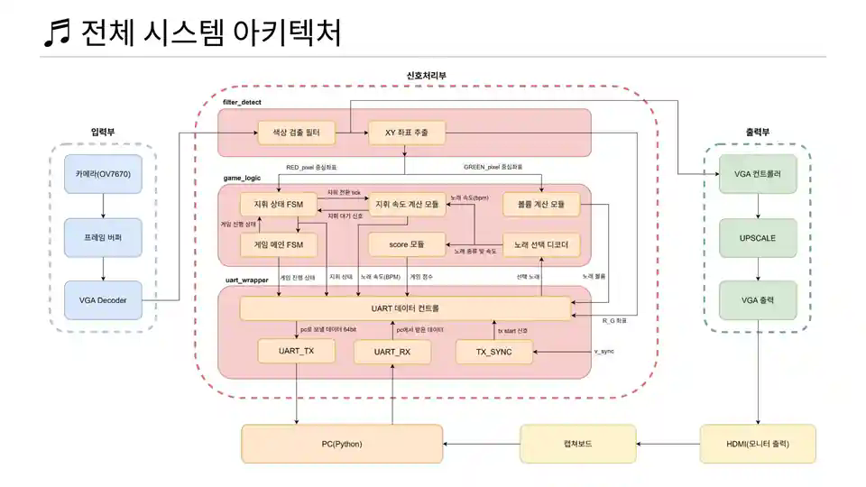

# FPGA 지휘 동작 인식 게임 — 제어 RTL 설계·UVM 검증

[전체 프로젝트](../README.md#프로젝트) · [Notion 상세·시연](https://app.notion.com/p/3d423ec941b781d2a2a5fcb84437ab55)

대한상공회의소 온디바이스AI 시스템반도체 설계교육 · 팀 · 2026.08.31 – 2026.09.08

> **대한상공회의소 · 7인 팀 프로젝트**
>
> **핵심 결과:** 제어부 Scoreboard 657,780건 PASS · FAIL 0건 / 보완 실행 Functional Coverage 98.96%
>
> **본인 담당:** 지휘 상태 모듈, Tick/Valid·점수 계산 모듈 RTL 설계, Game Logic 제어부 UVM 검증

## 개요

- **동작:** RED 지휘봉·GREEN 손 좌표로 음악 BPM·볼륨·게임 점수 제어
- **시스템:** FPGA 영상 처리·게임 제어·VGA 출력과 PC 음악·화면 연동
- **개인 담당:** 지휘 상태·점수 RTL, Game Logic 제어부 UVM 검증
- **주요 수정:** 상태 전이·데이터 전달 시점, Tick 누락·속도 수집 순서

## 담당 역할

- **지휘 상태 판정:** X·Y 좌표로 ZONE을 판별하고, 준비·지휘·종료 FSM 및 Pattern Tick 구현
- **데이터 전달:** 상태·점수의 Valid/Ready 처리와 후단 속도·통신 모듈의 인터페이스 연결
- **점수 계산:** 지휘 속도 수집, 4개 값의 평균과 원곡 BPM 비교, 점수 갱신 FSM 구현
- **UVM 검증:** 제어부 6개 모듈의 상태·출력 관측, Scoreboard·Coverage 구성, 코너 케이스 보완

## 시스템 구성

- **FPGA:** 카메라 → 색상·좌표 검출 → 지휘·속도·점수·볼륨 계산 → VGA/UART
- **PC:** 게임 상태·곡 선택 전달, FPGA 결과에 따른 음악 재생·화면 갱신

**FPGA 지휘 게임 전체 시스템 아키텍처**

[상세 그림 — Notion](https://app.notion.com/p/3d423ec941b781d2a2a5fcb84437ab55#5bf3e1233f48447995c96038fad1a14e)

색상·좌표 검출부터 제어 RTL·VGA/UART·PC 음악 재생까지의 흐름

전체 모듈 구성과 본인 담당 범위

| 구분 | 주요 구성 | 담당 범위 |
| --- | --- | --- |
| 영상 입력·처리 | OV7670, Frame Buffer, RGB Filter, XY Detection | 팀 구현. RED/GREEN 중심 좌표를 제어부 입력으로 사용 |
| 지휘·점수 제어 | pattern\_stick, game\_score | 본인 RTL 설계·파형 검증 |
| 게임·속도·볼륨·곡 선택 | game\_fsm, stick\_speed\_calc, volume\_ctrl, song\_decoder | 팀 구현. 본인은 담당 모듈과의 연결 및 제어부 UVM 검증 수행 |
| 통신·PC | UART Wrapper, Python UI·음악 재생 | 팀 구현. 상태·점수의 Valid/Ready 인터페이스 연동 |

개발 환경은 **Basys3(Artix-7), OV7670, SystemVerilog, Vivado, VCS·Verdi, Python**입니다. 검출 영상은 QVGA 320×240, VGA 출력은 640×480이며 시스템 기준 클럭은 100 MHz입니다.

FPGA–PC 데이터 구성과 프레임별 전달

UART 송신 데이터는 총 64비트이며, 상태·좌표·속도·점수·볼륨을 채널별 Valid/Ready로 받아 패킹합니다.

| 필드 | 비트 | 내용 |
| --- | --- | --- |
| Game State | 63:62 / 2비트 | IDLE·READY·GAME\_ING |
| XY | 61:22 / 40비트 | 지휘봉 X/Y, 손 X/Y 각 10비트 |
| Pattern | 21:19 / 3비트 | 지휘 상태 8개 |
| Volume | 18:12 / 7비트 | 0\~100 |
| Speed | 11:4 / 8비트 | 30\~220 BPM |
| Score | 3:0 / 4비트 | 0\~10 |

PC에서 받는 8비트 데이터는 PC 상태 `[6:4]`, 곡 번호 `[2:0]`를 사용합니다. 검출 좌표의 실제 유효 범위는 X=0\~319, Y=0\~239이며, 미검출 값 1023과 구분합니다.

`TX_SYNC`는 프레임 동기 신호 뒤 16클럭 지연 후 송신을 시작합니다. UART는 그때까지 채널별로 받은 최신 값을 전송하며, 모든 필드가 같은 프레임에서 동시에 갱신되었다는 뜻은 아닙니다.

## 지휘 상태·점수 RTL 설계

- **지휘 판정:** ZONE4 준비 후 ZONE1 진입, ZONE1→2→3→4 통과 시 Pattern Tick
- **점수 계산:** Tick 간격을 BPM으로 환산, 수집한 4개 속도 평균과 원곡 BPM 비교
- **전달 규칙:** 상태 전이용 1클럭 Tick과 UART용 Valid/Ready 분리
- **점수 FSM:** `IDLE → COLLECT → CALC → SEND`로 수집·연산·전송 시점 제어

지휘 패턴 FSM·ZONE 판정과 상태 전이 파형

`pattern_stick`은 좌표 범위 비교로 zone hit를 만든 뒤, 현재 상태에서 허용한 다음 ZONE으로 이동했는지 판정합니다.

- **지휘봉의 4개 ZONE과 진행 순서**

[상세 그림 — Notion](https://app.notion.com/p/3d423ec941b781d2a2a5fcb84437ab55#6ba6e200bd6d44398d87e597fb0585f5)

| 상태 | 전이 조건 | 동작 |
| --- | --- | --- |
| IDLE → START | game\_start | 지휘 시작 준비 |
| START → READY | ZONE4 도달 | 지휘봉을 위쪽 준비 위치에 정렬 |
| READY → PATTERN\_1 | ZONE1 도달 | 첫 박자 시작 |
| PATTERN\_1\~4 | 다음 ZONE 도달 및 i\_state\_change\_enable | 1→2→3→4→1 순서 반복, Pattern Tick 발생 |
| PATTERN\_1\~4 → STOP → IDLE | game\_stop 우선 처리 | 지휘 종료 후 초기 상태 복귀 |

- **지휘 상태 판정 FSM**

[상세 그림 — Notion](https://app.notion.com/p/3d423ec941b781d2a2a5fcb84437ab55#00c27ab14a2b454290a481a96e6a61dc)

- **지휘 상태 판정 파형 — 시작·준비·패턴 진행·정지**

[상세 그림 — Notion](https://app.notion.com/p/3d423ec941b781d2a2a5fcb84437ab55#d3a9a4ff49f449cfba4b17f06c908684)

좌표, 상태, `pattern_tick`, `pattern_control_valid`를 함께 관찰해 전이 시점을 확인했습니다. 최종 RTL에서 진행 중 ZONE 전이는 `i_state_change_enable`로 제어하고, `i_vsync`는 Valid 초기화에 사용합니다. 파형의 주석도 이 구분에 맞춰 정리했습니다.

Pattern Tick과 Valid/Ready의 역할·우선순위

| 신호 | 용도 | 구현 |
| --- | --- | --- |
| pattern\_tick | 속도 측정을 시작·종료하는 이벤트 | 해당 상태 전이에서 1클럭 발생. 매 클럭 기본값 0 |
| pattern\_control\_valid | 새 지휘 상태 전달 | 상태 전이 시 설정, 수신 Ready에 따라 해제. 다음 i\_vsync에서도 초기화 |
| score\_control\_valid | 계산된 점수 전달 | SEND에서 설정하고 Ready를 기다린 뒤 COLLECT 복귀 |
| i\_state\_change\_enable | 속도 연산·대기 중 추가 전이 방지 | 속도 FSM의 WAIT·CALC·COMP·FAST·NORMAL에서 0 |

기존 Valid 처리 여부와 관계없이 대상 전이의 Tick과 새 상태의 Valid를 만들도록 조건을 분리했습니다. `pattern_control_valid`는 프레임 경계에서 만료될 수 있으므로, 프레임을 넘어 무기한 유지하는 핸드셰이크와 구분합니다.

점수 FSM·4개 속도 평균·점수 조건

`speed_ram[0..3]`에 속도를 저장하고, 10비트 합을 오른쪽으로 2비트 이동해 정수 평균을 구했습니다. 원곡 BPM과의 절대 차이 `speed_diff`로 점수를 갱신합니다.

- **점수 계산 FSM — COLLECT·CALC·SEND**

[상세 그림 — Notion](https://app.notion.com/p/3d423ec941b781d2a2a5fcb84437ab55#611169d644c34f6cbacb367bec2f4802)

| 항목 | 첨부 RTL의 구현 |
| --- | --- |
| 초기값·범위 | 초기 5점, 출력 0\~10점 |
| BPM 차이 5 미만 | +1점, 10점이면 유지 |
| BPM 차이 5\~30 | 현재 점수 유지 |
| BPM 차이 30 초과 | -1점, 0점이면 유지 |
| 첫 평가 | RAM을 원곡 BPM으로 초기화하고 tick\_cnt=1에서 수집 시작. 기준값 1개와 측정값 3개로 첫 평균 계산 |
| 후속 평가 | 카운터를 순환하며 측정값 4개를 수집한 뒤 계산·전송 |

- **점수 계산 개발 파형 — RAM 수집·평균·SEND 확인**

[상세 그림 — Notion](https://app.notion.com/p/3d423ec941b781d2a2a5fcb84437ab55#cd64b84fab9242a2b01421e3cdadfe51)

화살표는 Tick에 따른 RAM 갱신 위치, 박스는 `speed_diff`와 점수·Valid의 출력 시점을 가리킵니다. 이 파형은 개발 단계 캡처로, 당시 점수 임계값은 최종 첨부 RTL과 다릅니다. 위 조건표는 최종 RTL 기준입니다.

## UVM 검증과 결과

- **대상:** Game Logic 제어부 6개 모듈
- **기본 실행:** Scoreboard 657,780건 PASS·FAIL 0건
- **보완 실행:** 미도달 조건·코너 케이스 추가, FC 75.0% → 98.96%
- **확인 항목:** 상태 전이·BPM 기대값·점수 변화·출력 범위·모듈 간 전달 시점
- **결과 범위:** 비교 건수와 FC는 별도 실행 결과, 카메라·VGA를 포함한 전체 UVM 결과와 구분

UVM 환경 구성과 Scoreboard 판정 범위

검증 대상은 `game_fsm`, `pattern_stick`, `stick_speed_calc`, `game_score`, `volume_ctrl`, `song_decoder`입니다.

| 구성 | 역할 |
| --- | --- |
| Sequence·Sequencer | 지휘봉 좌표, 손 Y좌표, PC 상태·곡 번호, 프레임 간격으로 시나리오 구성 |
| Driver | 좌표·PC 입력과 프레임 동기 신호를 DUT에 인가 |
| Monitor | 클럭 기준으로 상태·Tick·Valid·BPM·점수·볼륨 관측 |
| Scoreboard | FSM 허용 전이, BPM 기대값, 곡 선택 매핑, 점수·볼륨 범위 및 점수 변화 규칙 검사 |
| Coverage Subscriber | 상태·전이·BPM·점수·볼륨·곡 선택의 기능 bin 수집 |

657,780은 Scoreboard가 수행한 **여러 검사 항목의 누적 비교 횟수**이며, 독립적인 입력 시나리오 657,780개를 뜻하지 않습니다. 점수 검사는 범위·증감 규칙을 포함하며 모든 계산을 별도 참조 모델로 완전히 재현하는 검증과 구분합니다.

- **Game Logic 검증 시나리오·파형·결과 요약**

[상세 그림 — Notion](https://app.notion.com/p/3d423ec941b781d2a2a5fcb84437ab55#b00ca14a5add4627bfd0bdc9bd0142ad)

기본 테스트·코너 케이스와 모듈 간 전달 파형

| 테스트 | 확인 항목 |
| --- | --- |
| Conduct\_fsm\_test | 준비·순차 지휘·정지 시 상태 전이와 Pattern Tick |
| bpm\_calc\_test | Tick 간격에 따른 지휘 속도 계산과 출력 |
| score\_test | 속도 수집·평균 계산·점수 갱신·SEND |
| full\_game\_scenario\_test | 곡 선택, 시작·종료, 지휘, BPM·점수·볼륨이 연결된 게임 흐름 |
| full\_case\_coverage\_test | ZONE 경계, 상태별 종료, BPM·점수·볼륨 경계와 미실행 분기를 겨냥한 보완 자극 |

- **제어부 전달 파형 — 좌표·지휘 상태·속도·점수의 순서**

[상세 그림 — Notion](https://app.notion.com/p/3d423ec941b781d2a2a5fcb84437ab55#e321acf45eb04fd197cca4f2068f6393)

좌표 입력 뒤 지휘 상태가 바뀌고, Tick을 받은 속도 모듈의 출력이 점수 계산으로 이어지는 순서를 관찰했습니다. 각 모듈의 상태와 Valid를 함께 보며 데이터가 준비되는 시점을 대조했습니다.

Scoreboard 결과·Functional Coverage·Code Coverage

- **기본 실행 Scoreboard — Total 657,780 / PASS 657,780 / FAIL 0**

[상세 그림 — Notion](https://app.notion.com/p/3d423ec941b781d2a2a5fcb84437ab55#5a4afffd7792440f83ebfe9c95b80f59)

- **코너 케이스 보완 후 Functional Coverage — 98.96%**

[상세 그림 — Notion](https://app.notion.com/p/3d423ec941b781d2a2a5fcb84437ab55#cbc23903d408447d89efd8fe422d0589)

최종 캡처에서 `cp_pattern_transition`은 **12개 bin 중 11개 Hit(91.67%)**이고, 나머지 표시된 Coverpoint는 100%입니다. 남은 전이 bin이 있어 Functional Coverage 100%로 표기하지 않았습니다.

- **제어부 Code Coverage — DUT Score 83.47%**

[상세 그림 — Notion](https://app.notion.com/p/3d423ec941b781d2a2a5fcb84437ab55#60e4fe25afb94fbeb5158b9537ada339)

캡처의 DUT 기준 Line 97.35%, Toggle 77.47%, FSM 74.42%, Condition 78.90%, Branch 89.21%입니다. 기능 bin의 충족률인 Functional Coverage와 코드 실행 지표인 Code Coverage를 별도로 확인했습니다.

Coverage 미달 원인 분석과 Directed Test 보완

| 미달 원인 | 대응 |
| --- | --- |
| 설계에서 허용하지 않는 FSM 전이까지 계측 | 실제로 가능한 전이와 제외 대상을 구분해 검증 범위 정리 |
| ZONE 비교식의 뒤쪽 조건이 충분히 true/false로 평가되지 않음 | 경계 안팎 좌표의 Directed 자극으로 미실행 조건을 겨냥 |
| 넓은 내부 신호 상위 비트의 Toggle 미달 | 의미 없는 계측 대상은 구분하고, 유효한 카운터 상한은 별도 자극으로 확인 |
| 점수·볼륨·속도의 경계 및 상태별 종료 부족 | full\_case\_coverage\_test를 추가해 최소·최대값과 종료 분기 보완 |

도달 가능한 조건에는 자극을 추가하고, 불가능하거나 의미 없는 계측 항목은 제외 근거를 분리했습니다. 최종 기능 지표는 **98.96%**이며, 제외 범위를 고려해 결과를 해석했습니다.

## 문제 해결과 통합 타이밍

- **Tick 누락:** Valid 분기와 상태 전이 조건 분리
- **점수 누락:** 수집 카운터 초기 위치 조정으로 마지막 박자 평가 보완
- **확인:** UVM 결과와 전달 시점 파형 대조
- **초기 타이밍:** 나눗셈 경로 Negative Slack -80.719 ns
- **개선:** LUT·1 ms 계수, 계산 대기 상태·Multicycle Path 적용
- **최종 발표 결과:** 적용 제약 기준 WNS +0.205 ns, Setup/Hold 위반 Endpoint 0

본인 담당 모듈 디버깅 — Tick 누락과 첫 점수 수집 위치

**① 상태가 변해도 Tick·Valid가 발생하지 않는 문제**

기존에는 상태 전이 이벤트 생성 조건이 Valid 처리 분기에 묶여, 이미 전송을 기다리는 상황에서 새 전이를 처리하지 못했습니다. Valid의 유지·해제 조건과 상태 변경 시 이벤트 생성 조건을 분리해, 대상 전이의 Tick과 새 상태의 Valid가 기존 전송 대기 때문에 누락되지 않도록 수정했습니다.

**② 점수 계산에서 마지막 박자 평가가 빠지는 문제**

점수 활성화가 첫 박자보다 늦게 들어오는 점을 고려해 카운터를 보정했지만, 초기 위치가 어긋나 마지막 구간의 속도를 저장한 채 평균 계산 없이 끝나는 현상이 있었습니다. `tick_cnt` 초기값을 2에서 1로 조정하고, 원곡 BPM으로 초기화한 RAM과 후속 수집 순서를 맞췄습니다.

개발 일지와 파형에서 상태 전이, RAM 기록 위치, CALC 진입, SEND의 Valid 출력을 함께 확인했습니다.

음원 끊김 대응 — 지휘 속도와 다음 박자 진행 시점 조정

재생 중인 박자 도중 새 BPM을 곧바로 반영하면 기존 음원이 잘려 들리는 문제가 있었습니다. 팀은 속도 제어를 FSM으로 나누고, 빠른 지휘에서는 기존 박자의 잔여 시간을 고려해 다음 지휘 진행 시점을 조절했습니다.

- **박자 중간의 BPM 변경 문제와 잔여 시간 고려 방식**

[상세 그림 — Notion](https://app.notion.com/p/3d423ec941b781d2a2a5fcb84437ab55#4f72c3cd18354a9ab6d1f711fd5bbf61)

첨부 RTL은 `S_WAIT → S_CALC → S_COMP`에서 계산을 진행하고, `S_FAST` 또는 `S_NORMAL`로 분기합니다. 계산·대기 중 `o_state_change_enable=0`으로 추가 ZONE 전이를 막아, 한 번의 지휘 입력을 처리하는 동안 다음 입력이 앞서 진행하지 않도록 구성했습니다.

Negative Slack 개선 — LUT·1 ms 계수·계산 대기·Multicycle Path

**문제:** 100 MHz의 10 ns 주기에서 나눗셈을 포함한 긴 조합 경로가 타이밍을 만족하지 못했습니다.

- **초기 타이밍 분석 — Negative Slack -80.719 ns**

[상세 그림 — Notion](https://app.notion.com/p/3d423ec941b781d2a2a5fcb84437ab55#1944d52df9024eb0ba5076db52e6d338)

**조합 경로 경량화:** 재생 기준 BPM을 박자 시간으로 바꾸는 계산은 `bpm_to_cnt_LUT`로 대체했습니다. 경과 시간은 10 ns 클럭 단위 대신 **1 ms Tick으로 계수**해 11비트 카운터로 다룰 수 있게 했습니다. `count → BPM`의 `60000 / count_reg` 나눗셈은 남아 있습니다.

- **BPM → 재생 기준 시간 변환용 LUT**

[상세 그림 — Notion](https://app.notion.com/p/3d423ec941b781d2a2a5fcb84437ab55#84fe4107a75d4b7e8698248b1b9800dd)

**계산·저장 시점 조정:** 남은 나눗셈 경로에 `S_WAIT`의 대기와 결과 저장 단계를 두고, `count_reg → reg_bpm_comp_reg` 경로에 **Setup 3 / Hold 2**의 Multicycle Path를 적용했습니다. 단순한 전송 지연이나 분주 클럭 생성과 구분되는 연산 경로 제약입니다.

- **계산 대기 FSM과 Multicycle Path 제약**

[상세 그림 — Notion](https://app.notion.com/p/3d423ec941b781d2a2a5fcb84437ab55#7863caa74e214098907228c4e8bb131e)

- **최종 Design Timing Summary — WNS +0.205 ns**

[상세 그림 — Notion](https://app.notion.com/p/3d423ec941b781d2a2a5fcb84437ab55#0e1dbb9ba07d44b7bafa0af0085eabfc)

| 항목 | 최종 캡처 |
| --- | --- |
| Setup | WNS +0.205 ns / TNS 0 ns / Failing Endpoints 0 |
| Hold | WHS +0.027 ns / THS 0 ns / Failing Endpoints 0 |

수치는 해당 구현 실행에 적용한 타이밍 제약 기준입니다. UART의 프레임 뒤 16클럭 송신 지연과 이 연산 경로의 Multicycle Path는 서로 다른 설정입니다.

## 시연 및 구현 결과

- 카메라 입력·지휘 판정·BPM·볼륨·점수·UART·PC 음악 재생을 연결한 통합 시연
- 약 68초 영상에서 사용자 동작과 게임 화면 확인

**FPGA 지휘 게임 전체 시연 영상 — 약 68초**

[시연 영상 — Notion](https://app.notion.com/p/3d423ec941b781d2a2a5fcb84437ab55#792c1537d5b247258d199ba339ea9027)

사용자 지휘 동작·게임 화면·PC 음악 재생을 연결한 통합 시연

## 관련 링크

- [개인 GitHub — FPGA VGA 지휘게임](https://github.com/Min-star-prog/fpga-vga-conductor-game)
- [시연 영상](https://github.com/Min-star-prog/fpga-vga-conductor-game/blob/integration/docs/demo/%EC%A7%80%ED%9C%98%EA%B2%8C%EC%9E%84%20%EC%8B%9C%EC%97%B0%EC%98%81%EC%83%81.mp4)
- [지휘 패턴 FSM·Pattern Tick — pattern\_stick.sv](https://github.com/Min-star-prog/fpga-vga-conductor-game/blob/integration/rtl/game/pattern_stick.sv)
- [속도 수집·평균·점수와 Valid/Ready — game\_score.sv](https://github.com/Min-star-prog/fpga-vga-conductor-game/blob/integration/rtl/game/game_score.sv)
- [제어부 UVM — game\_logic\_pkg.sv](https://github.com/Min-star-prog/fpga-vga-conductor-game/blob/integration/tb/uvm/uvm_game_logic/game_logic_pkg.sv)

[← 전체 프로젝트](../README.md#프로젝트)

