# FPGA VGA 두더지 게임 설계

[전체 프로젝트](../README.md#프로젝트) · [Notion 상세·시연](https://app.notion.com/p/3d423ec941b7818cb683c61e69531362)

경희대학교 정보디스플레이학과 · 팀 · 2022.09.01 – 2022.12.31

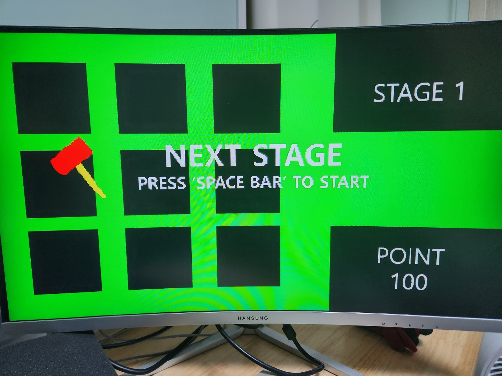

> **PS/2 키보드로 조작하는 FPGA 두더지 게임 · 화면 생성·RGB 합성 RTL 담당**

## 프로젝트 개요

- **시스템:** DE2 보드·PS/2 키보드·모니터를 연결한 3×3 두더지 게임
- **동작:** W·A·S·D로 망치 이동, ENTER로 타격, 점수·3단계 스테이지 표시

**실제 게임 화면 · 약 16초 시연**

[시연 영상](../assets/project-media/mole-demo.mp4)

두더지 등장·망치 이동과 타격·점수 변화 확인

## 담당 역할

- `BACKGROUND`·`MUX_MOLE`·`MUX`·`MUX_START` 구현
- 배경·두더지·망치·시작 화면 생성, 좌표별 RGB 선택과 모듈 연결

## 화면 구조·RGB 합성

**전체 블록 다이어그램**

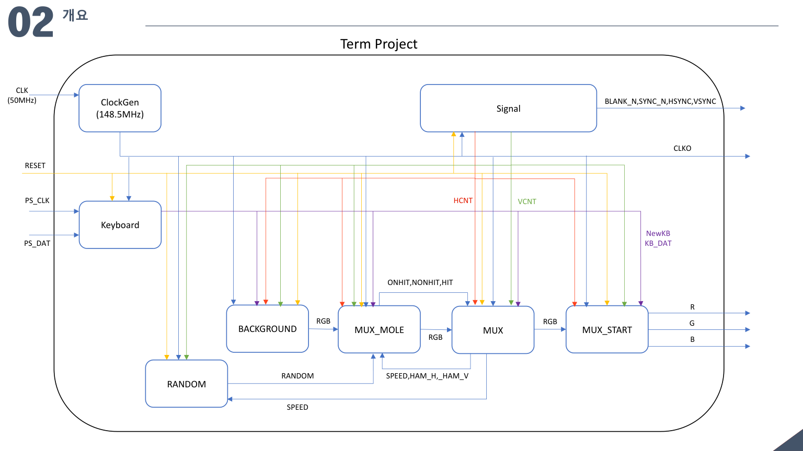

키보드 입력·등장 제어·영상 타이밍을 화면 합성 경로에 연결

- **합성 순서:** 배경 → 두더지 → 망치·점수 → 시작 화면, 나머지 영역은 앞단 RGB 전달

<details>
<summary>전체 구조·화면 좌표 배치</summary>

시스템은 영상 타이밍을 만드는 Signal 경로, 키보드 입력 경로, 두더지 등장 제어와 RGB 합성 경로로 구성됩니다. 화면 모듈은 HCNT·VCNT를 공유해 현재 출력할 픽셀의 영역을 판단합니다.

**전체 블록 다이어그램**

키보드의 NewKB·KB\_DAT, 두더지 등장과 속도 정보, 망치 좌표·타격·득점 관련 신호가 화면 모듈 사이를 연결하는 구조입니다.

화면은 두더지 9개 위치와 오른쪽 STAGE·POINT 영역으로 나눴습니다.

**게임 화면 배치와 좌표**

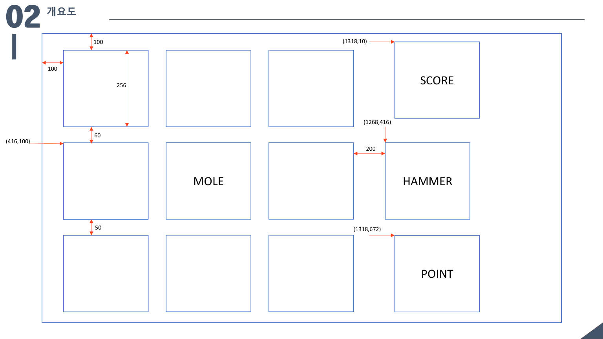

3×3 두더지 영역과 오른쪽 STAGE·POINT 표시 영역을 나눈 원본 좌표 설계입니다.

두더지 원점은 가로 100·456·812, 세로 100·416·722로 배치하고, 각 이미지의 표시 영역을 좌표 비교로 선택했습니다.

</details>

<details>
<summary>BACKGROUND·배경과 정보 영역</summary>

BACKGROUND는 기본 배경색을 출력하고, 오른쪽 정보 영역을 별도 색으로 구분합니다.

**BACKGROUND의 좌표별 배경색 생성**

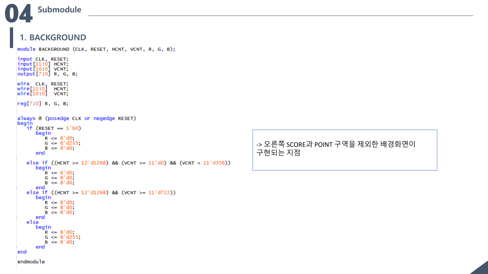

화면 좌표 조건에 따라 배경과 정보 표시 영역의 RGB를 생성하는 구현 자료입니다.

이 출력이 후속 모듈의 입력 RGB가 됩니다. 두더지와 망치, 문자 이미지는 이 배경 위에 차례대로 합성됩니다.

</details>

<details>
<summary>RGB 순차 합성·표시 우선순위</summary>

합성 순서는 `BACKGROUND → MUX_MOLE → MUX → MUX_START`입니다. 각 모듈이 앞단 RGB를 입력받고, 현재 좌표와 상태에 맞는 요소의 RGB를 출력합니다.

상위 요소가 차지하지 않는 영역은 이전 단계의 RGB를 전달해 배경과 두더지가 유지되도록 했습니다.

**화면 요소의 RGB 선택과 앞단 영상 전달**

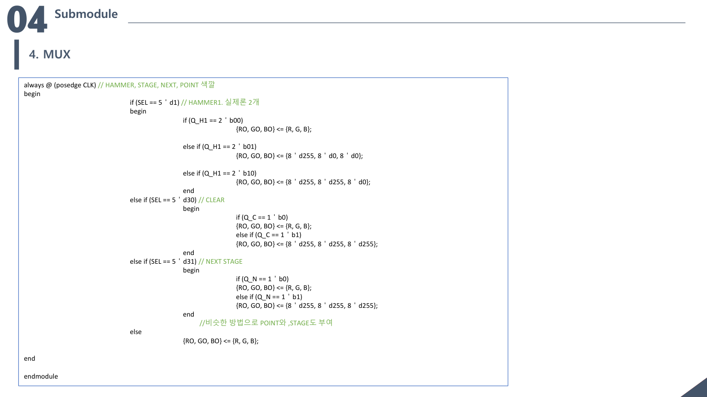

망치·NEXT·CLEAR 등 각 이미지의 색을 선택하고 나머지 영역은 이전 단계 RGB를 전달하는 구현 자료입니다.

망치 이미지에서 배경을 통과시켜야 하는 색상 코드도 앞단 RGB를 선택합니다. 시작 전에는 마지막 모듈인 MUX\_START가 시작 화면을 표시하고, 시작 후에는 게임 화면을 전달합니다.

좌표 조건·이미지 색상·표시 우선순위를 함께 다루며 여러 화면 요소를 하나의 출력 경로로 연결했습니다.

</details>

## ROM 이미지·상태별 표시

- **이미지 확대:** 64×64 ROM 이미지의 좌표 하위 2bit 제외, 256×256 표시
- **상태 표시:** 두더지 애니메이션·타격 자세·STAGE·POINT·START/NEXT/CLEAR 선택

<details>
<summary>ROM 스프라이트·4배 확대</summary>

원점 기준 상대 좌표를 구한 뒤, 가로·세로 좌표의 하위 2bit를 제외해 ROM 주소를 구성했습니다.

**상대 좌표·ROM 주소·등장 타이머**

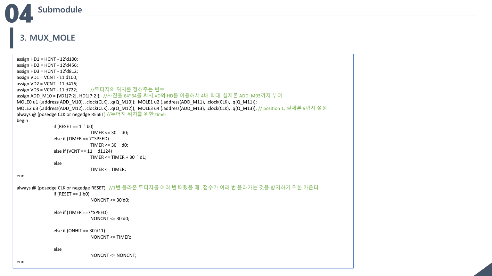

두더지 원점 기준 좌표에서 하위 2bit를 제외해 ROM 주소를 만드는 방식과 등장 주기 제어를 정리한 자료입니다.

64×64 원본 이미지의 각 픽셀이 화면의 4×4 영역에 반복돼 256×256 크기로 표시됩니다. 주소 계산과 실제 화면의 표시 범위를 함께 지정하는 방식입니다.

```verilog
assign HD1     = HCNT - 12'd100;
assign VD1     = VCNT - 11'd100;
assign ADD_M10 = {VD1[7:2], HD1[7:2]};
```

이미지 ROM의 색상 코드를 RGB 값에 대응시키고, 망치·문자 등 다른 화면 요소에도 원점·배율에 맞는 주소 계산을 적용했습니다.

</details>

<details>
<summary>스테이지·점수·NEXT·CLEAR 표시</summary>

타격 성공 시 10점을 더하고 총 3개 스테이지를 진행하도록 구성했습니다. MUX에서 현재 상태에 맞는 스테이지·점수·안내 이미지를 선택합니다.

스테이지가 올라갈수록 SPEED를 120000·80000·40000으로 줄여 두더지 등장 진행을 빠르게 구성했습니다.

**스테이지별 SPEED와 화면 요소 선택**

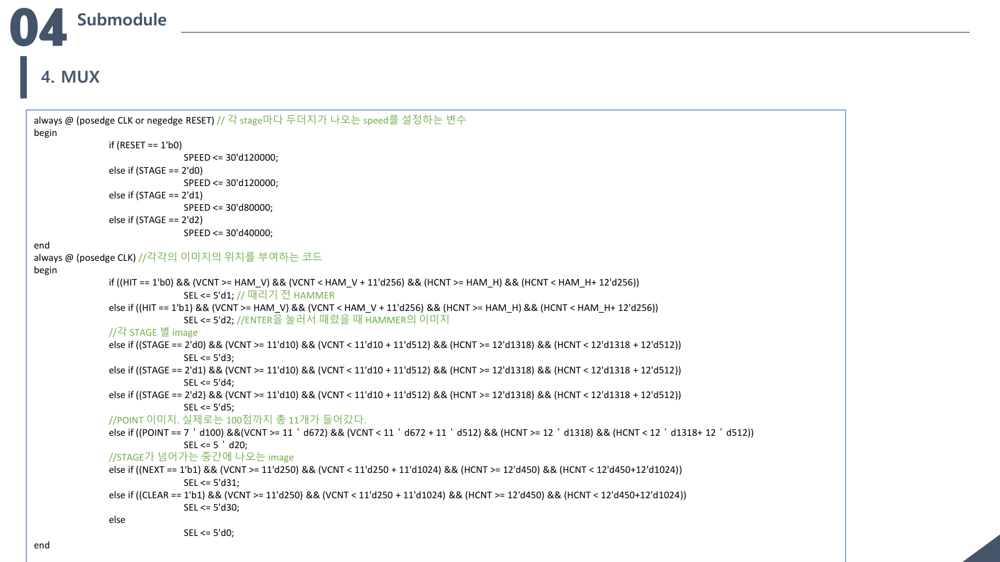

스테이지에 따른 SPEED 값과 망치·스테이지·점수·안내 화면 선택 조건을 정리한 자료입니다.

SPEED는 두더지 애니메이션과 등장 주기를 조절하는 내부 파라미터입니다.

100점에 도달하면 NEXT STAGE 안내를 표시하고, SPACE 입력으로 다음 단계로 진행하도록 구성했습니다.

**100점 도달 후 NEXT STAGE 표시**

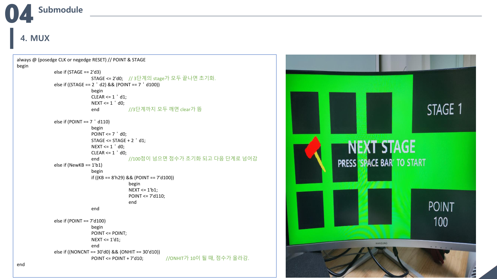

점수·스테이지 제어 코드와 실제 모니터의 NEXT STAGE·POINT 100 화면이 포함된 발표자료입니다.

마지막 단계에서는 CLEAR 화면을 표시하는 구조이며, 오른쪽 STAGE·POINT와 중앙 안내 화면을 상태에 맞춰 선택합니다.

</details>

<details>
<summary>MUX\_START·시작 화면 전환</summary>

MUX\_START는 시작 전 START 이미지를 표시하고, 시작 후에는 앞단 게임 화면의 RGB를 전달합니다.

**MUX\_START의 시작 화면 제어**

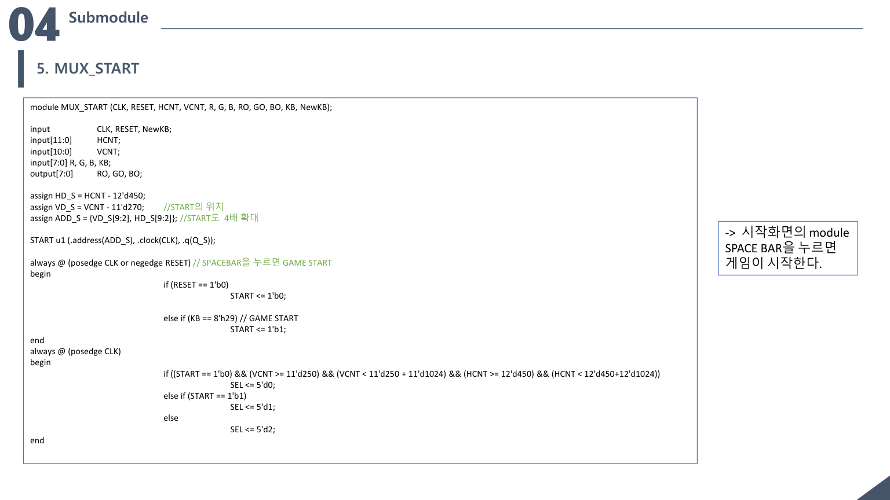

SPACE 입력에 따른 시작 상태와 START 이미지의 화면 배치를 설명한 자료입니다.

SPACE 입력으로 시작 상태를 바꾸고, 이미지 원점과 ROM 주소를 이용해 시작 문구를 배치했습니다. 시작 화면 제어를 합성 경로의 마지막에 두어 게임 화면과 전환했습니다.

</details>

## 주요 설계 과제 · 타격 판정

- **조건:** 올라오는 높이가 다른 두더지 이미지와 움직이는 망치를 함께 판정
- **구현:** 이미지 단계별 실제 모양에 맞춘 직사각형 타격 영역 설정

**두더지 높이에 따른 타격 영역**

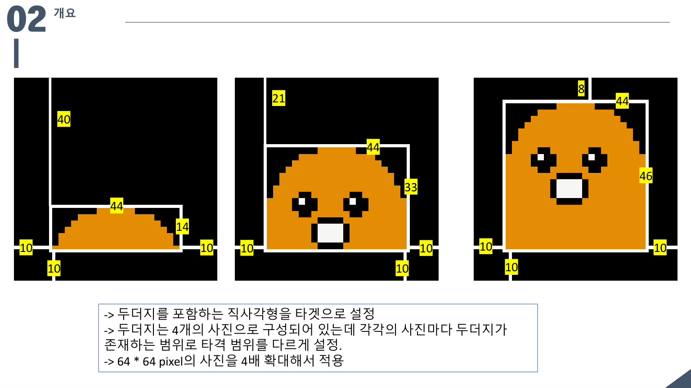

단계별 노출 높이와 망치 위치를 좌표 비교 조건에 반영

<details>
<summary>두더지 등장·애니메이션·타격 범위</summary>

**MUX\_MOLE**은 등장 위치와 TIMER·SPEED 조건에 따라 두더지 이미지 단계를 선택합니다. 발표자료는 두더지 이미지를 4장으로 구성하고, up/down 상태를 시간 구간에 따라 표시하는 방식을 설명합니다.

두더지가 실제로 드러난 부분을 기준으로 이미지 단계별 직사각형 타격 범위를 설정했습니다.

**두더지 이미지 단계별 타격 범위**

올라오는 높이가 다른 두더지 이미지에 각각 다른 직사각형 타격 영역을 적용한 원본 설계입니다.

등장 초기의 낮은 두더지와 완전히 올라온 두더지에 같은 범위를 적용하지 않고, 상태별 좌표 조건으로 유효 타격 위치를 구분했습니다. 타격한 두더지의 색을 바꾸는 화면 피드백도 포함했습니다.

등장 위치를 고르는 RANDOM은 피드백을 사용하는 시프트 레지스터 구조입니다. 위치 선택은 팀 전체 게임 기능으로 함께 정리했습니다.

</details>

<details>
<summary>키보드 연동·망치 위치·타격 자세</summary>

| 입력 | 동작 | 자료의 키 값 |
| --- | --- | --- |
| W | 망치 위로 이동 | 0x1D |
| A | 망치 왼쪽으로 이동 | 0x1C |
| S | 망치 아래로 이동 | 0x1B |
| D | 망치 오른쪽으로 이동 | 0x23 |
| ENTER | 타격 | 0x5A |
| SPACE | 시작·다음 단계 진행 | 0x29 |

NewKB와 키 값을 받아 망치의 기준 좌표 HAM\_H·HAM\_V를 갱신하고, 좌표에 맞춰 이미지를 배치했습니다.

**키보드 입력에 따른 망치 좌표 갱신**

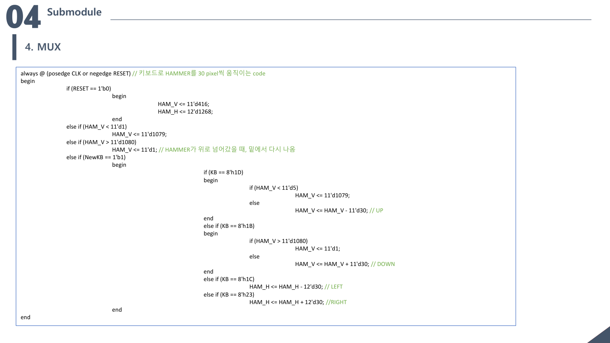

W·A·S·D 스캔 코드와 NewKB를 이용해 망치 좌표를 30 pixel씩 갱신한 구현 자료입니다.

발표자료의 이동 단위는 30 pixel입니다. 키보드 수신부와 화면 모듈 사이의 입력을 연결해 조작 결과가 망치 위치에 반영되도록 구성했습니다.

ENTER 입력에 따라 망치의 일반 자세와 타격 자세를 바꿔 표시했습니다.

**타격 전·후 망치 이미지와 판정 영역**

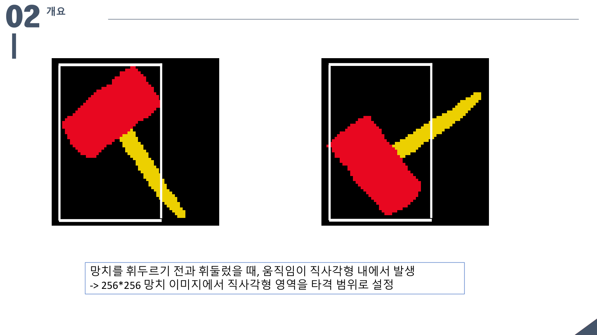

망치 자세에 따른 직사각형 타격 영역 설정

망치 이미지 전체가 아닌 실제 움직임이 일어나는 직사각형 영역을 타격 판정에 활용했습니다.

</details>

<details>
<summary>타격 입력·득점 조건 참고</summary>

HIT·ONHIT·NONCNT 연결과 점수 갱신 조건을 보여주는 당시 구현 자료

**ONHIT·NONCNT 득점 조건**

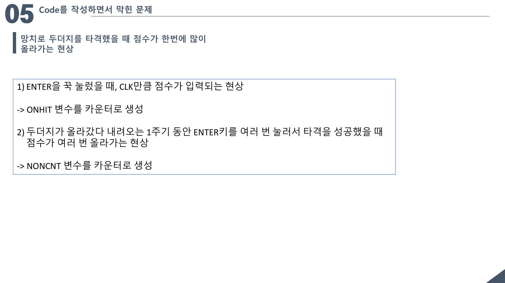

타격 입력과 등장 주기별 득점 조건을 설명한 원본 발표자료

**ENTER 입력과 ONHIT 제어**

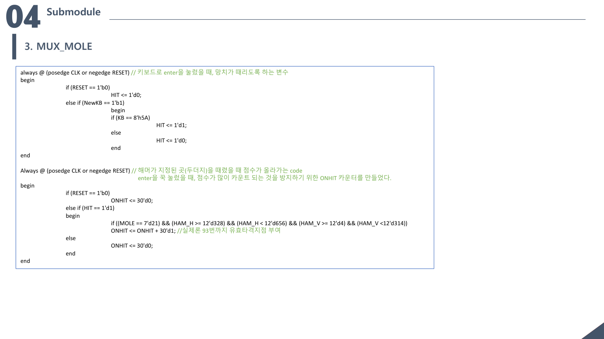

유효 타격 위치에서 ONHIT를 갱신하고 점수 조건에 연결하는 구현

**소스 범위:** 개발 중간본 코드 발췌. 최종 동작은 발표자료·시연 기준으로 확인.

```verilog
else if ((NONCNT == 30'd0) && (ONHIT == 30'd10))
    POINT <= POINT + 7'd10;
```

ONHIT의 특정 계수값과 NONCNT 상태를 함께 확인해 POINT를 10 증가시키는 코드 발췌

</details>

## 결과

- DE2 보드에서 게임 화면 출력·키보드 조작·점수 변화 시연
- 발표자료에서 POINT 100·NEXT STAGE 표시 확인

[← 전체 프로젝트](../README.md#프로젝트)

